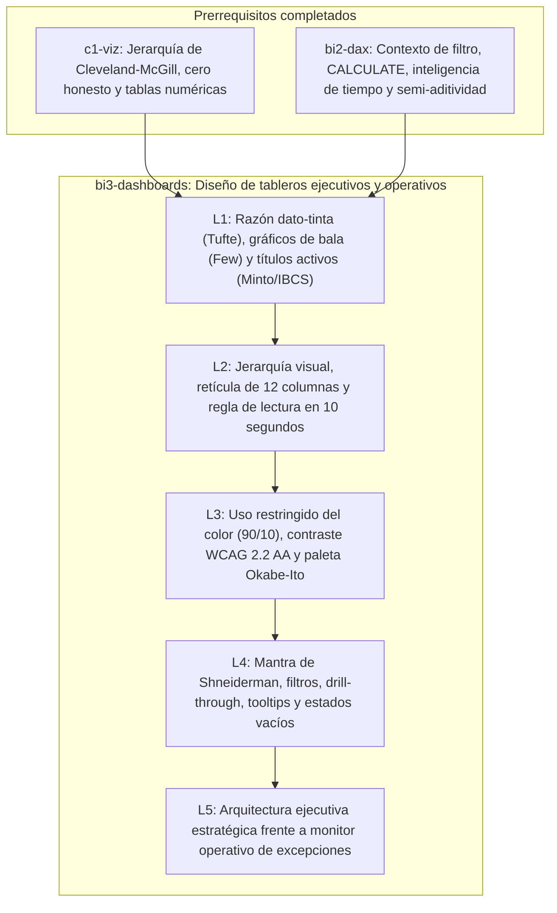

# Investigación Curricular y Proyecto de Módulo — `bi3-dashboards`

- **Módulo:** `bi3-dashboards` — *Diseño de tableros ejecutivos y operativos*
- **Ruta (Track):** `bi` (Business Intelligence y Gobierno)
- **Nivel:** `3` (Práctica guiada)
- **Prerrequisitos:** `bi2-dax` (*Cálculos de negocio y tiempo en DAX*), `c1-viz` (*Principios de visualización y lectura honesta de gráficos*)
- **Duración total:** 110 minutos (1 lección de 30 min + 4 lecciones de 20 min)
- **Dataset compartido:** Mercado Brisa (`orders`, `order_items`, `refunds`, `stores`, `calendar`, `products`, `customers`)

---

## 1. Propósito pedagógico y articulación curricular

El módulo `bi3-dashboards` integra los fundamentos perceptuales de `c1-viz` (jerarquía de Cleveland y McGill, integridad gráfica, selección de codificaciones y diseño de tablas numéricas) con el modelo semántico y las medidas analíticas de `bi2-dax` (contexto de filtro, variables `VAR/RETURN`, inteligencia de tiempo y aditividad) para resolver un problema central de Business Intelligence: **cómo estructurar tableros de control que respondan preguntas de negocio en menos de 10 segundos sin ruido visual ni barreras de accesibilidad**.

La progresión en cinco lecciones recorre el diseño de principio a fin:

1. **`bi3-dashboards-01-bi-tufte-code` (*Percepción visual, razón dato-tinta y narrativa ejecutiva*, 30 min, migración limpia de `l15-bi-tufte-code`):** Establece el marco de Edward Tufte (razón dato-tinta, eliminación de *chartjunk*, *small multiples* y *sparklines*), la especificación de gráficos de bala (*bullet graphs*) de Stephen Few frente a los velocímetros circulares, y la redacción de títulos activos bajo el Principio de la Pirámide de Barbara Minto y la notación semántica IBCS.
2. **`bi3-dashboards-02-jerarquia-visual-reticula-10s` (*Jerarquía visual, retícula y lectura en 10 segundos*, 20 min):** Traduce la jerarquía perceptual en una retícula modular (*grid*) de 12 columnas guiada por los patrones de escaneo ocular en F y Z documentados por Nielsen Norman Group. Aplica la regla de los 5–10 segundos de Stephen Few: indicadores globales contextualizados arriba a la izquierda, comparaciones y tendencias en la franja media, y tablas de detalle al pie sin desplazamiento innecesario.
3. **`bi3-dashboards-03-color-contraste-wcag-daltonismo` (*Color restringido, contraste WCAG y daltonismo*, 20 min):** Sustituye el uso decorativo del color por la regla 90/10 (tonos neutros para el contexto e hitos cromáticos solo para anomalías). Aplica los criterios de conformidad W3C WCAG 2.2 Nivel AA (`1.4.1 Use of Color`, `1.4.3 Contrast Minimum` de `4.5:1` en texto normal, `1.4.11 Non-text Contrast` de `3:1` en marcas gráficas), la paleta universal de Masataka Okabe y Kei Ito segura para deuteranopía/protanopía, y la doble codificación redundante (color + forma/símbolo + etiqueta textual).
4. **`bi3-dashboards-04-interaccion-filtros-drill-tooltips` (*Interacción útil: filtros, drill-through y tooltips*, 20 min):** Gobierna la interactividad mediante el mantra de búsqueda visual de Ben Shneiderman (*overview first, zoom and filter, then details-on-demand*). Delimita cuándo usar segmentadores (*slicers*), filtrado cruzado frente a resaltado cruzado, páginas de perforación (*drill-through*), descripciones emergentes (*report page tooltips*) y el diseño defensivo de estados vacíos (*empty states*) con `LEFT JOIN` y `COALESCE`.
5. **`bi3-dashboards-05-tablero-ejecutivo-vs-operativo` (*Tablero estratégico ejecutivo frente a operativo*, 20 min):** Contrasta la arquitectura de los tres arquetipos de tableros de Stephen Few (estratégico/ejecutivo, táctico/analítico y operativo) en audiencia, frecuencia de refresco, horizonte temporal, granularidad de grano en SQL y tipo de acción esperada (decisiones de asignación de capital frente a resolución inmediata de excepciones en tienda).

---

## 2. Fuentes autoritativas verificadas (HTTP 200)

Todas las fuentes fueron verificadas mediante petición HTTP `GET` con respuesta `200 OK` el `2026-10-29`. Cada lección cuenta con al menos 4 fuentes verificadas (mínimo 2 primarias de estándares W3C/IBCS, artículos fundacionales o documentación oficial de Microsoft Learn).

### Lección 1: `bi3-dashboards-01-bi-tufte-code`

| # | Título y Autor / Editorial | URL verificada (`200 OK`) | Tipo | Afirmación respaldada |
|---|---|---|---|---|
| 1.1 | Stephen Few — *Bullet Graph Design Specification* (Perceptual Edge) | `https://www.perceptualedge.com/articles/misc/Bullet_Graph_Design_Spec.pdf` | Primaria (Especificación técnica) | Anatomía de 5 componentes del gráfico de bala (etiqueta, escala cuantitativa, barra principal, marcador de meta y bandas cualitativas de fondo) como reemplazo compacto de los velocímetros radiales. |
| 1.2 | Claus O. Wilke — *Fundamentals of Data Visualization*, Cap. 23: *Balance the data and the context* | `https://clauswilke.com/dataviz/balance-data-context.html` | Primaria / Académica | Formalización de la razón dato-tinta (*data-ink ratio*) de Edward Tufte, eliminación de rejillas pesadas, bordes 3D y ruido gráfico (*chartjunk*) preservando los ejes de contexto. |
| 1.3 | IBCS Association — *International Business Communication Standards (IBCS) Version 2.0* | `https://www.ibcs.com/ibcs-version-2-0/` | Primaria (Estándar internacional) | Reglas de títulos de mensaje activo (sujeto + métrica + variación + causa/periodo) y consistencia visual entre escenarios reales (*Actual*), presupuesto (*Plan*) y año previo (*Previous Year*). |
| 1.4 | Claus O. Wilke — *Fundamentals of Data Visualization*, Cap. 21: *Multi-panel figures* | `https://clauswilke.com/dataviz/multi-panel-figures.html` | Primaria / Académica | Diseño de pequeños múltiplos (*small multiples*) con escalas compartidas para comparar series regionales o temporales sin superponer líneas ilegibles (*spaghetti charts*). |

### Lección 2: `bi3-dashboards-02-jerarquia-visual-reticula-10s`

| # | Título y Autor / Editorial | URL verificada (`200 OK`) | Tipo | Afirmación respaldada |
|---|---|---|---|---|
| 2.1 | Stephen Few — *Common Problems in Dashboard Design* (Perceptual Edge) | `https://www.perceptualedge.com/articles/Whitepapers/Dashboard_Design.pdf` | Primaria (Artículo técnico) | Definición de tablero como monitor visual en una sola pantalla sin desplazamiento para responder preguntas críticas de un vistazo (regla de los 5 a 10 segundos) y crítica a la fragmentación visual. |
| 2.2 | Microsoft Learn — *Tips for designing a great Power BI dashboard* | `https://learn.microsoft.com/en-us/power-bi/create-reports/service-dashboards-design-tips` | Primaria (Documentación oficial) | Ubicación de métricas clave en la esquina superior izquierda, límite de tarjetas e indicadores por vista, uso de espacio en blanco y coherencia de escala en una sola pantalla. |
| 2.3 | Nielsen Norman Group — *F-Shaped Pattern of Reading on the Web* | `https://www.nngroup.com/articles/f-shaped-pattern-reading-web-content/` | Primaria (Investigación de seguimiento ocular) | Evidencia empírica de fijación ocular horizontal superior y barrido vertical izquierdo, justificando situar los KPIs globales arriba a la izquierda y los identificadores de dimensión en la primera columna. |
| 2.4 | Nielsen Norman Group — *Visual Hierarchy in UX: Definition* | `https://www.nngroup.com/articles/visual-hierarchy-ux-definition/` | Primaria (Investigación UX) | Uso de tamaño relativo, peso tipográfico, proximidad (Gestalt) y espacio negativo para guiar el orden de inspección visual entre niveles de resumen, contexto y detalle. |

### Lección 3: `bi3-dashboards-03-color-contraste-wcag-daltonismo`

| # | Título y Autor / Editorial | URL verificada (`200 OK`) | Tipo | Afirmación respaldada |
|---|---|---|---|---|
| 3.1 | W3C WAI — *Understanding Success Criterion 1.4.1: Use of Color (WCAG 2.2)* | `https://www.w3.org/WAI/WCAG22/Understanding/use-of-color.html` | Primaria (Estándar W3C) | Prohibición de emplear el color como único canal visual para transmitir información, distinguir series o indicar estados de alerta; exigencia de doble codificación redundante. |
| 3.2 | W3C WAI — *Understanding Success Criterion 1.4.3: Contrast (Minimum) (WCAG 2.2)* | `https://www.w3.org/WAI/WCAG22/Understanding/contrast-minimum.html` | Primaria (Estándar W3C) | Razón mínima de contraste de luminancia relativa de `4.5:1` para texto normal (`< 18pt` regular o `< 14pt` negrita) y `3:1` para texto grande en nivel AA. |
| 3.3 | W3C WAI — *Understanding Success Criterion 1.4.11: Non-text Contrast (WCAG 2.2)* | `https://www.w3.org/WAI/WCAG22/Understanding/non-text-contrast.html` | Primaria (Estándar W3C) | Razón mínima de contraste de `3:1` contra colores adyacentes para objetos gráficos (barras, líneas de tendencia, umbrales) y bordes de controles interactivos. |
| 3.4 | Masataka Okabe & Kei Ito — *Color Universal Design (CUD)* | `https://jfly.uni-koeln.de/color/` | Primaria (Referencia científica) | Fisiología de la visión dicromática (protanopía y deuteranopía en ~8 % de hombres de ascendencia europea) y paleta de 8 colores distinguibles (azul `#0072B2`, naranja `#D55E00`, bermellón, etc.) en lugar de semáforos rojo-verde. |
| 3.5 | Microsoft Learn — *Design Power BI reports for accessibility* | `https://learn.microsoft.com/en-us/power-bi/create-reports/desktop-accessibility-creating-reports` | Primaria (Documentación oficial) | Orden de tabulación, texto alternativo (`alt text`), temas de alto contraste y sustitución de semáforos cromáticos por iconos y etiquetas accesibles en Power BI. |

### Lección 4: `bi3-dashboards-04-interaccion-filtros-drill-tooltips`

| # | Título y Autor / Editorial | URL verificada (`200 OK`) | Tipo | Afirmación respaldada |
|---|---|---|---|---|
| 4.1 | Ben Shneiderman — *The Eyes Have It: A Task by Data Type Taxonomy for Information Visualizations* (IEEE VL 1996) | `https://www.cs.umd.edu/~ben/papers/Shneiderman1996eyes.pdf` | Primaria (Artículo seminal) | Mantra de búsqueda de información visual: *Overview first, zoom and filter, then details-on-demand* como arquitectura de interacción progresiva. |
| 4.2 | Microsoft Learn — *Set up drillthrough in Power BI reports* | `https://learn.microsoft.com/en-us/power-bi/create-reports/desktop-drillthrough` | Primaria (Documentación oficial) | Configuración de páginas de destino de perforación (*drill-through*) que heredan el contexto de la entidad seleccionada sin saturar la vista principal con tablas granulares. |
| 4.3 | Microsoft Learn — *Report page tooltips in Power BI* | `https://learn.microsoft.com/en-us/power-bi/guidance/report-page-tooltips` | Primaria (Guía de arquitectura oficial) | Criterios de diseño para *tooltips* contextuales ligeros: micro-desgloses rápidos al pasar el cursor sin abandonar la página ni añadir latencia de consultas pesadas. |
| 4.4 | Microsoft Learn — *Change how visuals interact in a Power BI report* | `https://learn.microsoft.com/en-us/power-bi/create-reports/service-reports-visual-interactions` | Primaria (Documentación oficial) | Diferencia funcional y perceptual entre filtrado cruzado (*cross-filtering*, que reescala ejes y oculta el total) y resaltado cruzado (*cross-highlighting*, que conserva la proporción del total). |
| 4.5 | Microsoft Learn — *Slicers in Power BI* | `https://learn.microsoft.com/en-us/power-bi/visuals/power-bi-visualization-slicers` | Primaria (Documentación oficial) | Uso disciplinado de segmentadores visibles en el lienzo frente al panel de filtros (*Filter pane*) y prevención de combinaciones de filtro mutuamente excluyentes que producen estados vacíos silenciosos. |

### Lección 5: `bi3-dashboards-05-tablero-ejecutivo-vs-operativo`

| # | Título y Autor / Editorial | URL verificada (`200 OK`) | Tipo | Afirmación respaldada |
|---|---|---|---|---|
| 5.1 | Microsoft Learn — *Dashboards for business users of the Power BI service* | `https://learn.microsoft.com/en-us/power-bi/explore-reports/end-user-dashboards` | Primaria (Documentación oficial) | Distinción arquitectónica entre un tablero de monitoreo ejecutivo (vista única consolidada con alertas de estado) y un informe analítico multipágina. |
| 5.2 | Microsoft Learn — *Real-Time Dashboards in Microsoft Fabric* | `https://learn.microsoft.com/en-us/fabric/real-time-intelligence/real-time-dashboards-overview` | Primaria (Documentación oficial) | Requisitos de baja latencia, actualización automática y enfoque en colas de eventos y excepciones para tableros operativos en tiempo real o cuasi-real. |
| 5.3 | Microsoft Learn — *Real-time streaming in Power BI* | `https://learn.microsoft.com/en-us/power-bi/connect-data/service-real-time-streaming` | Primaria (Documentación oficial) | Compromisos técnicos entre modelos importados programados (adecuados para comités semanales/mensuales) y flujos en directo o *DirectQuery* para monitores operativos. |
| 5.4 | Stephen Few — *Selecting the Right Graph for Your Message* (Perceptual Edge) | `https://www.perceptualedge.com/articles/ie/the_right_graph.pdf` | Primaria (Artículo técnico) | Adecuación de la forma gráfica al grano y propósito: series agregadas y varianzas contra presupuesto para dirección frente a listas ordenadas de desviaciones puntuales para operaciones. |

---

## 3. Mapa de conceptos y articulación de competencias



### Tabla de trazabilidad por lección

| Lección | Conceptos nucleares | Consulta SQL verificada sobre Mercado Brisa | Glosario introducido |
|---|---|---|---|
| `bi3-dashboards-01-bi-tufte-code` | Razón dato-tinta, *chartjunk*, *bullet graph*, *sparklines*, *small multiples*, título de acción (Minto/IBCS). | Ingresos completados brutos y netos (descontando devoluciones procesadas) frente a meta anual (`monthly_target_usd * 12`) por región en 2024 (`Cono Sur` `45,6 %` bruto / `43,8 %` neto). | `razon-dato-tinta`, `chartjunk`, `grafico-de-bala`, `sparkline`, `pequenos-multiplos` |
| `bi3-dashboards-02-jerarquia-visual-reticula-10s` | Regla de los 10 segundos, patrones de escaneo F y Z, retícula modular de 12 columnas, jerarquía de 3 niveles (KPI global, tendencia/comparación, detalle). | Productividad por formato de tienda (`store_type`: `retail`, `flagship`, `warehouse`) en 2024 cruzando ingresos completados, pedidos y ventas por metro cuadrado (`area_sqm`). | `jerarquia-visual`, `patron-lectura-f-z` |
| `bi3-dashboards-03-color-contraste-wcag-daltonismo` | Regla cromática 90/10, contraste WCAG 2.2 AA (`4.5:1` texto, `3:1` gráfico), paleta Okabe-Ito para daltonismo, doble codificación redundante. | Cumplimiento de meta anual por tienda en 2024 para las 14 tiendas de Mercado Brisa con columna de estado accesible redundante (`[OK] En meta`, `[WARN] En observacion`, `[ALERT] Critico`). | `contraste-wcag`, `doble-codificacion` |
| `bi3-dashboards-04-interaccion-filtros-drill-tooltips` | Mantra de Shneiderman, *cross-filtering* vs *cross-highlighting*, *drill-through*, *report tooltips*, protección contra estados vacíos con `LEFT JOIN` y `COALESCE`. | Auditoría *drill-through* de devoluciones procesadas por `defecto_molino` en el 4.º trimestre de 2024 para las 14 tiendas, garantizando con `LEFT JOIN` y `COALESCE` que las 4 tiendas sin incidencias muestren `0` y etiqueta explícita. | `perforacion-drill-through`, `estado-vacio-informativo` |
| `bi3-dashboards-05-tablero-ejecutivo-vs-operativo` | Arquetipos estratégico, analítico y operativo; latencia de refresco; granularidad mensual/regional frente a monitor diario/por tienda de pedidos en excepción. | Monitor operativo de excepciones por tienda en 2024: volumen total de pedidos, pedidos en excepción (`status IN ('cancelled', 'pending')`), tasa de incidencia (`14,80 %` en `Tienda Polanco Sur`) e importe retenido/cancelado. | `tablero-ejecutivo-vs-operativo` |

---

## 4. Especificación del Proyecto de Módulo y Rúbrica (Paso 6)

### 4.1 Enunciado y contexto de negocio

- **Título del proyecto:** Diseño dual del tablero semanal del Comité de Dirección y del monitor operativo diario de tiendas de Mercado Brisa
- **Dataset:** Mercado Brisa (`orders`, `order_items`, `refunds`, `stores` y `calendar`)
- **Entregable esperado:** Prototipo funcional documentado en dos vistas (Vista A: Comité Ejecutivo Semanal; Vista B: Monitor Operativo Diario de Tiendas) con consultas SQL verificables sobre DuckDB, especificación de retícula de 12 columnas, títulos activos IBCS, gráficos de bala, tabla con *sparklines*, validación de accesibilidad WCAG 2.2 AA / Okabe-Ito y guía de uso por rol.

### 4.2 Consultas SQL de referencia del proyecto (verificadas sobre Mercado Brisa)

#### Vista A (Comité Ejecutivo): Cumplimiento anual y venta neta por región (2024)

```sql
WITH store_targets AS (
  SELECT
    region,
    COUNT(*) AS num_stores,
    ROUND(SUM(monthly_target_usd) * 12, 2) AS annual_target_usd
  FROM stores
  GROUP BY region
),
regional_sales AS (
  SELECT
    s.region,
    COUNT(o.order_id) AS completed_orders,
    ROUND(SUM(o.total_usd), 2) AS gross_revenue_usd
  FROM orders o
  JOIN stores s ON o.store_id = s.store_id
  WHERE o.status = 'completed'
    AND EXTRACT(YEAR FROM o.order_date) = 2024
  GROUP BY s.region
),
regional_refunds AS (
  SELECT
    s.region,
    ROUND(SUM(r.refund_amount_usd), 2) AS processed_refunds_usd
  FROM refunds r
  JOIN orders o ON r.order_id = o.order_id
  JOIN stores s ON o.store_id = s.store_id
  WHERE o.status = 'completed'
    AND r.status = 'processed'
    AND EXTRACT(YEAR FROM o.order_date) = 2024
  GROUP BY s.region
)
SELECT
  t.region,
  t.num_stores,
  rs.gross_revenue_usd,
  COALESCE(rr.processed_refunds_usd, 0) AS processed_refunds_usd,
  ROUND(rs.gross_revenue_usd - COALESCE(rr.processed_refunds_usd, 0), 2) AS net_revenue_usd,
  t.annual_target_usd,
  ROUND((rs.gross_revenue_usd - COALESCE(rr.processed_refunds_usd, 0)) * 100.0 / t.annual_target_usd, 1) AS net_attainment_pct
FROM store_targets t
JOIN regional_sales rs ON t.region = rs.region
LEFT JOIN regional_refunds rr ON t.region = rr.region
ORDER BY net_revenue_usd DESC;
```

**Resultado verificado en Mercado Brisa:**
- `Cono Sur` (3 tiendas): Bruto `$919,026.32` | Devoluciones `$36,387.51` | Neto `$882,638.81` | Meta anual `$2,016,000.00` | Cumplimiento neto `43.8 %`.
- `Andina` (4 tiendas): Bruto `$858,331.08` | Devoluciones `$43,155.37` | Neto `$815,175.71` | Meta anual `$2,880,000.00` | Cumplimiento neto `28.3 %`.
- `Iberia` (3 tiendas): Bruto `$590,458.99` | Devoluciones `$22,608.55` | Neto `$567,850.44` | Meta anual `$2,652,000.00` | Cumplimiento neto `21.4 %`.
- `Norteamérica` (4 tiendas): Bruto `$363,700.11` | Devoluciones `$14,410.83` | Neto `$349,289.28` | Meta anual `$3,552,000.00` | Cumplimiento neto `9.8 %`.

#### Vista B (Monitor Operativo): Cola de tiendas por tasa de excepción e incidencias de calidad (2024)

```sql
SELECT
  s.store_id,
  s.store_name,
  s.region,
  COUNT(o.order_id) AS total_orders_2024,
  SUM(CASE WHEN o.status IN ('cancelled', 'pending') THEN 1 ELSE 0 END) AS exception_orders,
  ROUND(
    SUM(CASE WHEN o.status IN ('cancelled', 'pending') THEN 1 ELSE 0 END) * 100.0
    / COUNT(o.order_id),
    2
  ) AS exception_rate_pct,
  ROUND(
    SUM(CASE WHEN o.status IN ('cancelled', 'pending') THEN o.total_usd ELSE 0 END),
    2
  ) AS backlog_and_cancelled_usd
FROM stores s
JOIN orders o ON s.store_id = o.store_id
WHERE EXTRACT(YEAR FROM o.order_date) = 2024
GROUP BY s.store_id, s.store_name, s.region
ORDER BY exception_rate_pct DESC, s.store_id ASC;
```

**Resultado verificado en Mercado Brisa (Top 3 tiendas en excepción):**
1. `Tienda Polanco Sur` (`store_id = 2`, `Norteamérica`): `41` excepciones sobre `277` pedidos (`14.80 %`), `$19,367.51` afectados.
2. `Tienda Las Condes` (`store_id = 7`, `Cono Sur`): `67` excepciones sobre `561` pedidos (`11.94 %`), `$36,081.92` afectados.
3. `Almacén Logístico Coslada` (`store_id = 14`, `Iberia`): `86` excepciones sobre `741` pedidos (`11.61 %`), `$46,176.13` afectados.

### 4.3 Rúbrica de evaluación del proyecto (4 criterios, escala 0–4)

| Criterio | 0 — No entregado | 1 — Insuficiente | 2 — Básico | 3 — Competente | 4 — Excelente |
|---|---|---|---|---|---|
| **C1. Razón dato-tinta, gráficos de bala y narrativa activa (L1)** | No presenta vistas ni consultas de comparación contra meta. | Usa velocímetros circulares o gráficos 3D con títulos genéricos (`"Ventas por región"`) y calcula ventas sin filtrar `status = 'completed'`. | Reemplaza velocímetros por barras simples con meta anual (`monthly_target_usd * 12`), pero omite bandas cualitativas o mantiene rejillas y bordes redundantes. | Diseña gráficos de bala completos para las 4 regiones con ingresos brutos y netos de devoluciones, eliminando *chartjunk* y redactando títulos con métrica y periodo. | Incorpora gráficos de bala bajo especificación de Stephen Few y tabla con *sparklines*, títulos activos IBCS con hallazgo cuantificado (ej. *"Cono Sur lidera el cumplimiento neto con 43,8 % mientras Norteamérica cae a 9,8 %"*), y conciliación exacta con Mercado Brisa. |
| **C2. Jerarquía visual, retícula de 12 columnas y lectura en 10 segundos (L2)** | Lienzo desordenado sin estructura de retícula ni agrupación lógica. | Coloca tablas detalladas o logotipos en la esquina superior izquierda y supera los 9 bloques visuales provocando desplazamiento vertical y horizontal. | Agrupa tarjetas arriba y gráficos abajo, pero las tarjetas carecen de comparación contra meta o año anterior (`2023` vs `2024`). | Estructura una retícula de 12 columnas en tres niveles (KPIs con contexto arriba a la izquierda, comparaciones en el centro y tabla al pie) que responde el estado global en menos de 10 segundos. | Justifica explícitamente el recorrido ocular en F/Z de cada bloque, limita la fila superior a 3–4 indicadores con varianza relativa y absoluta, e integra productividad por formato (`store_type` y `area_sqm`) sin desbordamiento en escritorio ni móvil. |
| **C3. Accesibilidad cromática, contraste WCAG 2.2 AA y doble codificación (L3)** | Usa paletas arcoíris o semáforos rojo-verde puros sin etiquetas ni verificación de contraste. | Aplica colores corporativos pero depende exclusivamente del color rojo/verde para indicar incumplimiento de meta (`1.4.1` fallido) o tiene texto gris claro con contraste `< 4.5:1`. | Cumple contraste `4.5:1` en textos principales pero olvida el contraste `3:1` en marcas gráficas (`1.4.11`) o carece de símbolos redundantes en las tablas. | Aplica la regla 90/10 (gris neutro para contexto y acento solo en alertas), verifica razones de contraste `>= 4.5:1` (texto) y `>= 3:1` (gráficos) y usa tonos distinguibles en deuteranopía/protanopía. | Implementa paleta Okabe-Ito documentada con códigos hexadecimales, razones de contraste medidas en modo claro y oscuro, y doble codificación redundante en SQL y UI (`[OK]`, `[WARN]`, `[ALERT]` + iconos direccionales) verificable en escala de grises. |
| **C4. Interacción gobernada, estados vacíos y separación ejecutivo vs. operativo (L4 y L5)** | Mezcla métricas estratégicas anuales y colas operativas de pedidos en un solo lienzo sin filtros ni *drill-through*. | Añade más de 6 segmentadores que colapsan la vista en blanco cuando una tienda no tiene devoluciones, sin distinguir audiencia ejecutiva de operativa. | Separa la vista ejecutiva de la operativa y define una página *drill-through*, pero usa `INNER JOIN` que oculta tiendas sin incidencias en el trimestre. | Diseña interacción siguiendo el mantra de Shneiderman (hasta 3 segmentadores, *cross-highlighting* conservando el total, *tooltip* ligero y *drill-through* de devoluciones) y protege estados vacíos con `LEFT JOIN` y `COALESCE`. | Documenta la arquitectura completa de ambos tableros (grano, latencia de refresco, umbral de alerta y guía de acción por rol para Dirección General y Jefatura de Tienda) con consultas SQL reproducibles al céntimo sobre las 14 tiendas de Mercado Brisa. |
