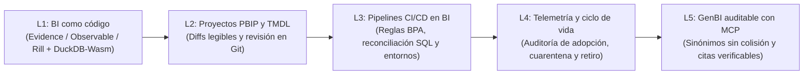

# Investigación curricular y diseño instruccional — `bi4-operacion`: BI como código y operación a escala

- **Módulo:** `bi4-operacion` — *BI como código y operación a escala*
- **Ruta:** `bi` (Especialista en BI) · **Nivel:** 4 (Experto de ruta)
- **Prerrequisitos de catálogo:** `bi3-gobierno` (el cual depende de `bi3-dashboards` -> `bi2-dax` -> `bi2-modelo-semantico` -> `c2-dimensional`)
- **Duración total estimada:** 120 minutos (`[25, 25, 25, 20, 25]`)
- **Conjunto de datos:** Mercado Brisa (`orders`, `order_items`, `products`, `payments`, `refunds`, `events`, `stores`, `calendar`)
- **Fecha de verificación documental:** `2026-10-29`

---

## 1. Investigación de fuentes primarias y de referencia (Paso 1)

Todas las fuentes listadas a continuación fueron consultadas y verificadas con respuesta HTTP `200` el `2026-10-29`. Ninguna lección depende de blogs de opinión sin respaldo en documentación técnica oficial o especificaciones abiertas.

### Lección 1 — `bi4-operacion-01-bi-como-codigo-evidence-observable-rill`
*Título de catálogo:* BI como código declarativo con Evidence, Observable Framework y Rill sobre DuckDB-Wasm (25 min)

| Tipo de fuente | Autor / Organización | Título y URL | Fecha de acceso | Afirmación técnica concreta que respalda |
| --- | --- | --- | --- | --- |
| Documentación oficial | Evidence | *Core Concepts — SQL Queries in Markdown* (`https://docs.evidence.dev/core-concepts/queries/`) | `2026-10-29` | Evidence compila páginas Markdown (`.md`) con bloques SQL con nombre y permite encadenar consultas (`${query_name}`) que se ejecutan en el cliente mediante DuckDB-Wasm (*Universal SQL*) sobre artefactos Parquet pregenerados. |
| Documentación y repositorio oficial | Observable | *Observable Framework — Static site generator for data apps* (`https://github.com/observablehq/framework`) | `2026-10-29` | Los *data loaders* de Observable Framework se ejecutan en tiempo de compilación (*build-time*) para materializar instantáneas tipadas (Parquet, Arrow, CSV) que el navegador consulta localmente con DuckDB-Wasm sin latencia ni carga concurrente hacia el almacén. |
| Documentación oficial | Rill Data | *Rill Developer & Rill Cloud Documentation* (`https://docs.rilldata.com/`) | `2026-10-29` | Rill estructura el proyecto analítico como código declarativo separado en conectores (`sources/*.yaml`), transformaciones SQL (`models/*.sql`) y vistas de métricas (`metrics_views/*.yaml`) respaldadas por DuckDB para exploración interactiva sub-segundo. |
| Documentación oficial | DuckDB Foundation | *DuckDB-Wasm Client Overview* (`https://duckdb.org/docs/stable/clients/wasm/overview.html`) | `2026-10-29` | DuckDB-Wasm ejecuta el motor analítico vectorizado en WebAssembly dentro del navegador y aplica proyección de columnas y empuje de predicados sobre archivos Parquet mediante peticiones HTTP por rangos o archivos locales registrados. |

### Lección 2 — `bi4-operacion-02-pbip-tmdl-versionado-git`
*Título de catálogo:* Proyectos Power BI (PBIP) y lenguaje TMDL: revisión de modelos y medidas en Git (25 min)

| Tipo de fuente | Autor / Organización | Título y URL | Fecha de acceso | Afirmación técnica concreta que respalda |
| --- | --- | --- | --- | --- |
| Documentación oficial | Microsoft Learn | *Power BI Desktop projects (PBIP)* (`https://learn.microsoft.com/en-us/power-bi/developer/projects/projects-overview`) | `2026-10-29` | El formato PBIP sustituye el contenedor binario opaco `.pbix` por una estructura de carpetas en texto plano que separa la capa visual (`*.Report`) del modelo tabular (`*.SemanticModel`), habilitando diffs legibles y trabajo en ramas. |
| Documentación oficial | Microsoft Learn | *Tabular Model Definition Language (TMDL) overview* (`https://learn.microsoft.com/en-us/analysis-services/tmdl/tmdl-overview`) | `2026-10-29` | TMDL representa el modelo de objetos tabulares (TOM) con sintaxis declarativa basada en sangría y fragmenta el archivo monolítico `model.bim` en archivos independientes por tabla (`tables/*.tmdl`), relaciones (`relationships.tmdl`), roles y expresiones. |
| Documentación oficial | Microsoft Learn | *Power BI Desktop projects Git integration* (`https://learn.microsoft.com/en-us/power-bi/developer/projects/projects-git`) | `2026-10-29` | El archivo `.gitignore` de un proyecto PBIP debe excluir obligatoriamente `**/.pbi/localSettings.json` y `**/.pbi/cache.abf` para evitar subir cachés binarias de VertiPaq y credenciales o rutas locales al repositorio remoto. |
| Documentación oficial | Microsoft Learn | *Power BI Desktop project semantic model folder* (`https://learn.microsoft.com/en-us/power-bi/developer/projects/projects-dataset`) | `2026-10-29` | La carpeta `*.SemanticModel` contiene `definition.pbism` y el directorio `definition/`, donde residen `database.tmdl`, `model.tmdl`, `relationships.tmdl` y `tables/*.tmdl` con las columnas, particiones M y medidas DAX del modelo. |

### Lección 3 — `bi4-operacion-03-cicd-pruebas-promocion-entornos`
*Título de catálogo:* Integración y despliegue continuo (CI/CD): pruebas automáticas de consultas y promoción de entornos (25 min)

| Tipo de fuente | Autor / Organización | Título y URL | Fecha de acceso | Afirmación técnica concreta que respalda |
| --- | --- | --- | --- | --- |
| Documentación oficial | Microsoft Learn | *CI/CD best practices in Microsoft Fabric* (`https://learn.microsoft.com/en-us/fabric/cicd/best-practices-cicd`) | `2026-10-29` | La operación a escala exige separar espacios de trabajo por entorno (`Dev`, `Test`, `Prod`), automatizar validaciones antes de fusionar ramas y parametrizar las conexiones para promover artefactos sin editar manualmente los archivos fuente. |
| Documentación oficial | Microsoft Learn | *Power BI Desktop projects Azure DevOps build pipelines* (`https://learn.microsoft.com/en-us/power-bi/developer/projects/projects-azdo`) | `2026-10-29` | Un pipeline de integración continua sobre proyectos PBIP ejecuta Tabular Editor desde línea de comandos para validar la sintaxis del modelo semántico y aplicar reglas del Best Practice Analyzer (BPA) en cada Pull Request. |
| Documentación técnica | Tabular Editor | *Best Practice Analyzer (BPA) Documentation* (`https://docs.tabulareditor.com/te2/Best-Practice-Analyzer.html`) | `2026-10-29` | El motor BPA evalúa expresiones dinámicas sobre los metadatos del modelo tabular para bloquear antipatrones en CI: claves foráneas visibles con `summarizeBy: sum`, medidas sin `formatString`, columnas huérfanas o relaciones bidireccionales riesgosas. |
| Documentación oficial | Microsoft Learn | *Introduction to deployment pipelines in Microsoft Fabric* (`https://learn.microsoft.com/en-us/fabric/cicd/deployment-pipelines/intro-to-deployment-pipelines`) | `2026-10-29` | Las reglas de despliegue (*deployment rules*) en los pipelines de promoción vinculan cada etapa (`Development`, `Test`, `Production`) con su origen de datos y parámetros específicos, garantizando aislamiento entre entornos. |

### Lección 4 — `bi4-operacion-04-telemetria-adopcion-retiro-tableros`
*Título de catálogo:* Telemetría de uso, auditoría de adopción y retiro ordenado de tableros sin uso (20 min)

| Tipo de fuente | Autor / Organización | Título y URL | Fecha de acceso | Afirmación técnica concreta que respalda |
| --- | --- | --- | --- | --- |
| Documentación oficial | Microsoft Learn | *Monitor usage metrics in workspaces* (`https://learn.microsoft.com/en-us/power-bi/collaborate-share/service-modern-usage-metrics`) | `2026-10-29` | Los reportes nativos de métricas de uso distinguen entre vistas totales (*Report views*) y espectadores únicos (*Unique viewers*), pero solo retienen una ventana móvil corta (30 días), insuficiente para auditorías trimestrales o anuales de obsolescencia. |
| Documentación oficial | Microsoft Learn | *Track user activities in Microsoft Fabric* (`https://learn.microsoft.com/en-us/fabric/admin/track-user-activities`) | `2026-10-29` | La API REST `ActivityEvents` exporta eventos granulares (`ViewReport`, `ExportArtifact`, `RefreshDataset`) hacia un almacén histórico propio, permitiendo cruzar consumo humano real frente a coste de refresco y tasa de exportación a hojas de cálculo. |
| Guía de arquitectura | Microsoft Learn | *Fabric adoption roadmap: Content ownership and management* (`https://learn.microsoft.com/en-us/power-bi/guidance/fabric-adoption-roadmap-content-ownership-and-management`) | `2026-10-29` | El control de la proliferación de reportes (*report sprawl*) requiere asignar un propietario responsable (*owner*) por artefacto y diferenciar entre adopción recurrente multiusuario y artefactos de un único lector o de mera extracción manual. |
| Guía de arquitectura | Microsoft Learn | *Fabric adoption roadmap: Governance* (`https://learn.microsoft.com/en-us/power-bi/guidance/fabric-adoption-roadmap-governance`) | `2026-10-29` | El retiro seguro de artefactos analíticos sigue un ciclo de vida gobernado: detección por inactividad y baja audiencia única, aviso previo de deprecación, cuarentena (ocultamiento y pausa de refrescos conservando respaldo en Git) y baja definitiva. |

### Lección 5 — `bi4-operacion-05-genbi-auditable-sinonimos-mcp`
*Título de catálogo:* GenBI auditable: preparar sinónimos, contexto y citas verificables en la capa semántica para MCP (25 min)

| Tipo de fuente | Autor / Organización | Título y URL | Fecha de acceso | Afirmación técnica concreta que respalda |
| --- | --- | --- | --- | --- |
| Especificación técnica | Model Context Protocol (MCP) | *Model Context Protocol Specification (2025-03-26)* (`https://modelcontextprotocol.io/specification/2025-03-26`) | `2026-10-29` | MCP estandariza el acoplamiento entre modelos de lenguaje y fuentes de datos mediante tres primitivas: `Resources` (catálogo de métricas, grano y sinónimos), `Tools` (ejecución parametrizada y segura de consultas sobre la capa semántica) y `Prompts`. |
| Documentación oficial | Microsoft Learn | *Update your data model to work well with Copilot* (`https://learn.microsoft.com/en-us/power-bi/create-reports/copilot-evaluate-data`) | `2026-10-29` | La precisión de un asistente GenBI depende de metadatos explícitos en el modelo semántico: descripciones de negocio en tablas y medidas, sinónimos sin ambigüedad, ocultamiento de claves técnicas (`isHidden`) y desactivación de agregaciones implícitas. |
| Documentación oficial | Microsoft Learn | *Best practices to optimize Q&A in Power BI* (`https://learn.microsoft.com/en-us/power-bi/natural-language/q-and-a-best-practices`) | `2026-10-29` | Asignar el mismo sinónimo (por ejemplo, `"ventas"`) a múltiples columnas o medidas provoca colisiones léxicas y respuestas inconsistentes; cada término de negocio debe mapearse de forma unívoca a una medida certificada. |
| Documentación técnica | dbt Labs | *dbt Semantic Layer Documentation* (`https://docs.getdbt.com/docs/use-dbt-semantic-layer/dbt-sl`) | `2026-10-29` | Conectar asistentes conversacionales a una capa semántica declarativa evita que el modelo de lenguaje improvise SQL sobre tablas físicas (*text-to-SQL* libre), garantizando que humanos y agentes consuman la misma fórmula gobernada y auditable. |

---

## 2. Mapa de conceptos y progresión pedagógica (Paso 2)

El módulo `bi4-operacion` cierra la ruta de **Especialista en BI (Nivel 4)**. Asume que quien estudia ya domina el modelado en estrella y el grano del modelo semántico (`bi2-modelo-semantico`), la escritura de medidas DAX con contexto de filtro y fila (`bi2-dax`), el diseño visual de alta densidad informativa (`bi3-dashboards`), la gobernanza de capas semánticas con RLS (`bi3-gobierno`), los contratos de datos (`de3-transformacion-03-contracts-semantic-layer`) y los fundamentos de servidores MCP (`x4-ia-datos-01-mcp-semantic-ai-rag`).

| Orden | ID de lección | Duración | Conceptos nuevos introducidos | Prerrequisitos asumidos | Error o antipatrón que corrige | Tablas de Mercado Brisa utilizadas |
| --- | --- | --- | --- | --- | --- | --- |
| 1 | `bi4-operacion-01-bi-como-codigo-evidence-observable-rill` | 25 min | BI declarativo en Markdown + SQL (Evidence), *data loaders* en tiempo de compilación (Observable Framework), modelos y `metrics_views` en YAML (Rill), ejecución analítica en el cliente con DuckDB-Wasm sobre instantáneas Parquet. | `bi3-gobierno-05`, `bi3-dashboards-01-bi-tufte-code`, grano y relaciones `1:N` (`bi2-modelo-semantico-01`). | Unir `orders`, `order_items` y `refunds` sin preagregar dentro de un bloque SQL de un reporte Markdown, provocando abanico (*fan-out*) cruzado entre líneas de pedido y devoluciones; o consultar en vivo el almacén en cada vista en lugar de servir instantáneas Parquet preagregadas. | `orders`, `order_items`, `refunds`, `stores`, `calendar` |
| 2 | `bi4-operacion-02-pbip-tmdl-versionado-git` | 25 min | Estructura de proyectos Power BI (`.pbip`, `*.SemanticModel`, `*.Report`), lenguaje declarativo TMDL (`model.tmdl`, `relationships.tmdl`, `tables/*.tmdl`), higiene de `.gitignore` (`cache.abf`, `localSettings.json`) y auditoría de medidas DAX en Pull Requests mediante reconciliación SQL. | `bi4-operacion-01`, `bi2-dax-01`, `bi2-dax-02`, `bi2-modelo-semantico-05`. | Versionar archivos binarios `.pbix` en Git (imposibilitando diffs por línea y fusiones de ramas), subir el archivo `cache.abf` al repositorio, o aprobar en un PR una medida TMDL que calcula coste multiplicando `SUM(qty) * AVERAGE(unit_cost_usd)` en vez de iterar fila a fila con `SUMX`. | `orders`, `order_items`, `products`, `refunds`, `stores` |
| 3 | `bi4-operacion-03-cicd-pruebas-promocion-entornos` | 25 min | Pipelines CI/CD para BI, análisis estático automatizado de metadatos con Tabular Editor CLI y reglas BPA, pruebas de reconciliación numérica entre granos (`header` vs `lines` vs `payments`), y promoción entre entornos (`Dev -> Test -> Prod`) con reglas de despliegue parametrizadas. | `bi4-operacion-02`, `de3-transformacion-03-contracts-semantic-layer`. | Confiar en pruebas CI superficiales (`COUNT(*) > 0`) que no detectan duplicación de cobros (`payments` con múltiples intentos capturados) ni deriva entre descuentos de cabecera (`orders.discount_usd`) y descuentos de línea (`order_items.discount_usd`), o editar manualmente cadenas de conexión al pasar a producción. | `orders`, `order_items`, `payments`, `stores`, `calendar` |
| 4 | `bi4-operacion-04-telemetria-adopcion-retiro-tableros` | 20 min | Extracción histórica de telemetría de uso (`ActivityEvents`), métricas de adopción real (usuarios únicos recurrentes, intensidad de uso, días de inactividad, ratio de exportación a hoja de cálculo frente a lectura visual) y protocolo de retiro en 4 fases (detección, aviso de deprecación, cuarentena y baja). | `bi4-operacion-03`. | Evaluar el éxito de un tablero o flujo analítico únicamente por el conteo bruto de eventos (`COUNT(*)`) sin medir usuarios únicos (`COUNT(DISTINCT user_id)`) ni días de inactividad (`DATEDIFF`), manteniendo activos artefactos "zombi" o de extracción manual que consumen cómputo diario de refresco. | `events` (`event_type`, `device_type`, `campaign_id`, `user_id`, `event_ts`) |
| 5 | `bi4-operacion-05-genbi-auditable-sinonimos-mcp` | 25 min | Preparación de metadatos semánticos para GenBI (descripciones con grano y exclusiones, diccionario de sinónimos libre de colisiones léxicas, ocultamiento de claves con `isHidden`), exposición gobernada vía servidor MCP (`Resources` y `Tools`) y respuestas con citas verificables (`metric_id`, versión semántica, filtro temporal y SQL de auditoría). | `bi4-operacion-04`, `x4-ia-datos-01-mcp-semantic-ai-rag`. | Conectar un LLM mediante *text-to-SQL* libre contra tablas físicas sin capa semántica ni diccionario de sinónimos, haciendo que ante la pregunta *"¿cuáles fueron las ventas netas de 2024?"* sume `orders.total_usd` sobre todos los estados (`completed`, `cancelled`, `pending`, `refunded`) e infle el ingreso neto real en más de 1.11 millones de USD. | `orders`, `refunds`, `stores`, `calendar` |



---

## 3. Especificación completa del proyecto de fin de módulo (Paso 6)

### 3.1 Enunciado y contexto operativo (`projectSpec`)

- **Prompt de catálogo (`src/data/catalog/modules.js`):** *"Versionar un reporte ejecutivo como código y configurar su validación automática y sus metadatos para consultas conversacionales."*
- **Conjunto de datos:** Mercado Brisa (`orders`, `order_items`, `stores`, `refunds` y `calendar`).
- **Entregable esperado:** *"Proyecto BI-as-Code en Git (estructura PBIP/TMDL o Markdown+SQL) con script de validación CI y diccionario de sinónimos MCP."*

### 3.2 Escenario de ingeniería en Mercado Brisa

El comité ejecutivo de **Mercado Brisa** revisa cada lunes el desempeño comercial de sus 14 ubicaciones (`stores`: 4 tiendas `flagship`, 7 tiendas `retail` y 3 almacenes `warehouse` distribuidos en `Cono Sur`, `Andina`, `Iberia` y `Norteamérica`). Hasta ahora, el equipo mantenía un archivo binario `Comite_Ejecutivo_v14_FINAL_ahora_si.pbix` en una carpeta compartida y una página ad-hoc de consultas donde un asistente de lenguaje respondía preguntas ejecutando SQL libre sobre la tabla `orders`.

Esta operación manual provocó tres incidentes graves en el cierre de `2024`:
1. Un cambio no revisado en una medida DAX incluyó pedidos en estado `'cancelled'`, `'pending'` y `'refunded'` dentro de las ventas reportadas.
2. En un tablero web experimental, una consulta unió `orders`, `order_items` y `refunds` en un único bloque SQL sin preagregar por `order_id`, duplicando las líneas de pedido en órdenes con múltiples devoluciones parciales (`1,305` registros en `refunds` para `1,035` órdenes completadas) e inflando las devoluciones.
3. El asistente conversacional respondió que las "ventas netas" de `2024` en `Cono Sur` eran de `1,119,793.69 USD` (suma bruta de `total_usd` con impuestos, envío y pedidos cancelados), cuando el ingreso neto certificado de órdenes completadas tras devoluciones procesadas fue de `755,876.56 USD` (una sobreestimación de `363,917.13 USD`).

Tu objetivo es migrar este flujo hacia un repositorio **BI como código** reproducible en Git que contenga:
1. **Definición declarativa del modelo y reporte en texto plano:** archivo `tables/orders.tmdl` (con las medidas certificadas `Ventas Brutas USD`, `Devoluciones Procesadas USD`, `Ingresos Netos USD` y `Cumplimiento Anual %`), archivo `.gitignore` que bloquee artefactos binarios (`cache.abf`, `localSettings.json`) y página declarativa en Markdown + SQL (`pages/comite-ejecutivo.md`) lista para compilar sobre DuckDB-Wasm.
2. **Script determinista de validación CI (`ci/reconcile_2024.sql`):** consulta SQL ejecutada automáticamente en cada Pull Request que verifica la reconciliación entre la cabecera (`orders`), el detalle (`order_items`) y las devoluciones (`refunds`) para el año `2024`, comprobando que `header_subtotal_usd - lines_subtotal_usd = 0.00` y documentando la deriva entre descuentos de cabecera (`orders.discount_usd`) y descuentos de línea (`order_items.discount_usd`).
3. **Catálogo de sinónimos y contrato de cita verificable para MCP (`mcp/semantic_metrics.yaml` + consulta de auditoría):** definición desambiguada de sinónimos de negocio (evitando que `"ventas"` apunte simultáneamente a `total_usd` y a `Ingresos Netos USD`) y consulta SQL que emite la respuesta con metadatos de cita (`metric_id`, `semantic_version`, `region`, `store_type`, `completed_orders`, `gross_sales_usd`, `refunded_usd`, `net_revenue_usd`).

### 3.3 Estructura de archivos requerida en el entregable Git

```text
mercado-brisa-bi/
├── .gitignore
├── ComiteEjecutivo.pbip
├── ComiteEjecutivo.SemanticModel/
│   ├── definition.pbism
│   └── definition/
│       ├── model.tmdl
│       ├── relationships.tmdl
│       └── tables/
│           ├── orders.tmdl
│           ├── refunds.tmdl
│           ├── stores.tmdl
│           └── calendar.tmdl
├── pages/
│   └── comite-ejecutivo.md
├── ci/
│   ├── bpa-rules.json
│   └── reconcile_2024.sql
└── mcp/
    ├── semantic_metrics.yaml
    └── audit_citation_2024.sql
```

### 3.4 Consultas SQL de referencia verificadas sobre Mercado Brisa

#### A. Consulta del cargador de datos / bloque declarativo (`pages/comite-ejecutivo.md`) — Desempeño regional 2024

```sql
WITH lines_by_order AS (
  SELECT
    order_id,
    SUM(line_total_usd) AS lines_subtotal_usd
  FROM order_items
  GROUP BY order_id
),
refunds_by_order AS (
  SELECT
    order_id,
    SUM(refund_amount_usd) AS refunds_usd
  FROM refunds
  WHERE status = 'processed'
  GROUP BY order_id
)
SELECT
  s.region,
  COUNT(o.order_id) AS completed_orders,
  ROUND(SUM(l.lines_subtotal_usd), 2) AS subtotal_usd,
  ROUND(SUM(o.discount_usd), 2) AS order_discount_usd,
  ROUND(SUM(o.subtotal_usd - o.discount_usd), 2) AS gross_sales_usd,
  ROUND(COALESCE(SUM(r.refunds_usd), 0), 2) AS refunded_usd,
  ROUND(SUM(o.subtotal_usd - o.discount_usd) - COALESCE(SUM(r.refunds_usd), 0), 2) AS net_revenue_usd
FROM orders o
JOIN stores s ON s.store_id = o.store_id
JOIN lines_by_order l ON l.order_id = o.order_id
LEFT JOIN refunds_by_order r ON r.order_id = o.order_id
WHERE o.status = 'completed'
  AND EXTRACT(YEAR FROM o.order_date) = 2024
GROUP BY s.region
ORDER BY net_revenue_usd DESC, s.region ASC;
```

**Resultado determinista esperado en Mercado Brisa:**

| `region` | `completed_orders` | `subtotal_usd` | `order_discount_usd` | `gross_sales_usd` | `refunded_usd` | `net_revenue_usd` |
| --- | --- | --- | --- | --- | --- | --- |
| `Cono Sur` | `2199` | `802885.68` | `10621.61` | `792264.07` | `36387.51` | `755876.56` |
| `Andina` | `2154` | `747325.56` | `7390.52` | `739935.04` | `43155.37` | `696779.67` |
| `Iberia` | `1232` | `514157.46` | `5157.91` | `508999.55` | `22608.55` | `486391.00` |
| `Norteamérica` | `912` | `317114.94` | `3686.89` | `313428.05` | `14410.83` | `299017.22` |

#### B. Consulta de reconciliación automática en CI (`ci/reconcile_2024.sql`)

```sql
WITH lines_by_order AS (
  SELECT
    order_id,
    SUM(line_total_usd) AS lines_subtotal_usd,
    SUM(discount_usd) AS lines_discount_usd
  FROM order_items
  GROUP BY order_id
)
SELECT
  s.region,
  COUNT(o.order_id) AS completed_orders,
  ROUND(SUM(o.subtotal_usd), 2) AS header_subtotal_usd,
  ROUND(SUM(l.lines_subtotal_usd), 2) AS lines_subtotal_usd,
  ROUND(SUM(o.subtotal_usd) - SUM(l.lines_subtotal_usd), 2) AS subtotal_drift_usd,
  ROUND(SUM(o.discount_usd) - SUM(l.lines_discount_usd), 2) AS discount_drift_usd
FROM orders o
JOIN stores s ON s.store_id = o.store_id
JOIN lines_by_order l ON l.order_id = o.order_id
WHERE o.status = 'completed'
  AND EXTRACT(YEAR FROM o.order_date) = 2024
GROUP BY s.region
ORDER BY s.region ASC;
```

**Resultado determinista esperado (`subtotal_drift_usd = 0` en las 4 regiones):**

| `region` | `completed_orders` | `header_subtotal_usd` | `lines_subtotal_usd` | `subtotal_drift_usd` | `discount_drift_usd` |
| --- | --- | --- | --- | --- | --- |
| `Andina` | `2154` | `747325.56` | `747325.56` | `0.00` | `-245.89` |
| `Cono Sur` | `2199` | `802885.68` | `802885.68` | `0.00` | `2885.83` |
| `Iberia` | `1232` | `514157.46` | `514157.46` | `0.00` | `-7.79` |
| `Norteamérica` | `912` | `317114.94` | `317114.94` | `0.00` | `620.29` |

### 3.5 Rúbrica de evaluación del proyecto (escala 0–4 en 4 criterios)

| Criterio | 0 — No entregado / Nulo | 1 — Insuficiente | 2 — Básico / En desarrollo | 3 — Competente (Estándar esperado) | 4 — Experto (Operación a escala) |
| --- | --- | --- | --- | --- | --- |
| **1. Modelado declarativo y versionado en Git (PBIP/TMDL y Markdown+SQL)** | Entrega un archivo binario `.pbix` o consultas sueltas sin estructura de proyecto ni control de versiones. | Incluye carpetas de proyecto pero conserva `cache.abf` o `localSettings.json` en el repositorio, o escribe bloques SQL con abanico (*fan-out*) entre `order_items` y `refunds`. | Separa `.SemanticModel` y `.Report` con `.gitignore` funcional, pero las medidas en `orders.tmdl` carecen de `formatString`, `displayFolder` o `description`, o omiten filtrar `status = 'completed'`. | Estructura limpia en TMDL y Markdown+SQL con `.gitignore` completo, preagregación por `order_id` antes de cruzar tablas de hechos `1:N` y medidas DAX equivalentes a las consultas SQL sobre Mercado Brisa. | Además del nivel 3, organiza medidas en carpetas de visualización, declara `summarizeBy: none` e `isHidden` en todas las claves foráneas (`order_id`, `store_id`, `customer_id`) e incluye un cargador de datos (*data loader*) reproducible en Parquet. |
| **2. Integración continua (CI) y pruebas de reconciliación** | No incluye pruebas automatizadas ni reglas de validación estática. | Incluye únicamente pruebas superficiales de volumen (`COUNT(*) > 0`) que no verifican cuadre numérico ni metadatos del modelo. | Define reglas estáticas básicas o una consulta de cuadre global, pero no desglosa por región ni distingue entre `subtotal_usd` y `discount_usd`. | Implementa tanto reglas estáticas BPA (bloqueo de resúmenes implícitos y medidas sin formato) como el script `reconcile_2024.sql` que verifica `subtotal_drift_usd = 0` por región y reporta la deriva de descuentos. | Además del nivel 3, automatiza la ejecución en un flujo de CI con código de salida distinto de cero ante cualquier deriva superior a `0.01 USD` y parametriza la promoción entre entornos (`Dev`, `Test`, `Prod`). |
| **3. Telemetría de adopción y gobierno del ciclo de vida** | No contempla medición de uso ni criterios de retiro de artefactos obsoletos. | Mide únicamente el volumen bruto de eventos (`COUNT(*)`) sin distinguir usuarios únicos ni ventana de inactividad. | Calcula usuarios únicos e inactividad sobre `events`, pero propone borrar tableros inmediatamente sin fase de aviso ni cuarentena. | Audita flujos y campañas en `events` combinando `unique_users`, `events_per_user` e `inactive_days`, y define un protocolo formal de aviso, cuarentena de 30 días y retiro con respaldo en Git. | Además del nivel 3, cruza la telemetría de lectura con el coste de refresco y la proporción de exportaciones manuales para detectar tableros "zombi" y "puentes de extracción". |
| **4. Metadatos semánticos y citas verificables para MCP (GenBI)** | Permite que el asistente ejecute *text-to-SQL* libre sobre `orders` sin capa semántica ni citas. | Define descripciones genéricas pero reutiliza el mismo sinónimo (`"ventas"`) en múltiples columnas (`subtotal_usd`, `total_usd`), manteniendo ambigüedad léxica. | Asigna sinónimos únicos a `net_revenue_usd`, pero la salida de la herramienta MCP no devuelve metadatos de cita (`metric_id`, versión, filtros aplicados). | Diseña un diccionario de sinónimos sin colisiones léxicas, documenta exclusiones (`status = 'completed'`, devoluciones `'processed'`) y devuelve en la herramienta MCP la tabla con `metric_id`, versión semántica y cifras exactas verificables. | Además del nivel 3, incluye pruebas adversariales de lenguaje natural (preguntas ambiguas sobre facturación bruta vs ingreso neto) y demuestra la cuantificación exacta del sesgo evitado (`363,917.13 USD` en `Cono Sur` en `2024`). |
