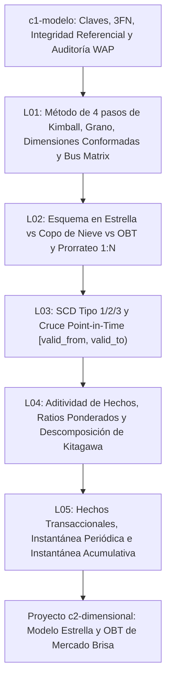

# Investigación y diseño curricular — `c2-dimensional` (Modelado dimensional)

- **Módulo:** `c2-dimensional` — Modelado dimensional
- **Nivel:** 2 (`Fundamentos de datos e ingeniería analítica`)
- **Track:** `core` (Tronco común)
- **Prerrequisito de módulo:** `c1-modelo` (El modelo relacional)
- **Duración total estimada:** 135 minutos (5 lecciones: 25, 25, 30, 30 y 25 min)
- **Dataset principal:** Mercado Brisa (`orders`, `order_items`, `products`, `customers`, `customer_changes`, `payments`, `refunds`, `stores`, `calendar`, `marketing_spend`)

---

## Paso 1 — Investigación bibliográfica y fuentes verificadas

Todas las URLs incluidas en las 5 lecciones fueron verificadas mediante petición HTTP directa (`200 OK`) y corresponden a referencias primarias de modelado dimensional (Kimball Group), documentación técnica oficial de motores y herramientas de transformación (`DuckDB`, `dbt Labs`, `SQLMesh`) y literatura académica (Stanford Encyclopedia of Philosophy).

### Lección 01 — `c2-dimensional-01-hechos-dimensiones-bus`
*Título en catálogo:* Diseño de hechos y dimensiones conformadas: grano y matriz de bus de Kimball
*Título corto (`<= 60` chars):* Hechos, dimensiones conformadas y matriz de bus de Kimball

| Tipo | Título | Autor / Organización | Año | URL verificada (`200 OK`) | Fecha de acceso |
| :--- | :--- | :--- | :--- | :--- | :--- |
| Primaria (libro / guía oficial) | Four-Step Dimensional Design Process | Ralph Kimball & Margy Ross — Kimball Group | 2013 | https://www.kimballgroup.com/data-warehouse-business-intelligence-resources/kimball-techniques/dimensional-modeling-techniques/four-4-step-design-process/ | 2026-10-29 |
| Primaria (guía oficial) | Declaring the Grain | Ralph Kimball & Margy Ross — Kimball Group | 2013 | https://www.kimballgroup.com/data-warehouse-business-intelligence-resources/kimball-techniques/dimensional-modeling-techniques/grain/ | 2026-10-29 |
| Primaria (guía oficial) | Enterprise Data Warehouse Bus Matrix | Ralph Kimball & Margy Ross — Kimball Group | 2013 | https://www.kimballgroup.com/data-warehouse-business-intelligence-resources/kimball-techniques/dimensional-modeling-techniques/enterprise-data-warehouse-bus-matrix/ | 2026-10-29 |
| Primaria (guía oficial) | Conformed Dimensions | Ralph Kimball & Margy Ross — Kimball Group | 2013 | https://www.kimballgroup.com/data-warehouse-business-intelligence-resources/kimball-techniques/dimensional-modeling-techniques/conformed-dimension/ | 2026-10-29 |
| Primaria (guía oficial) | Degenerate Dimensions & Dimension Surrogate Keys | Ralph Kimball & Margy Ross — Kimball Group | 2013 | https://www.kimballgroup.com/data-warehouse-business-intelligence-resources/kimball-techniques/dimensional-modeling-techniques/degenerate-dimension/ | 2026-10-29 |

### Lección 02 — `c2-dimensional-02-star-schema-obt` (`legacyId: l4-star-schema-obt`)
*Título:* Esquema en estrella frente a tabla ancha (OBT)

| Tipo | Título | Autor / Organización | Año | URL verificada (`200 OK`) | Fecha de acceso |
| :--- | :--- | :--- | :--- | :--- | :--- |
| Primaria (libro / guía oficial) | Star Schemas and OLAP Cubes | Ralph Kimball & Margy Ross — Kimball Group | 2013 | https://www.kimballgroup.com/data-warehouse-business-intelligence-resources/kimball-techniques/dimensional-modeling-techniques/star-schema-olap-cube/ | 2026-10-29 |
| Primaria (guía oficial) | Snowflaked Dimensions | Ralph Kimball & Margy Ross — Kimball Group | 2013 | https://www.kimballgroup.com/data-warehouse-business-intelligence-resources/kimball-techniques/dimensional-modeling-techniques/snowflake-dimension/ | 2026-10-29 |
| Primaria (guía oficial) | Drilling Across Fact Tables | Ralph Kimball & Margy Ross — Kimball Group | 2013 | https://www.kimballgroup.com/data-warehouse-business-intelligence-resources/kimball-techniques/dimensional-modeling-techniques/drilling-across/ | 2026-10-29 |
| Documentación técnica | DuckDB SQL — FROM & JOIN Clauses | DuckDB Foundation | 2024 | https://duckdb.org/docs/stable/sql/query_syntax/from.html | 2026-10-29 |

### Lección 03 — `c2-dimensional-03-scd2-history` (`legacyId: l5-scd2-history`)
*Título:* Dimensiones lentamente cambiantes (SCD Tipo 2)

| Tipo | Título | Autor / Organización | Año | URL verificada (`200 OK`) | Fecha de acceso |
| :--- | :--- | :--- | :--- | :--- | :--- |
| Primaria (libro / guía oficial) | Type 2: Add a New Row | Ralph Kimball & Margy Ross — Kimball Group | 2013 | https://www.kimballgroup.com/data-warehouse-business-intelligence-resources/kimball-techniques/dimensional-modeling-techniques/type-2/ | 2026-10-29 |
| Primaria (guía oficial) | Type 1: Overwrite & Type 3: Add a New Attribute | Ralph Kimball & Margy Ross — Kimball Group | 2013 | https://www.kimballgroup.com/data-warehouse-business-intelligence-resources/kimball-techniques/dimensional-modeling-techniques/type-1/ | 2026-10-29 |
| Documentación técnica | Add snapshots to your DAG (SCD Type 2) | dbt Labs | 2024 | https://docs.getdbt.com/docs/build/snapshots | 2026-10-29 |
| Documentación técnica | Model Kinds — SCD Type 2 Models | Tobiko Data — SQLMesh | 2024 | https://sqlmesh.readthedocs.io/en/stable/concepts/models/model_kinds/ | 2026-10-29 |

### Lección 04 — `c2-dimensional-04-metrics-simpson` (`legacyId: l6-metrics-simpson`)
*Título:* Aditividad de métricas y paradoja de Simpson

| Tipo | Título | Autor / Organización | Año | URL verificada (`200 OK`) | Fecha de acceso |
| :--- | :--- | :--- | :--- | :--- | :--- |
| Primaria (libro / guía oficial) | Additive, Semi-Additive, and Non-Additive Facts | Ralph Kimball & Margy Ross — Kimball Group | 2013 | https://www.kimballgroup.com/data-warehouse-business-intelligence-resources/kimball-techniques/dimensional-modeling-techniques/additive-semi-additive-non-additive-fact/ | 2026-10-29 |
| Primaria (académica) | Simpson's Paradox — Stanford Encyclopedia of Philosophy | Jan Sprenger & Naftali Weinberger | 2021 | https://plato.stanford.edu/entries/paradox-simpson/ | 2026-10-29 |
| Documentación técnica | DuckDB SQL — Aggregate Functions (`FILTER`, `COUNT DISTINCT`) | DuckDB Foundation | 2024 | https://duckdb.org/docs/stable/sql/functions/aggregates.html | 2026-10-29 |
| Documentación técnica | Semantic Layer — Metrics Overview (Ratio & Derived Metrics) | dbt Labs | 2024 | https://docs.getdbt.com/docs/build/metrics-overview | 2026-10-29 |

### Lección 05 — `c2-dimensional-05-hechos-instantanea-acumulativos`
*Título en catálogo:* Tablas de hechos transaccionales, de instantánea periódica y acumulativas
*Título corto (`<= 60` chars):* Tablas de hechos: transaccional, instantánea y acumulativa

| Tipo | Título | Autor / Organización | Año | URL verificada (`200 OK`) | Fecha de acceso |
| :--- | :--- | :--- | :--- | :--- | :--- |
| Primaria (libro / guía oficial) | Transaction Fact Tables | Ralph Kimball & Margy Ross — Kimball Group | 2013 | https://www.kimballgroup.com/data-warehouse-business-intelligence-resources/kimball-techniques/dimensional-modeling-techniques/transaction-fact-table/ | 2026-10-29 |
| Primaria (guía oficial) | Periodic Snapshot Fact Tables | Ralph Kimball & Margy Ross — Kimball Group | 2013 | https://www.kimballgroup.com/data-warehouse-business-intelligence-resources/kimball-techniques/dimensional-modeling-techniques/periodic-snapshot-fact-table/ | 2026-10-29 |
| Primaria (guía oficial) | Accumulating Snapshot Fact Tables | Ralph Kimball & Margy Ross — Kimball Group | 2013 | https://www.kimballgroup.com/data-warehouse-business-intelligence-resources/kimball-techniques/dimensional-modeling-techniques/accumulating-snapshot-fact-table/ | 2026-10-29 |
| Documentación técnica | DuckDB SQL — Window Functions | DuckDB Foundation | 2024 | https://duckdb.org/docs/stable/sql/functions/window_functions.html | 2026-10-29 |

---

## Paso 2 — Mapa conceptual y progresión pedagógica del módulo

### Frontera con `c1-modelo` y módulos posteriores

El módulo previo `c1-modelo` estableció los cimientos del modelo relacional transaccional (OLTP): claves primarias, naturales, sustitutas y compuestas (`L01`), dependencias funcionales y formas normales `1FN`–`3FN` (`L02`), integridad referencial y detección de huérfanos mediante `LEFT JOIN ... WHERE IS NULL` (`L03`), perfilado de calidad con `COUNT(*) FILTER` (`L04`) y auditorías bloqueantes WAP (`L05`).

El módulo `c2-dimensional` toma ese esquema relacional validado de Mercado Brisa y lo transforma en una arquitectura analítica dimensional (OLAP) siguiendo la metodología de Ralph Kimball:

1. **De `3FN` a hechos, dimensiones y bus empresarial (`L01`):** Introduce el método de 4 pasos de Kimball (proceso de negocio, declaración explícita del grano, dimensiones descriptivas y medidas numéricas). Distingue claves sustitutas (`store_id`, `product_id`, `change_id`) de claves naturales (`store_code`, `sku`), define dimensiones degeneradas (`order_id` en `order_items`) y dimensiones conformadas (`calendar`, `stores`, `customers`). Muestra por qué cruzar dos tablas de hechos directamente produce un abismo de multiplicación (*Chasm Trap*) y cómo resolverlo mediante `Drill-Across` preagregando cada proceso por sus dimensiones conformadas.

2. **Topología física — Esquema en estrella frente a OBT (`L02`, migrada de `l4-star-schema-obt`):** Compara la representación en estrella (`fct_order_items` rodeada de `dim_product`, `dim_store`, `dim_customer`, `dim_calendar`) con el esquema en copo de nieve (*Snowflake*) y las tablas anchas desnormalizadas (*One Big Table*, `OBT`) en motores columnares modernos (`Parquet` / `DuckDB`). Cuantifica la inflación de métricas de cabecera (`shipping_usd` pasa de `$370.50` a `$435.50` en órdenes completadas) cuando se desnormaliza una relación `1:N` sin prorrateo.

3. **Evolución temporal de atributos — SCD Tipo 2 (`L03`, migrada de `l5-scd2-history`):** Resuelve el problema de la mutabilidad histórica en las dimensiones (`customer_changes` con `4,100` filas para `2,400` clientes). Contrasta `SCD Tipo 1` (sobrescritura *As-Is*), `SCD Tipo 2` (versionado por fila con intervalo semiabierto `[valid_from, valid_to)` para reporte *As-Was*) y `SCD Tipo 3` (columna previa). Demuestra en SQL cómo un `JOIN` sin acotación temporal multiplica `14,760` órdenes completadas hasta `25,271` filas y cómo el cruce *Point-in-Time* preserva el grano exacto y evita distorsionar `$628,099.05` de ingresos del nivel `bronce`.

4. **Semántica de agregación y paradoja de Simpson (`L04`, migrada de `l6-metrics-simpson`):** Clasifica los hechos según su comportamiento algebraico al agrupar dimensiones: aditivos (`SUM(total_usd)`, `SUM(qty)`), semiaditivos (saldos que no se suman en el tiempo) y no aditivos (ratios como `CPA`, `CTR`, `CVR`, `AOV` y conteos distintos como `COUNT(DISTINCT customer_id)`). Demuestra en `marketing_spend` el sesgo de promediar ratios diarios (`AVG(spend / conversions) = $14.37` frente a `SUM(spend) / SUM(conversions) = $13.59` en `referral`) y aplica la descomposición de Kitagawa-Oaxaca en `orders` para separar el efecto tasa (`+$54.81`) del efecto mezcla (`+$7.38`) entre `desktop` y `mobile`.

5. **Los tres granos de tablas de hechos de Kimball (`L05`):** Cierra el módulo contrastando los tres patrones estructurales de tablas de hechos:
   - *Hechos transaccionales:* una fila por evento atómico (`orders`, `order_items`), poblamiento disperso y medidas aditivas de flujo.
   - *Hechos de instantánea periódica:* una fila por entidad y periodo fijo (saldo acumulado mensual por región), poblamiento denso y medidas semiaditivas evaluadas al cierre con `ARG_MAX(balance, month)` o `AVG`.
   - *Hechos de instantánea acumulativa:* una fila por ciclo de vida completo de un pedido (`fct_order_lifecycle`), con múltiples marcas de tiempo de hitos (`order_ts`, `captured_ts`, `first_refund_ts`) y métricas de latencia operativa (`minutes_to_capture`, `days_to_refund`).

### Conexiones hacia especializaciones (Niveles 3 y 4)

- Hacia `de3-transformacion` (Ingeniería de Datos): la construcción declarativa de tablas `dim_*` y `fct_*`, snapshots SCD2 incrementales e idempotencia en pipelines `dbt` / `SQLMesh`.
- Hacia `da2-exploracion` y `da3-experimentacion` (Análisis de Datos): el uso de estratificación y descomposición de Kitagawa-Oaxaca para controlar variables de confusión y auditar asignaciones experimentales (`experiment_assignments`).
- Hacia `bi2-metricas` y `bi2-modelo-semantico` (Business Intelligence): la codificación de métricas no aditivas (`SUM(num) / NULLIF(SUM(den), 0)`), métricas semiaditivas y árboles de KPIs sobre un bus dimensional compartido.



---

## Paso 6 — Proyecto integrador del módulo (`c2-dimensional-project`)

### Especificación del proyecto

- **ID:** `c2-dimensional-project`
- **Título:** Modela el esquema en estrella de Mercado Brisa
- **Dataset:** `orders`, `order_items`, `products`, `customers`, `customer_changes`, `payments`, `refunds`, `stores`, `calendar`
- **Escenario:** El equipo de finanzas y operaciones de Mercado Brisa necesita reemplazar las consultas ad-hoc sobre tablas transaccionales crudas por un modelo dimensional certificado en `DuckDB`. Actualmente, los reportes ejecutivos sufren cuatro defectos recurrentes: (1) incluyen el producto de prueba `SKU-TEST-NEG` (`product_id = 180`, `list_price_usd = -9.99`), (2) duplican el costo de envío (`shipping_usd`) al unir `orders` con `order_items`, (3) atribuyen todas las ventas históricas al nivel actual del cliente (`customers.current_tier`) en lugar de su versión `SCD Tipo 2` vigente en `customer_changes`, y (4) multiplican filas al cruzar pagos (`payments`) y reembolsos (`refunds`) en un mismo `JOIN`.

### Entregables requeridos

1. **Entregable 1 — Dimensiones conformadas y SCD Tipo 2 (`dim_product` y `dim_customer_scd2`):**
   Escribir una consulta que perfile y limpie `dim_product` (excluyendo registros de prueba con `list_price_usd <= 0`) y audite `dim_customer_scd2` (`customer_changes`), verificando que las `14,760` órdenes completadas crucen exactamente `1:1` mediante la condición temporal semiabierta `o.order_ts >= cc.valid_from AND (o.order_ts < cc.valid_to OR cc.valid_to IS NULL)` y cuantificando el sesgo *As-Is* frente a *As-Was* por cada `tier`.

2. **Entregable 2 — Tabla de hechos a grano de línea y tabla ancha (`fct_order_items` y `obt_sales`):**
   Construir el modelo a grano de línea de pedido (`order_item_id`) para órdenes con `status = 'completed'` y `p.list_price_usd > 0`, incorporando el atributo de dimensión degenerada (`order_id`), el nivel histórico del cliente (`tier_at_order`), la región de la tienda (`region`), la categoría del producto (`category`) y el margen bruto de línea (`line_total_usd - qty * unit_cost_usd`). Demostrar cómo calcular ingresos, unidades y margen por `region` y `category` sin inflar métricas de cabecera.

3. **Entregable 3 — Reporte *Drill-Across* e instantánea acumulativa (`fct_order_lifecycle`):**
   Construir un reporte *Drill-Across* por `region` y `store_type` que combine ventas brutas (`orders`) y devoluciones (`refunds`) mediante CTEs preagregadas sin perder tiendas sin reembolsos (`warehouse` en `Andina` e `Iberia`, `retail` en `Iberia`), seguido de una tabla de hechos de instantánea acumulativa que mida `captured_orders`, `refunded_orders`, `avg_minutes_to_capture` y `avg_days_to_refund` por región.

### Consultas SQL de referencia verificadas en DuckDB

#### Verificación del Entregable 1 (Auditoría *As-Was* vs *As-Is* sobre `dim_customer_scd2`)

```sql
WITH as_is AS (
  SELECT
    c.current_tier AS tier,
    COUNT(o.order_id) AS as_is_orders,
    ROUND(SUM(o.total_usd), 2) AS as_is_revenue_usd
  FROM orders o
  INNER JOIN customers c ON o.customer_id = c.customer_id
  WHERE o.status = 'completed'
  GROUP BY c.current_tier
),
as_was AS (
  SELECT
    cc.tier AS tier,
    COUNT(o.order_id) AS as_was_orders,
    ROUND(SUM(o.total_usd), 2) AS as_was_revenue_usd
  FROM orders o
  INNER JOIN customer_changes cc
    ON o.customer_id = cc.customer_id
   AND o.order_ts >= cc.valid_from
   AND (o.order_ts < cc.valid_to OR cc.valid_to IS NULL)
  WHERE o.status = 'completed'
  GROUP BY cc.tier
)
SELECT
  w.tier,
  w.as_was_orders,
  i.as_is_orders,
  w.as_was_revenue_usd,
  i.as_is_revenue_usd,
  ROUND(i.as_is_revenue_usd - w.as_was_revenue_usd, 2) AS distortion_usd
FROM as_was w
INNER JOIN as_is i ON w.tier = i.tier
ORDER BY w.as_was_revenue_usd DESC;
```

Resultado verificado (`4` filas):
- `oro`: `5,485` órdenes *As-Was* (`$2,497,409.26`) vs `6,468` órdenes *As-Is* (`$2,910,010.27`), distorsión `+$412,601.01`.
- `plata`: `4,567` órdenes *As-Was* (`$1,856,698.12`) vs `4,630` órdenes *As-Is* (`$1,873,949.75`), distorsión `+$17,251.63`.
- `bronce`: `3,746` órdenes *As-Was* (`$1,528,183.35`) vs `2,247` órdenes *As-Is* (`$900,084.30`), distorsión `-$628,099.05`.
- `platino`: `962` órdenes *As-Was* (`$387,171.69`) vs `1,415` órdenes *As-Is* (`$585,418.10`), distorsión `+$198,246.41`.

#### Verificación del Entregable 2 (Modelo en estrella / `obt_sales` por región)

```sql
WITH obt_sales AS (
  SELECT
    oi.order_item_id,
    o.order_id,
    s.region,
    cc.tier AS tier_at_order,
    p.category,
    oi.qty,
    oi.line_total_usd,
    ROUND(oi.line_total_usd - (oi.qty * p.unit_cost_usd), 2) AS line_margin_usd
  FROM order_items oi
  INNER JOIN orders o ON oi.order_id = o.order_id
  INNER JOIN products p ON oi.product_id = p.product_id
  INNER JOIN stores s ON o.store_id = s.store_id
  INNER JOIN customer_changes cc
    ON o.customer_id = cc.customer_id
   AND o.order_ts >= cc.valid_from
   AND (o.order_ts < cc.valid_to OR cc.valid_to IS NULL)
  WHERE o.status = 'completed'
    AND p.list_price_usd > 0
)
SELECT
  region,
  COUNT(DISTINCT order_id) AS orders_count,
  SUM(qty) AS units_sold,
  ROUND(SUM(line_total_usd), 2) AS net_sales_usd,
  ROUND(SUM(line_margin_usd), 2) AS gross_margin_usd,
  ROUND(100.0 * SUM(line_margin_usd) / NULLIF(SUM(line_total_usd), 0), 2) AS gross_margin_pct
FROM obt_sales
GROUP BY region
ORDER BY gross_margin_usd DESC;
```

Resultado verificado (`4` filas):
- `Cono Sur`: `4,920` órdenes, `23,467` unidades, `$1,797,472.18` ventas netas, `$861,688.28` margen bruto (`47.94%`).
- `Andina`: `4,921` órdenes, `22,502` unidades, `$1,733,571.64` ventas netas, `$829,571.07` margen bruto (`47.85%`).
- `Iberia`: `2,811` órdenes, `15,211` unidades, `$1,174,460.14` ventas netas, `$562,675.96` margen bruto (`47.91%`).
- `Norteamérica`: `2,108` órdenes, `9,870` unidades, `$758,647.22` ventas netas, `$363,053.56` margen bruto (`47.86%`).

#### Verificación del Entregable 3 (Instantánea acumulativa del ciclo de vida del pedido)

```sql
WITH payment_milestones AS (
  SELECT
    order_id,
    MIN(payment_ts) FILTER (WHERE status = 'captured') AS captured_ts
  FROM payments
  GROUP BY order_id
),
refund_milestones AS (
  SELECT
    order_id,
    MIN(refund_ts) AS first_refund_ts
  FROM refunds
  GROUP BY order_id
),
fct_order_lifecycle AS (
  SELECT
    o.order_id,
    s.region,
    o.order_ts,
    pm.captured_ts,
    rm.first_refund_ts,
    DATE_DIFF('second', o.order_ts, pm.captured_ts) / 60.0 AS minutes_to_capture,
    DATE_DIFF('hour', pm.captured_ts, rm.first_refund_ts) / 24.0 AS days_to_refund
  FROM orders o
  INNER JOIN stores s ON o.store_id = s.store_id
  LEFT JOIN payment_milestones pm ON o.order_id = pm.order_id
  LEFT JOIN refund_milestones rm ON o.order_id = rm.order_id
)
SELECT
  region,
  COUNT(order_id) AS total_orders,
  COUNT(captured_ts) AS captured_orders,
  COUNT(first_refund_ts) AS refunded_orders,
  ROUND(AVG(minutes_to_capture), 2) AS avg_minutes_to_capture,
  ROUND(AVG(days_to_refund), 2) AS avg_days_to_refund
FROM fct_order_lifecycle
GROUP BY region
ORDER BY total_orders DESC;
```

Resultado verificado (`4` filas):
- `Cono Sur`: `6,001` órdenes totales, `5,401` capturadas, `328` reembolsadas, `0.32` min a captura, `7.13` días a reembolso.
- `Andina`: `6,000` órdenes totales, `5,400` capturadas, `493` reembolsadas, `0.32` min a captura, `6.94` días a reembolso.
- `Iberia`: `3,428` órdenes totales, `3,085` capturadas, `164` reembolsadas, `0.32` min a captura, `6.82` días a reembolso.
- `Norteamérica`: `2,571` órdenes totales, `2,314` capturadas, `165` reembolsadas, `0.32` min a captura, `7.31` días a reembolso.

### Rúbrica de evaluación del proyecto (4 criterios, escala 0–4)

| Criterio | 0 — No entregado | 1 — Insuficiente | 2 — Básico | 3 — Competente | 4 — Sobresaliente |
| :--- | :--- | :--- | :--- | :--- | :--- |
| 1. Declaración del grano y prevención de fan-out | No define el grano ni separa cabecera y línea. | Une `orders` con `order_items`, `payments` o `refunds` directamente sumando métricas de cabecera duplicadas. | Separa `order_items` de `orders`, pero omite filtrar `list_price_usd > 0` o usa `COUNT(order_id)` en lugar de `COUNT(DISTINCT order_id)` sobre la OBT. | Declara explícitamente el grano de línea (`order_item_id`) y de cabecera (`order_id`), filtra `SKU-TEST-NEG` y evita inflar `shipping_usd`. | Documenta y valida mediante aserciones SQL que `COUNT(*)` del modelo coincide con el grano declarado y que el *Drill-Across* entre `orders` y `refunds` preserva los 11 segmentos `region x store_type`. |
| 2. Integridad histórica SCD Tipo 2 (*Point-in-Time*) | Ignora `customer_changes` y usa solo `customers.current_tier`. | Hace `JOIN` con `customer_changes` solo por `customer_id`, multiplicando las órdenes a `25,271` filas. | Incluye `valid_from` y `valid_to`, pero olvida manejar `valid_to IS NULL` (perdiendo las versiones vigentes `is_current = true`) o usa `BETWEEN` inclusivo. | Aplica correctamente `o.order_ts >= cc.valid_from AND (o.order_ts < cc.valid_to OR cc.valid_to IS NULL)` preservando las `14,760` órdenes completadas. | Cuantifica con exactitud la distorsión *As-Is* frente a *As-Was* (`-$628,099.05` en `bronce`) y expone ambos atributos (`tier_at_order` y `current_tier`) para análisis de migración de cohortes. |
| 3. Semántica de agregación y métricas no aditivas | Calcula promedios simples de ratios (`AVG(margin_pct)` o `AVG(cpa)`). | Mezcla numeradores y denominadores de granos distintos sin preagregar. | Calcula ratios ponderados `SUM(num) / SUM(den)`, pero no protege contra división por cero con `NULLIF` ni separa tasas de efectos de mezcla. | Implementa todas las tasas y márgenes mediante `SUM(num) / NULLIF(SUM(den), 0)` y distingue medidas aditivas, semiaditivas y no aditivas. | Incorpora la descomposición de Kitagawa-Oaxaca o validación estratificada para demostrar qué parte de la variación proviene de cambios de tasa frente a cambios de composición. |
| 4. Modelado de tablas de instantánea periódica y acumulativa | Solo modela una tabla transaccional simple. | Intenta construir la instantánea acumulativa sin preagregar `payments` y `refunds` por `order_id`, duplicando filas por reintentos de pago. | Preagrega `payments` y `refunds` a nivel `order_id`, pero no filtra `WHERE status = 'captured'` al calcular el hito `captured_ts`. | Construye `fct_order_lifecycle` a grano `1` fila por `order_id` usando `MIN(payment_ts) FILTER (WHERE status = 'captured')` y calcula latencias en minutos y días. | Contrasta en el mismo entregable el cierre de saldos semiaditivos (`ARG_MAX`) en instantáneas periódicas y las latencias entre hitos en instantáneas acumulativas. |
