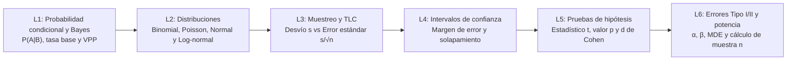

# Investigación curricular y técnica — `da2-inferencia`

- **Módulo:** `da2-inferencia` — *Probabilidad e inferencia estadística*
- **Ruta y nivel:** `da` (`Analista de Datos`), Nivel 2 (`Intermedio`)
- **Duración total estimada:** `135 min` (6 lecciones de `20–25 min`)
- **Dataset canónico verificado:** **Mercado Brisa** (`orders`, `refunds`, `payments`, `stores`, `customers`, `events`, `experiments`, `experiment_assignments`, `calendar`)
- **Fecha de verificación de fuentes y consultas:** `2026-10-29`

---

## 1. Paso 1 — Fuentes verificadas por lección

Todas las fuentes listadas a continuación fueron consultadas y verificadas con estado `HTTP 200` el `2026-10-29`. Cada lección cuenta con al menos dos fuentes primarias oficiales (NIST/SEMATECH Engineering Statistics Handbook, American Statistical Association, documentación oficial de SciPy, Statsmodels y DuckDB) y literatura estadística de referencia.

### Lección 1: `da2-inferencia-01-probabilidad-bayes`
1. **Stanford Encyclopedia of Philosophy — Bayes' Theorem** (Primaria, `HTTP 200`, verificada `2026-10-29`)
   - URL: https://plato.stanford.edu/entries/bayes-theorem/
   - Aporte al diseño: Formulación axiomática de la probabilidad condicional $P(A \mid B) = \frac{P(B \mid A)P(A)}{P(B)}$, descomposición del denominador por ley de probabilidad total y análisis formal de la falacia de la tasa base (*base-rate neglect*).
2. **NIST/SEMATECH e-Handbook of Statistical Methods — Basic Probability and Conditional Rules (`mpc3521`)** (Primaria, `HTTP 200`, verificada `2026-10-29`)
   - URL: https://www.itl.nist.gov/div898/handbook/mpc/section3/mpc3521.htm
   - Aporte al diseño: Reglas operativas de probabilidad conjunta, marginal y condicional aplicadas a sistemas de inspección, tasas de falsos positivos y control de defectos.
3. **OpenIntro Statistics (4th Edition) — Chapter 3: Probability** (Secundaria técnica, `HTTP 200`, verificada `2026-10-29`)
   - URL: https://www.openintro.org/book/os/
   - Aporte al diseño: Pedagogía de tablas de contingencia de frecuencias naturales frente a árboles de probabilidades condicionales para evitar la inversión de condicionales $P(A \mid B) \neq P(B \mid A)$.

### Lección 2: `da2-inferencia-02-distribuciones-probabilidad`
1. **NIST/SEMATECH e-Handbook — Gallery of Distributions (`eda366`, `eda3661`, `eda3669`, `eda366i`, `eda366j`)** (Primaria, `HTTP 200`, verificada `2026-10-29`)
   - URLs:
     - https://www.itl.nist.gov/div898/handbook/eda/section3/eda366.htm
     - https://www.itl.nist.gov/div898/handbook/eda/section3/eda3669.htm
     - https://www.itl.nist.gov/div898/handbook/eda/section3/eda366i.htm
     - https://www.itl.nist.gov/div898/handbook/eda/section3/eda366j.htm
   - Aporte al diseño: Funciones de masa y densidad de probabilidad, supuestos generadores y momentos para las distribuciones normal, log-normal, binomial y de Poisson.
2. **SciPy Official Reference — Statistical Functions (`scipy.stats.binom`, `scipy.stats.poisson`, `scipy.stats.lognorm`)** (Primaria, `HTTP 200`, verificada `2026-10-29`)
   - URLs:
     - https://docs.scipy.org/doc/scipy/reference/generated/scipy.stats.binom.html
     - https://docs.scipy.org/doc/scipy/reference/generated/scipy.stats.poisson.html
     - https://docs.scipy.org/doc/scipy/reference/generated/scipy.stats.lognorm.html
   - Aporte al diseño: Parametrización computacional estándar de variables discretas y continuas asimétricas, incluyendo la relación entre $\mu_{\ln X}$, $\sigma_{\ln X}$ y la media geométrica $\exp(\mu_{\ln X})$.
3. **DuckDB Official Documentation — Aggregate Statistical Functions** (Primaria, `HTTP 200`, verificada `2026-10-29`)
   - URL: https://duckdb.org/docs/sql/functions/aggregates
   - Aporte al diseño: Implementación en SQL de `SKEWNESS(x)`, `STDDEV_SAMP(x)`, `MEDIAN(x)` y transformaciones logarítmicas `LN(x)` / `EXP(x)` sobre columnas monetarias.

### Lección 3: `da2-inferencia-03-muestreo-tlc-error-estandar`
1. **NIST/SEMATECH e-Handbook — Central Limit Theorem & Sampling Distributions (`prc14`, `eda352`)** (Primaria, `HTTP 200`, verificada `2026-10-29`)
   - URLs:
     - https://www.itl.nist.gov/div898/handbook/prc/section1/prc14.htm
     - https://www.itl.nist.gov/div898/handbook/eda/section3/eda352.htm
   - Aporte al diseño: Distinción rigurosa entre la desviación estándar muestral $s$ (dispersión de observaciones individuales) y el error estándar de la media $EE = s / \sqrt{n}$ (dispersión del estimador muestral).
2. **DuckDB Official Documentation — Statistical Aggregates (`STDDEV_SAMP`, `VAR_SAMP`)** (Primaria, `HTTP 200`, verificada `2026-10-29`)
   - URL: https://duckdb.org/docs/sql/functions/aggregates
   - Aporte al diseño: Cálculo exacto con corrección de Bessel ($n - 1$) mediante `STDDEV_SAMP(x) / SQRT(COUNT(x))` y control de valores nulos.
3. **OpenIntro Statistics (4th Edition) — Chapter 5: Foundations for Inference** (Secundaria técnica, `HTTP 200`, verificada `2026-10-29`)
   - URL: https://www.openintro.org/book/os/
   - Aporte al diseño: Ley de rendimientos decrecientes del tamaño muestral (reducir el error estándar a la mitad exige multiplicar la muestra por cuatro) y por qué una muestra grande no corrige el sesgo de selección.

### Lección 4: `da2-inferencia-04-intervalos-confianza`
1. **NIST/SEMATECH e-Handbook — Confidence Intervals (`eda352`, `prc14`)** (Primaria, `HTTP 200`, verificada `2026-10-29`)
   - URL: https://www.itl.nist.gov/div898/handbook/eda/section3/eda352.htm
   - Aporte al diseño: Construcción de intervalos bilaterales para medias ($\bar{x} \pm z_{\alpha/2} \cdot s/\sqrt{n}$) y proporciones ($\hat{p} \pm z_{\alpha/2}\sqrt{\hat{p}(1-\hat{p})/n}$), e interpretación frecuentista del nivel de confianza $1 - \alpha$.
2. **Greenland, S., Senn, S. J., Rothman, K. J., et al. (2016) — Statistical tests, P values, confidence intervals, and power: a guide to misinterpretations** (Primaria arbitrada, `HTTP 200`, verificada `2026-10-29`)
   - URL: https://pmc.ncbi.nlm.nih.gov/articles/PMC5187603/
   - Aporte al diseño: Catálogo de malinterpretaciones frecuentes de intervalos de confianza (confundir el IC del 95 % con la probabilidad de que el parámetro fijo caiga dentro de un intervalo particular o con el rango del 95 % de los pedidos individuales).
3. **SciPy Official Reference — `scipy.stats` Confidence Intervals** (Primaria, `HTTP 200`, verificada `2026-10-29`)
   - URL: https://docs.scipy.org/doc/scipy/reference/stats.html
   - Aporte al diseño: Uso de cuantiles críticos normales ($z_{0.975} = 1.96$) frente a cuantiles $t$ de Student y reglas prácticas sobre solapamiento de intervalos en reportes ejecutivos.

### Lección 5: `da2-inferencia-05-pruebas-hipotesis-valor-p`
1. **Wasserstein, R. L., & Lazar, N. A. (2016) — The ASA Statement on p-Values: Context, Process, and Purpose** (Primaria institucional, `HTTP 200`, verificada `2026-10-29`)
   - URL: https://www.amstat.org/asa/files/pdfs/P-ValueStatement.pdf
   - Aporte al diseño: Los seis principios de la American Statistical Association sobre valores $p$: el valor $p$ no mide la probabilidad de que $H_0$ sea verdadera ni cuantifica la importancia práctica o de negocio de un efecto.
2. **NIST/SEMATECH e-Handbook — Two-Sample t-Test for Equal and Unequal Variances (`prc31`, `prc21`)** (Primaria, `HTTP 200`, verificada `2026-10-29`)
   - URLs:
     - https://www.itl.nist.gov/div898/handbook/prc/section3/prc31.htm
     - https://www.itl.nist.gov/div898/handbook/prc/section2/prc21.htm
   - Aporte al diseño: Formulación del estadístico de Welch $t = \frac{\bar{x}_1 - \bar{x}_2}{\sqrt{s_1^2/n_1 + s_2^2/n_2}}$ para comparar dos grupos con varianzas potencialmente distintas.
3. **SciPy Official Reference — `scipy.stats.ttest_ind`** (Primaria, `HTTP 200`, verificada `2026-10-29`)
   - URL: https://docs.scipy.org/doc/scipy/reference/generated/scipy.stats.ttest_ind.html
   - Aporte al diseño: Complementariedad entre la prueba $t$ de dos muestras independientes y el tamaño del efecto estandarizado $d$ de Cohen ($d = (\bar{x}_1 - \bar{x}_2)/s_{\text{pooled}}$).

### Lección 6: `da2-inferencia-06-errores-potencia-tamano-muestra`
1. **NIST/SEMATECH e-Handbook — Sample Sizes Required (`prc22`, `prc24`, `prc242`)** (Primaria, `HTTP 200`, verificada `2026-10-29`)
   - URLs:
     - https://www.itl.nist.gov/div898/handbook/prc/section2/prc22.htm
     - https://www.itl.nist.gov/div898/handbook/prc/section2/prc24.htm
     - https://www.itl.nist.gov/div898/handbook/prc/section2/prc242.htm
   - Aporte al diseño: Matriz de decisión entre errores Tipo I ($\alpha$) y Tipo II ($\beta$), potencia estadística ($1 - \beta$) y ecuaciones de tamaño muestral $n = 2(z_{1-\alpha/2} + z_{1-\beta})^2 \sigma^2 / \Delta^2$.
2. **Statsmodels Official Documentation — `statsmodels.stats.power.TTestIndPower`** (Primaria, `HTTP 200`, verificada `2026-10-29`)
   - URL: https://www.statsmodels.org/stable/generated/statsmodels.stats.power.TTestIndPower.html
   - Aporte al diseño: Relación funcional entre los cuatro parámetros de diseño experimental ($n$, $\alpha$, potencia $1 - \beta$ y efecto mínimo detectable MDE) y planificación de la duración en días según tráfico diario.
3. **Greenland, S. et al. (2016) — Statistical tests, P values, confidence intervals, and power** (Primaria arbitrada, `HTTP 200`, verificada `2026-10-29`)
   - URL: https://pmc.ncbi.nlm.nih.gov/articles/PMC5187603/
   - Aporte al diseño: Riesgos de los estudios con baja potencia (*underpowered studies*): inflación del tamaño del efecto en hallazgos significativos (*winner's curse*) y falsos negativos costosos por detener pruebas antes de alcanzar la muestra planeada.

---

## 2. Paso 2 — Mapa de conceptos y tabla de progresión del módulo

El módulo `da2-inferencia` conecta el pensamiento descriptivo de `c0-numeros` (proporciones, tasas en puntos básicos, media vs. mediana y falacias correlacionales) con la toma de decisiones bajo incertidumbre que precede a `da2-experimentacion`.

### Tabla de progresión curricular

| Orden | ID de lección | Concepto central | Fórmula / Herramienta SQL | Caso real en Mercado Brisa |
|---|---|---|---|---|
| 1 | `da2-inferencia-01-probabilidad-bayes` | Probabilidad condicional $P(A\mid B)$, tasa base y teorema de Bayes | `SUM(CASE WHEN ...)` y funciones de ventana `SUM(...) OVER ()` para separar $P(A\mid B)$, $P(B)$ y $P(B\mid A)$ | Propensión a pedidos altos (`total_usd >= 800`) por segmento (`orders` + `customers`) y fallos de cobro en el primer intento (`payments`) |
| 2 | `da2-inferencia-02-distribuciones-probabilidad` | Familias discretas (binomial, Poisson) y continuas (normal vs. log-normal) | `STDDEV_SAMP`, `SKEWNESS`, `LN(total_usd)`, `EXP(AVG(LN(...)))` e índice de dispersión de Poisson | Conteo diario de devoluciones (`calendar` + `refunds`, $\lambda = 1.324$) y modelado log-normal del ticket por segmento y dispositivo |
| 3 | `da2-inferencia-03-muestreo-tlc-error-estandar` | Muestreo, sesgo de selección, Teorema del Límite Central y error estándar | `STDDEV_SAMP(x) / SQRT(COUNT(x))` y error estándar relativo (%) | Comparación entre dispersión individual ($s \approx 299\text{–}335\text{ USD}$) y precisión de la media ($EE \approx 5.11\text{–}6.54\text{ USD}$) por tienda y país |
| 4 | `da2-inferencia-04-intervalos-confianza` | Intervalo de confianza al 95 %, margen de error y comunicación ejecutiva | `AVG(x) ± 1.96 * STDDEV_SAMP(x) / SQRT(COUNT(x))` para medias y proporciones | Solapamiento de IC 95 % entre tiendas de México y Colombia (`STR-MX-01`, `STR-MX-03`, `STR-CO-01`, `STR-CO-02`) |
| 5 | `da2-inferencia-05-pruebas-hipotesis-valor-p` | Hipótesis nula/alternativa, estadístico $t$ de Welch, valor $p$ y $d$ de Cohen | Estadístico $t$, varianza combinada $s_{\text{pooled}}$ y $d = (\bar{x}_1 - \bar{x}_2)/s_{\text{pooled}}$ | Evaluación de los experimentos 1 a 5 en `experiment_assignments` + `experiments` (`EXP-CHECKOUT-1STEP`, $t = 7.56, d = 0.378$) y contraste entre tiendas |
| 6 | `da2-inferencia-06-errores-potencia-tamano-muestra` | Errores Tipo I ($\alpha$) y Tipo II ($\beta$), potencia ($1-\beta$), MDE y tamaño de muestra | $n_{\text{brazo}} = \lceil 2 \cdot (1.96 + 0.8416)^2 \cdot s^2 / \Delta^2 \rceil$ y días de captura | Dimensionamiento muestral por dispositivo y por segmento de cliente (`cafeteria_b2b`, `retail`, `pro_barista`) para detectar un MDE del 5 % |

---

## 3. Paso 4 — Verificación de consultas SQL contra Parquet de Mercado Brisa

Las 18 consultas SQL del módulo (3 por lección: `section.example`, `workedExample.steps[0..1]` y `practice.solution`) fueron ejecutadas directamente en `@duckdb/node-api` sobre los archivos reales de `public/datasets/*.parquet`:

- **Lección 1 (`da2-inferencia-01-probabilidad-bayes`):**
  - Al cruzar `orders` y `customers` (18 000 órdenes), el segmento `cafeteria_b2b` presenta la mayor verosimilitud de pedido alto (`total_usd >= 800`): $P(\text{Alto} \mid \text{B2B}) = 19.81\%$ (`628 / 3170`), frente a `12.38 %` en `retail` y `12.14 %` en `pro_barista`. Sin embargo, como la tasa base de `cafeteria_b2b` es solo `17.61 %`, la probabilidad posterior $P(\text{Segmento} \mid \text{Alto})$ es mayor en `pro_barista` (`37.61 %`) y `retail` (`36.71 %`) que en `cafeteria_b2b` (`25.67 %`).
  - En `payments` (`attempt_number = 1`), los cuatro métodos tienen una tasa base idéntica (`25.00 %` cada uno, `4612–4613` intentos), pero `transferencia_spei` (`11.75 %`) y `efectivo_tienda` (`11.73 %`) registran tasas de fallo mucho mayores que `card` (`7.94 %`) y `billetera_digital` (`7.87 %`), concentrando el `29.91 %` y `29.86 %` de los fallos posteriores.
- **Lección 2 (`da2-inferencia-02-distribuciones-probabilidad`):**
  - El conteo diario de devoluciones (`calendar` + `refunds`, `1095` días) tiene una tasa media diaria $\lambda = 1.324$ y varianza $1.865$ (índice de dispersión $1.41$).
  - Los montos `total_usd` en `orders` tienen asimetría positiva (`SKEWNESS` entre `0.83` y `1.02`). Un intervalo ingenuo $\bar{x} \pm 2s$ produce cotas inferiores negativas imposibles (`-175.33 USD` en B2B, `-210.81 USD` en `retail` y `-217.97 USD` en `pro_barista`). La transformación log-normal ($\mu_{\ln X}, \sigma_{\ln X}$) sitúa la media geométrica en `392.22 USD` (`cafeteria_b2b`), `287.62 USD` (`retail`) y `281.80 USD` (`pro_barista`) con cotas inferiores estrictamente positivas (`78.97 USD`, `44.25 USD` y `42.69 USD`).
- **Lección 3 (`da2-inferencia-03-muestreo-tlc-error-estandar`):**
  - Mientras la desviación estándar de pedidos individuales ronda los `299.00–334.92 USD` en todos los países (`AR`, `CO`, `ES`, `MX`, `PE`, `CL`), el error estándar de la media cae a `5.11–6.54 USD` (error estándar relativo de `1.19 %` a `1.50 %`) gracias a tamaños muestrales de `2571` a `3429` pedidos por país.
- **Lección 4 (`da2-inferencia-04-intervalos-confianza`):**
  - En México, un ranking puntual ordenaría `STR-MX-03` (`350.45 USD`) por encima de `STR-MX-01` (`346.13 USD`). Sin embargo, sus intervalos de confianza del 95 % (`[329.50, 371.39] USD` y `[325.08, 367.17] USD`) se solapan casi por completo, demostrando empate estadístico.
- **Lección 5 (`da2-inferencia-05-pruebas-hipotesis-valor-p`):**
  - Al contrastar `STR-MX-03` contra `STR-MX-01`, la diferencia de `+4.32 USD` tiene un error estándar de `15.15 USD`, estadístico $t = 0.29$ y $d = 0.016$ (ruido azaroso), mientras que `STR-MX-02` vs `STR-MX-01` (`+149.61 USD`) arroja $t = 8.46$ y $d = 0.472$.
  - En los experimentos 1 a 5 (`experiment_assignments` + `experiments`), `EXP-CHECKOUT-1STEP` logra una mejora de `+6.91 USD` con $t = 7.56$ y $d = 0.378$ (tras confirmar balance pre-experimento de $+0.04\text{ USD}$, $t = 0.03$).
- **Lección 6 (`da2-inferencia-06-errores-potencia-tamano-muestra`):**
  - Con $\alpha = 0.05$ ($z_{0.975} = 1.96$) y potencia $1 - \beta = 0.80$ ($z_{0.80} = 0.8416$), detectar un MDE relativo del `5 %` sobre el ticket medio requiere `2825` pedidos por brazo en `cafeteria_b2b` ($\text{MDE} = 25.69\text{ USD}$), `3599` en `retail` ($\text{MDE} = 20.50\text{ USD}$) y `3716` en `pro_barista` ($\text{MDE} = 20.24\text{ USD}$).

---

## 4. Paso 6 — Proyecto integrador del módulo y rúbrica (0–4)

### Enunciado del proyecto integrador
**Dictamen de inferencia y dimensionamiento muestral para el comité comercial de Mercado Brisa:**
El equipo directivo de Mercado Brisa quiere tomar tres decisiones basadas en datos:
1. Priorizar la auditoría antifraude de reembolsos según dispositivo (`desktop`, `mobile`, `pos_tienda`) sin caer en la falacia de confundir volumen de reembolsos con riesgo condicional.
2. Evaluar si las diferencias de ticket promedio entre las tiendas de México y Colombia justifican cambiar los bonos de gerencia de tienda.
3. Dictaminar cuáles de los tres experimentos recientes (`EXP-CHECKOUT-1STEP`, `EXP-FREE-SHIP-THRESHOLD`, `EXP-RECO-PDP-V2`) deben desplegarse a producción y cuántos días deberá correr el próximo experimento por país para detectar una mejora del `8 %` con `80 %` de potencia y $\alpha = 0.05$.

### Entregables esperados
1. Consultas SQL reproducibles en DuckDB para tasas condicionales de reembolso, intervalos de confianza al 95 % por tienda, estadísticos $t$ y $d$ de Cohen por experimento, y tabla de tamaño de muestra por país.
2. Nota ejecutiva de una página que separe significancia estadística ($|t| \ge 1.96$) de magnitud práctica ($d$ de Cohen e impacto en USD) y explicite los riesgos Tipo I y Tipo II de cada recomendación.

### Rúbrica de evaluación del proyecto (escala 0–4)

| Criterio | 0 — No entregado | 1 — Insuficiente | 2 — Básico | 3 — Competente | 4 — Sobresaliente |
|---|---|---|---|---|---|
| **1. Razonamiento bayesiano y distribucional** | No incluye análisis de reembolsos ni revisión de asimetría. | Confunde $P(\text{Reembolso}\mid\text{Canal})$ con $P(\text{Canal}\mid\text{Reembolso})$ o asume normalidad sin revisar asimetría. | Calcula probabilidades condicionales correctas pero omite la tasa base o ignora el sesgo log-normal del ticket. | Distingue $P(A\mid B)$ de $P(B\mid A)$, reporta la tasa base (`8.15 %`) y modela el ticket considerando su asimetría positiva. | Integra tasas base, probabilidades condicionales e intervalos en escala logarítmica y explica cómo cambian la priorización operativa. |
| **2. Precisión muestral e intervalos de confianza** | Reporta solo promedios puntuales sin medidas de dispersión ni tamaño muestral. | Usa la desviación estándar individual $s$ como si fuera el error de la media $\bar{x}$. | Calcula el error estándar $s/\sqrt{n}$ pero interpreta erróneamente el IC 95 % como rango de pedidos individuales. | Construye IC 95 % exactos por tienda e identifica qué diferencias puntuales se solapan dentro del margen de error. | Comunica los IC 95 % con precisión frecuentista y evita rankings espurios entre sucursales con muestras distintas. |
| **3. Pruebas de hipótesis y tamaño del efecto** | Evalúa los experimentos solo mirando la diferencia bruta de medias. | Calcula el estadístico $t$ con la varianza de un solo grupo o afirma que un resultado no significativo prueba efecto cero. | Calcula el estadístico $t$ de dos muestras correctamente pero omite el tamaño del efecto estandarizado $d$ de Cohen. | Calcula $t$, $EE$ y $d$ de Cohen para los 3 experimentos, contrastando significancia estadística y relevancia económica. | Incorpora verificación pre-experimento (`pre_metric_usd`) y diferencia claramente entre significancia estadística, $d$ de Cohen y ROI de negocio. |
| **4. Potencia estadística y cálculo de muestra** | No estima el tamaño de muestra ni la duración del experimento futuro. | Propone un tamaño de muestra arbitrario sin especificar $\alpha$, potencia $1-\beta$ ni MDE ($\Delta$). | Aplica la fórmula de tamaño de muestra para un solo brazo o ignora el tráfico diario al estimar la duración. | Calcula $n$ por brazo con $\alpha=0.05$, potencia `80 %` y MDE del `8 %`, convirtiendo la muestra total ($2n$) en días de captura por país. | Analiza el compromiso entre errores Tipo I/II, MDE y duración operativa, recomendando alternativas cuando el horizonte supera 35 días. |
