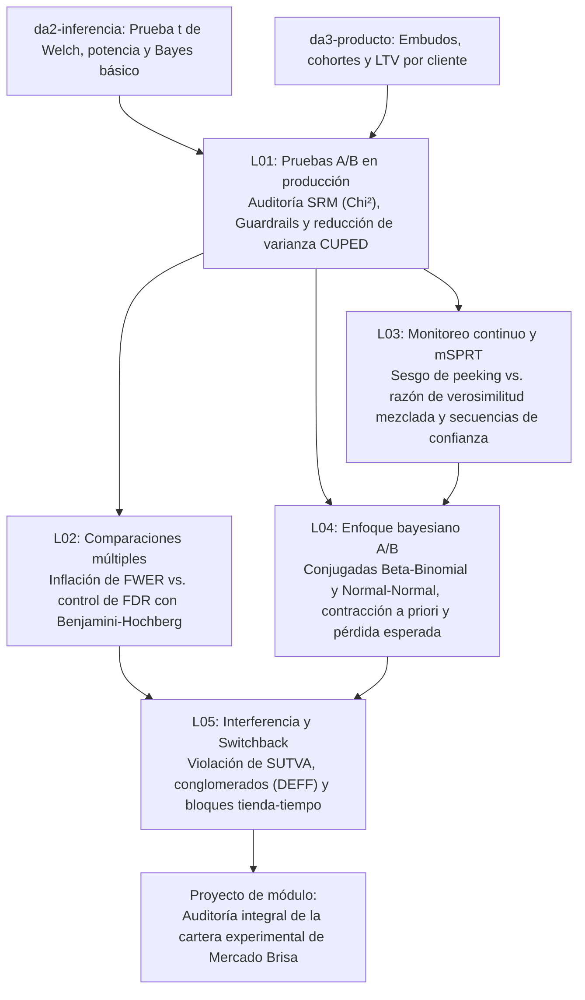

# Investigación Curricular — Módulo `da3-experimentos`: Experimentación controlada

- **Área**: Análisis de Datos (`da`)
- **Nivel**: 3 (Avanzado — Ola C)
- **Prerrequisitos**: `da2-inferencia` (*Inferencia estadística y pruebas de hipótesis*), `da3-producto` (*Analítica de producto: embudos, cohortes y retención*)
- **Duración total**: 120 minutos (5 lecciones)
- **Dataset compartido**: Mercado Brisa (`experiments`, `experiment_assignments`, `orders`, `refunds`, `events`, `stores`, `calendar`, `customers`)

---

## Paso 1 — Investigación de fuentes primarias verificadas (`HTTP 200`)

Cada una de las 5 lecciones se apoya en al menos 3 fuentes primarias (artículos seminales, libros de referencia y documentación técnica oficial) verificadas mediante consulta directa con respuesta `HTTP 200` el `2026-10-29`.

### Lección 1 (`da3-experimentos-01-ab-testing-cuped`) — Pruebas A/B en producción: SRM, guardrails y CUPED
1. **Deng, A., Xu, Y., Kohavi, R., & Walker, T. (2013)** — *Improving the Sensitivity of Online Controlled Experiments by Utilizing Pre-Experiment Data* (ACM WSDM 2013).
   - URL: https://exp-platform.com/Documents/2013-02-CUPED-ImprovingSensitivityOfControlledExperiments.pdf (`HTTP 200`)
   - Sustenta: Derivación formal del estimador lineal insesgado $\hat{Y}_{\text{CUPED}} = Y - \theta(X - \bar{X})$, pendiente óptima $\theta^* = \text{Cov}(Y, X)/\text{Var}(X)$ y factor exacto de reducción de varianza $(1 - r_{XY}^2)$.
2. **Kohavi, R., Tang, D., & Xu, Y. (2020)** — *Trustworthy Online Controlled Experiments: A Practical Guide to A/B Testing* (Cambridge University Press).
   - URL: https://experimentguide.com/ (`HTTP 200`)
   - Sustenta: Diagnóstico de *Sample Ratio Mismatch* (SRM) mediante bondad de ajuste $\chi^2$, taxonomía de causas operativas de SRM y diseño de métricas de protección (*guardrail metrics*).
3. **Statsig Documentation** — *CUPED (Controlled-experiment Using Pre-Experiment Data)*.
   - URL: https://docs.statsig.com/stats-engine/methodologies/cuped (`HTTP 200`)
   - Sustenta: Implementación de CUPED en motores modernos de experimentación y requisitos de invariancia de la covariable pre-asignación.
4. **DuckDB Foundation** — *Aggregate Functions (`COVAR_SAMP`, `VAR_SAMP`, `CORR`)*.
   - URL: https://duckdb.org/docs/sql/functions/aggregates (`HTTP 200`)
   - Sustenta: Sintaxis SQL de agregaciones bivariadas para estimar $\theta$ y correlaciones basales directamente en motor columnar.

### Lección 2 (`da3-experimentos-02-comparaciones-multiples-bh`) — Comparaciones múltiples y Benjamini-Hochberg
1. **Benjamini, Y., & Hochberg, Y. (1995)** — *Controlling the False Discovery Rate: A Practical and Powerful Approach to Multiple Testing* (Journal of the Royal Statistical Society, Series B, 57(1), 289–300).
   - URL: https://www.math.tau.ac.il/~ybenja/MyPapers/benjamini_hochberg1995.pdf (`HTTP 200`)
   - Sustenta: Definición de la tasa de descubrimientos falsos $\text{FDR} = \mathbb{E}[V / \max(R, 1)]$ y demostración del algoritmo escalonado ascendente (*step-up*) $p_{(k)} \le \frac{k}{m}q$.
2. **Statsmodels Developers** — *`statsmodels.stats.multitest.multipletests` Reference*.
   - URL: https://www.statsmodels.org/stable/generated/statsmodels.stats.multitest.multipletests.html (`HTTP 200`)
   - Sustenta: Comparación formal entre el control de la tasa de error por familia ($\text{FWER}$: Bonferroni, Holm-Bonferroni) y el control de $\text{FDR}$ (Benjamini-Hochberg y Benjamini-Yekutieli).
3. **SciPy Community** — *`scipy.stats.false_discovery_control` Reference*.
   - URL: https://docs.scipy.org/doc/scipy/reference/generated/scipy.stats.false_discovery_control.html (`HTTP 200`)
   - Sustenta: Cálculo de valores $p$ ajustados (*q-values*) monotónicos bajo supuestos de independencia y dependencia positiva (PRDS).

### Lección 3 (`da3-experimentos-03-pruebas-secuenciales-msprt`) — Pruebas secuenciales (mSPRT) y monitoreo continuo
1. **Johari, R., Koomen, P., Pekelis, L., & Walsh, D. (2017/2022)** — *Peeking at A/B Tests: Why It Matters, and What to Do About It / Always Valid Inference: Continuous Monitoring of A/B Tests* (KDD 2017 / Operations Research 2022).
   - URL: https://arxiv.org/abs/1512.04922 (`HTTP 200`)
   - Sustenta: Fórmula cerrada de la razón de verosimilitud mezclada $\Lambda_t(\tau^2)$, valores $p$ siempre válidos $p_t^{\text{seq}} = \min(1, 1/\max_{s \le t}\Lambda_s)$ y control uniforme del error Tipo I bajo parada opcional.
2. **Howard, S. R., Ramdas, A., McAuliffe, J., & Sekhon, J. (2021)** — *Time-uniform, nonparametric, nonasymptotic confidence sequences* (Annals of Statistics, 49(2), 1055–1080).
   - URL: https://arxiv.org/abs/1810.08240 (`HTTP 200`)
   - Sustenta: Construcción de secuencias de confianza $(1-\alpha)$ válidas en todo tiempo de parada $t \ge 1$ mediante supermartingalas no negativas.
3. **Statsig Documentation** — *Sequential Testing (mSPRT)*.
   - URL: https://docs.statsig.com/experiments-plus/sequential-testing (`HTTP 200`)
   - Sustenta: Calibración práctica del hiperparámetro de mezcla $\tau^2$ y ensanchamiento del intervalo secuencial en fases tempranas de captura.
4. **Miller, E. (2010)** — *How Not To Run an A/B Test*.
   - URL: https://www.evanmiller.org/how-not-to-run-an-ab-test.html (`HTTP 200`)
   - Sustenta: Cuantificación del sesgo por *data peeking* cuando se aplica una regla de parada opcional sobre pruebas de horizonte fijo.

### Lección 4 (`da3-experimentos-04-enfoque-bayesiano-ab`) — Enfoque bayesiano en pruebas A/B
1. **Miller, E. (2015)** — *Formulas for Bayesian A/B Testing*.
   - URL: https://www.evanmiller.org/bayesian-ab-testing.html (`HTTP 200`)
   - Sustenta: Actualización conjugada Beta-Binomial $\text{Beta}(\alpha_0 + k, \beta_0 + n - k)$ y expresión analítica de $\Pr(\theta_T > \theta_C \mid \text{datos})$.
2. **Deng, A., Lu, J., & Chen, S. (2016)** — *Continuous Monitoring of A/B Tests without Pain: Optional Stopping in Bayesian Testing* (IEEE DSAA 2016).
   - URL: https://arxiv.org/abs/1707.02646 (`HTTP 200`)
   - Sustenta: Calibración de distribuciones a priori informativas/escépticas, actualización conjugada Normal-Normal para métricas continuas y reglas de decisión por pérdida esperada.
3. **SciPy Community** — *`scipy.stats.beta` Continuous Random Variable Reference*.
   - URL: https://docs.scipy.org/doc/scipy/reference/generated/scipy.stats.beta.html (`HTTP 200`)
   - Sustenta: Momentos exactos de la distribución Beta ($\mu = \frac{\alpha}{\alpha+\beta}$, $\sigma^2 = \frac{\alpha\beta}{(\alpha+\beta)^2(\alpha+\beta+1)}$) y cuantiles para intervalos de credibilidad.

### Lección 5 (`da3-experimentos-05-efectos-red-interferencia-switchback`) — Interferencia de red y pruebas switchback
1. **Bojinov, I., Simchi-Levi, D., & Zhao, J. (2022)** — *Design and Analysis of Switchback Experiments* (Management Science, 69(7), 3759–3777).
   - URL: https://arxiv.org/abs/2009.00148 (`HTTP 200`)
   - Sustenta: Formalización de experimentos de alternancia temporal (*switchback*), orden de los efectos de arrastre (*carryover* $m$), periodos de lavado (*burn-in/washout*) y agregación al grano bloque tienda-tiempo.
2. **Ugander, J., Karrer, B., Backstrom, L., & Kleinberg, J. (2013)** — *Graph Cluster Randomization: Network Exposure to Multiple Universes* (ACM KDD 2013).
   - URL: https://arxiv.org/abs/1305.5565 (`HTTP 200`)
   - Sustenta: Violación del supuesto SUTVA ($Y_i(\mathbf{Z}) \neq Y_i(Z_i)$) por derrame de red o canibalización de recursos compartidos, y reducción del sesgo mediante aleatorización por conglomerados.
3. **Kohavi, R., Tang, D., & Xu, Y. (2020)** — *Trustworthy Online Controlled Experiments* (Capítulo 22: *Leakage and Interference between Variants*).
   - URL: https://experimentguide.com/ (`HTTP 200`)
   - Sustenta: Correlación intraclase ($\rho_{\text{ICC}}$), factor de inflación de varianza $\text{DEFF} = 1 + (\bar{m}-1)\rho_{\text{ICC}}$ y cálculo del error estándar a nivel de conglomerado.

---

## Paso 2 — Mapa conceptual y progresión pedagógica

En `da2-inferencia` el estudiante aprendió a formular una prueba de hipótesis aislada de horizonte fijo (prueba $t$ de Welch, potencia, tamaño de muestra, Bayes elemental e introducción a Bonferroni), mientras que en `da3-producto` aprendió a construir métricas de embudo, retención por cohortes y LTV. El módulo `da3-experimentos` conecta ambos mundos y resuelve las cinco patologías reales de la experimentación en producción sobre **Mercado Brisa**:



### Tabla de progresión curricular

| Orden | ID de lección | Título corto (`<= 60` car.) | Min | Concepto central y fórmula | Tablas Mercado Brisa utilizadas |
| :--- | :--- | :--- | :--- | :--- | :--- |
| 1 | `da3-experimentos-01-ab-testing-cuped` | `Pruebas A/B en producción: SRM, guardrails y CUPED` | 30 | Auditoría $\chi^2_{\text{SRM}}$ antes de leer efectos; ajuste $\hat{Y}_{\text{CUPED}} = Y - \theta(X - \bar{X})$ con $\text{Var}(\hat{\Delta}_{\text{CUPED}}) = \text{Var}(\hat{\Delta})(1 - r^2)$. | `experiments`, `experiment_assignments` |
| 2 | `da3-experimentos-02-comparaciones-multiples-bh` | `Comparaciones múltiples y método de Benjamini-Hochberg` | 25 | Explosión de $\text{FWER} = 1-(1-\alpha)^m$ al segmentar cohortes; umbral escalonado BH $p_{(k)} \le \frac{k}{m}q$ para controlar $\text{FDR}$. | `experiment_assignments`, `experiments` |
| 3 | `da3-experimentos-03-pruebas-secuenciales-msprt` | `Pruebas secuenciales (mSPRT) y monitoreo continuo` | 25 | Inflación del error Tipo I por parada opcional (*peeking*); estadístico $\Lambda_t(\tau^2) \ge 1/\alpha$ y secuencia de confianza siempre válida. | `experiment_assignments`, `experiments` |
| 4 | `da3-experimentos-04-enfoque-bayesiano-ab` | `Enfoque bayesiano en pruebas A/B y decisión bajo riesgo` | 20 | Modelos conjugados $\text{Beta}(\alpha_0+k, \beta_0+n-k)$ y Normal-Normal con contracción hacia el *prior*; $\Pr(\Delta > 0 \mid \text{datos})$ y pérdida esperada. | `experiment_assignments`, `experiments` |
| 5 | `da3-experimentos-05-efectos-red-interferencia-switchback` | `Interferencia de red, conglomerados y pruebas switchback` | 20 | Violación de SUTVA en tiendas/almacenes; inflación $\text{DEFF} = 1+(\bar{m}-1)\rho_{\text{ICC}}$ y agregación por bloque tienda-semana en diseño *switchback*. | `orders`, `stores`, `calendar` |

---

## Paso 4 — Verificación de consultas SQL y salidas reales en DuckDB

Todas las consultas de `section.example`, `workedExample.steps` y `practice.solution` fueron ejecutadas sobre los archivos Parquet de `public/datasets/` mediante `@duckdb/node-api`:

1. **`da3-experimentos-01-ab-testing-cuped`**:
   - **Auditoría SRM (`experiments` + `experiment_assignments`)**: Los experimentos 1 a 5 presentan `800` usuarios en `control` y `800` en `treatment` ($\chi^2 = 0.00$, `BALANCEADO`). El experimento 6 (`EXP-PUSH-CART`) presenta `980` en `control` y `620` en `treatment` ($\chi^2 = 81.00 > 10.83$, $p < 0.0001$, `ALERTA_SRM`), por lo que queda descartado para inferencia causal.
   - **Reducción de varianza CUPED en `experiment_id = 1` (`EXP-CHECKOUT-1STEP`)**: Correlación pre-post $r = 0.9678$, pendiente óptima $\theta = 0.6551$. La desviación estándar por brazo cae de `18.43` / `18.14` USD a `4.64` / `4.61` USD, reduciendo el error estándar del *lift* de `0.91` USD a `0.23` USD (reducción del 74.7 % en el error estándar, equivalente a multiplicar por $15.6\times$ el tamaño muestral efectivo).
2. **`da3-experimentos-02-comparaciones-multiples-bh`**:
   - **Experimento A/A sobre gasto pre-experimento (`pre_experiment_spend_usd`) en 15 cohortes diarias de `experiment_id = 1`**: La cohorte `2024-02-06` arroja por puro azar $|z| = 2.780$ ($p = 0.00516 \le 0.05$, falso positivo bajo umbral ingenuo). Con $m = 15$ comparaciones, el umbral de rango $k = 1$ de Benjamini-Hochberg ($q = 0.05$) y de Bonferroni es $0.05 / 15 = 0.00333$; como $0.00516 > 0.00333$, ambos procedimientos bloquean el falso positivo (`RETENER_H0`).
   - **Evaluación post-experimento (`post_experiment_spend_usd`) en las 15 cohortes diarias**: Bonferroni ($p \le 0.00333$) solo detecta 4 cohortes (`rango_k` 1 a 4), mientras que Benjamini-Hochberg ($p_{(k)} \le 0.05 \cdot k / 15$) detecta 7 cohortes (`rango_k` 1 a 7, con $p_{(7)} = 0.01699 \le 0.02333$), preservando la potencia estadística sin descontrolar la tasa de descubrimientos falsos.
3. **`da3-experimentos-03-pruebas-secuenciales-msprt`**:
   - **Falsa alarma por *peeking* diario en serie A/A (`experiment_id = 3`, `pre_experiment_spend_usd`)**: En el día 1 (`2024-06-01`, $n = 82$) $|z_{\text{fijo}}| = 2.112 > 1.96$ y en el día 2 (`2024-06-02`, $n = 195$) $|z_{\text{fijo}}| = 2.015 > 1.96$. Sin embargo, la razón de verosimilitud mezclada mSPRT ($\tau^2 = 25$) vale apenas $\Lambda_1 = 1.850$ y $\Lambda_2 = 2.173$, muy por debajo del umbral válido $1/\alpha = 20.0$.
   - **Monitoreo secuencial válido en `experiment_id = 1` (`post_experiment_spend_usd`)**: En el día 1 (`2024-02-01`, $n = 85$), el estadístico fijo ya cruza $1.96$ ($z = 2.468$, radio fijo $\pm 7.33$ USD), pero mSPRT exige esperar ($\Lambda_1 = 4.22 < 20$, radio secuencial $\pm 12.37$ USD que aún incluye el cero). En el día 2 (`2024-02-02`, $n = 202$), $\Lambda_2 = 281.56 \ge 20$ y la cota inferior de la secuencia de confianza ($9.94 - 7.64 = +2.30$ USD) supera el cero de forma válida.
4. **`da3-experimentos-04-enfoque-bayesiano-ab`**:
   - **Modelo Beta-Binomial para conversión a pedido premium (`post_experiment_spend_usd >= 75.0`)**: Con distribución a priori $\text{Beta}(\alpha_0 = 12, \beta_0 = 28)$ (media previa $0.3000$), en `EXP-CHECKOUT-1STEP` el brazo `control` ($224/800 = 0.2800$) actualiza a $\text{Beta}(236, 604)$ con media posterior `0.2810`, y `treatment` ($312/800 = 0.3900$) actualiza a $\text{Beta}(324, 516)$ con media posterior `0.3857`.
   - **Modelo Normal-Normal con *prior* escéptico $\mathcal{N}(0, \sigma_0^2 = 4.0)$ en muestra temprana (primeros 2 días)**: En los 5 experimentos válidos, la estimación de máxima verosimilitud temprana ($\hat{\Delta}_{\text{MLE}}$ entre `6.30` y `10.36` USD con $\text{EE} \approx 2.42\text{--}2.61$ USD) se contrae hacia cero (`media_post_usd` entre `2.34` y `4.21` USD, $\text{SD}_{\text{post}} \approx 1.54\text{--}1.59$ USD). Solo `EXP-CHECKOUT-1STEP` ($\Pr(\Delta > 0) = 0.9911$) y `EXP-SUB-BUNDLE` ($0.9970$) superan el umbral bayesiano del 98 % tras dos días.
5. **`da3-experimentos-05-efectos-red-interferencia-switchback`**:
   - **Inflación del error estándar por conglomerados (`stores` + `orders`)**: Al dividir las 14 tiendas en dos brazos de $K = 7$ tiendas (`6,327` órdenes en `control` con media de tienda `414.36` USD vs. `8,433` órdenes en `treatment` con media de tienda `437.31` USD), el error estándar ingenuo a nivel de orden es `4.00` y `3.47` USD, mientras que el error estándar correcto al grano de tienda es `28.48` y `27.44` USD: un factor de inflación de **`7.12x` y `7.91x`** que convierte un aparente $z = 4.33$ en un $t = 0.58$ no significativo.
   - **Diseño *switchback* por bloque tienda-semana (`orders` + `stores` + `calendar` en `year = 2024`)**: Al alternar régimen según `(store_id + iso_week) % 2` y agregar primero al grano `(store_id, iso_week)`, se obtienen `106` vs `104` bloques en tiendas `flagship`, `180` vs `184` en `retail` y `80` vs `78` en `warehouse`, permitiendo contrastar el ingreso medio por bloque con errores estándar libres de pseudorreplicación por orden.

---

## Paso 6 — Especificación del proyecto de módulo y rúbrica 0–4

### Título del proyecto
**Dictamen integral de experimentación controlada para el comité de producto de Mercado Brisa**

### Contexto y objetivo
El comité de producto de **Mercado Brisa** debe decidir cuáles de las 6 iniciativas del catálogo `experiments` se despliegan al 100 % de los usuarios y cómo rediseñar la evaluación logística en su red de 14 tiendas y almacenes (`stores`). El estudiante actuará como analista líder de experimentación y entregará un dictamen reproducible en SQL y Markdown que integre las cinco capas metodológicas del módulo:

1. **Capa 1 — Auditoría de integridad y reducción de varianza (SRM + CUPED)**:
   - Ejecutar la prueba $\chi^2$ de bondad de ajuste 50/50 sobre los 6 experimentos de `experiments` + `experiment_assignments`, bloquear formalmente todo experimento con $\chi^2 > 10.83$ ($p < 0.001$) y calcular el estimador ajustado $\hat{Y}_{\text{CUPED}} = Y - \theta(X - \bar{X})$ en los experimentos válidos, reportando el *lift* crudo, el *lift* CUPED y la reducción del error estándar.
2. **Capa 2 — Control de descubrimientos falsos en cortes por cohorte (Benjamini-Hochberg)**:
   - Evaluar el efecto por cohorte diaria de asignación en `EXP-CHECKOUT-1STEP` tanto en la métrica pre-experimento (control negativo A/A) como en la métrica post-experimento, comparando las decisiones bajo umbral sin ajuste ($\alpha = 0.05$), Bonferroni ($\alpha/m$) y el procedimiento escalonado de Benjamini-Hochberg ($q = 0.05$).
3. **Capa 3 — Monitoreo continuo válido y regla de parada Bayesiana (mSPRT + Normal-Normal)**:
   - Construir la trayectoria acumulada diaria de `EXP-CHECKOUT-1STEP` con el estadístico secuencial $\Lambda_t(\tau^2 = 25)$ y la secuencia de confianza al 95 %, y contrastarla con la distribución posterior conjugada Normal-Normal bajo un *prior* escéptico $\mathcal{N}(0, 4)$ en la ventana temprana de 48 horas.
4. **Capa 4 — Diagnóstico de interferencia y diseño Switchback en tiendas físicas y almacenes**:
   - Demostrar la falacia de pseudorreplicación al comparar el error estándar a nivel de `order_id` frente al grano de conglomerado `store_id` en las 14 tiendas de `stores` + `orders`, y evaluar un diseño *switchback* por bloque `(store_id, iso_week)` sobre el calendario 2024 (`calendar`).

### Consulta SQL de referencia para el entregable integrador (Capas 1 y 3)

```sql
WITH srm AS (
  SELECT
    experiment_id,
    SUM(CASE WHEN variant = 'control' THEN 1 ELSE 0 END) AS n_c,
    SUM(CASE WHEN variant = 'treatment' THEN 1 ELSE 0 END) AS n_t,
    COUNT(*) AS n_tot,
    POWER(SUM(CASE WHEN variant = 'control' THEN 1 ELSE 0 END) - 0.5 * COUNT(*), 2) / (0.5 * COUNT(*))
      + POWER(SUM(CASE WHEN variant = 'treatment' THEN 1 ELSE 0 END) - 0.5 * COUNT(*), 2) / (0.5 * COUNT(*)) AS chi2_srm
  FROM experiment_assignments
  GROUP BY 1
),
params AS (
  SELECT
    a.experiment_id,
    AVG(a.pre_experiment_spend_usd) AS mean_x,
    COVAR_SAMP(a.post_experiment_spend_usd, a.pre_experiment_spend_usd)
      / VAR_SAMP(a.pre_experiment_spend_usd) AS theta
  FROM experiment_assignments a
  GROUP BY 1
),
ajustado AS (
  SELECT
    a.experiment_id,
    a.variant,
    a.post_experiment_spend_usd AS y,
    a.post_experiment_spend_usd - p.theta * (a.pre_experiment_spend_usd - p.mean_x) AS y_cuped
  FROM experiment_assignments a
  JOIN params p USING (experiment_id)
),
metricas AS (
  SELECT
    experiment_id,
    AVG(CASE WHEN variant = 'treatment' THEN y END)
      - AVG(CASE WHEN variant = 'control' THEN y END) AS lift_crudo,
    AVG(CASE WHEN variant = 'treatment' THEN y_cuped END)
      - AVG(CASE WHEN variant = 'control' THEN y_cuped END) AS lift_cuped,
    SQRT(
      VAR_SAMP(CASE WHEN variant = 'control' THEN y END) / COUNT(CASE WHEN variant = 'control' THEN 1 END)
      + VAR_SAMP(CASE WHEN variant = 'treatment' THEN y END) / COUNT(CASE WHEN variant = 'treatment' THEN 1 END)
    ) AS ee_crudo,
    SQRT(
      VAR_SAMP(CASE WHEN variant = 'control' THEN y_cuped END) / COUNT(CASE WHEN variant = 'control' THEN 1 END)
      + VAR_SAMP(CASE WHEN variant = 'treatment' THEN y_cuped END) / COUNT(CASE WHEN variant = 'treatment' THEN 1 END)
    ) AS ee_cuped
  FROM ajustado
  GROUP BY 1
)
SELECT
  e.experiment_code,
  s.n_c,
  s.n_t,
  ROUND(s.chi2_srm, 2) AS chi2_srm,
  ROUND(m.lift_crudo, 2) AS lift_crudo_usd,
  ROUND(m.lift_cuped, 2) AS lift_cuped_usd,
  ROUND(m.ee_crudo, 2) AS ee_crudo,
  ROUND(m.ee_cuped, 2) AS ee_cuped,
  CASE
    WHEN s.chi2_srm > 10.83 THEN 'INVALIDO_SRM'
    WHEN (m.lift_cuped - 1.96 * m.ee_cuped) > 0 THEN 'DESPLEGAR_CON_CUPED'
    ELSE 'RETENER_CONTROL'
  END AS dictamen_comite
FROM experiments e
JOIN srm s USING (experiment_id)
JOIN metricas m USING (experiment_id)
ORDER BY e.experiment_id;
```

### Rúbrica de evaluación del proyecto (4 criterios, escala 0–4)

| Criterio | 0 — No presentado | 1 — Insuficiente | 2 — Básico | 3 — Competente | 4 — Sobresaliente |
| :--- | :--- | :--- | :--- | :--- | :--- |
| **1. Auditoría SRM y reducción de varianza CUPED** | No verifica el balance de asignación ni calcula el ajuste basal. | Reporta diferencias de medias crudas sin auditar SRM o usa una covariable post-asignación contaminada por el tratamiento. | Detecta el SRM de `EXP-PUSH-CART` ($\chi^2 = 81.0$), pero calcula $\theta$ por separado en cada brazo o confunde $\text{SD}$ con $\text{EE}$. | Bloquea `EXP-PUSH-CART` antes de inferir efectos, estima $\theta = \text{Cov}(Y,X)/\text{Var}(X)$ sobre la muestra combinada y cuantifica la caída del error estándar de `0.91` a `0.23` USD. | Además de ejecutar la cadena SRM + CUPED sin errores, demuestra analíticamente por qué $\mathbb{E}[\bar{X}_T - \bar{X}_C] = 0$ preserva la insesgadez del estimador y traduce $(1 - r^2)$ a ahorro en días de captura. |
| **2. Control de comparaciones múltiples (FWER vs. FDR)** | Aplica $\alpha = 0.05$ sin ajuste a todas las cohortes o segmentos. | Reconoce el riesgo de falsos positivos múltiples pero solo aplica Bonferroni sin ordenar los valores $p$ ni evaluar la pérdida de potencia. | Ordena los valores $p$ con `ROW_NUMBER()`, pero calcula mal la cota escalonada $\frac{k}{m}q$ o no distingue entre FWER y FDR. | Implementa en SQL tanto Bonferroni como Benjamini-Hochberg ($q = 0.05$), verificando el bloqueo del falso positivo en el control negativo pre-experimento y la mayor potencia de BH en la métrica post-experimento. | Incorpora la regla monotónica de rechazo hasta el mayor rango $k^*$ que cumple $p_{(k)} \le \frac{k}{m}q$ y justifica cuándo elegir FWER (decisiones regulatorias críticas) frente a FDR (cribado de cohortes de producto). |
| **3. Inferencia secuencial (mSPRT) y decisión bayesiana** | Evalúa el experimento día a día con el umbral fijo $|z| > 1.96$ deteniendo la prueba en la primera fluctuación. | Menciona el problema de *peeking* o el teorema de Bayes pero no calcula $\Lambda_t$ ni actualiza la distribución posterior. | Calcula la razón de verosimilitud $\Lambda_t$ o la media posterior, pero omite la secuencia de confianza siempre válida o la contracción (*shrinkage*) del *prior* escéptico. | Construye la trayectoria acumulada con $\Lambda_t(\tau^2)$ y secuencias de confianza al 95 %, y contrasta la inferencia secuencial con la actualización Normal-Normal ($\Pr(\Delta > 0 \mid \text{datos})$) en muestras tempranas. | Explica la diferencia epistemológica entre el control frecuentista uniforme en el tiempo ($\forall t \ge 1$) de mSPRT y la decisión bayesiana basada en pérdida esperada y sensibilidad a la varianza a priori $\sigma_0^2$. |
| **4. Interferencia de red, conglomerados y Switchback** | Analiza experimentos asignados por tienda o bloque temporal como si las $18,000$ órdenes fueran independientes. | Identifica verbalmente la violación de SUTVA pero mantiene `GROUP BY variant` directo sobre la tabla `orders` sin agregar primero al grano del conglomerado. | Agrega las métricas por tienda o por bloque temporal, pero no cuantifica el factor de inflación del error estándar ($\text{DEFF}$) ni el riesgo de arrastre (*carryover*). | Agrega estrictamente al grano de la unidad de aleatorización (`store_id` o `(store_id, iso_week)`), demuestra la inflación de $7.1\times\text{--}7.9\times$ en el error estándar y evalúa el diseño *switchback* por tipo de tienda. | Formula un protocolo operativo completo que combina aleatorización por conglomerados o bloques *switchback*, ventanas de lavado (*washout*) para mitigar el *carryover* logístico y estimación de varianza robusta a nivel de bloque. |
