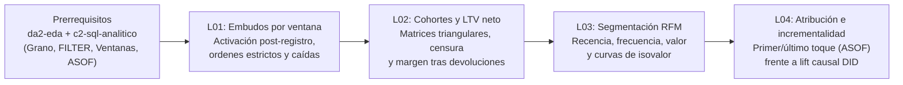

# Investigación curricular y diseño pedagógico: `da3-producto` (Analítica de producto y crecimiento)

- **Módulo**: `da3-producto` — *Analítica de producto y crecimiento*
- **Track / Nivel**: Analista de Datos (`da`) — Nivel 3 (Especialización por carrera)
- **Prerrequisitos del catálogo**: `da2-eda` (*Exploración de datos, estadística descriptiva y detección de anomalías*) y `c2-sql-analitico` (*SQL analítico: ventanas, CTEs, ASOF y pivotes*)
- **Dataset de trabajo**: **Mercado Brisa** (`customers`, `orders`, `order_items`, `products`, `refunds`, `events`, `marketing_spend`, `experiments`, `experiment_assignments`)
- **Fecha de verificación de fuentes**: `2026-10-29`

---

## Paso 1 — Investigación de fuentes primarias y secundarias por lección

Todas las URLs incluidas en esta investigación fueron verificadas mediante petición HTTP real (`status 200 OK`) con fecha de acceso `2026-10-29`. Cada lección cuenta con cuatro fuentes independientes (al menos tres primarias: artículos fundacionales revisados por pares, manuales estadísticos de referencia y documentación técnica oficial de motores analíticos).

### Lección 1 (`da3-producto-01-embudos-conversion-ventana`)
**Título de catálogo**: *Embudos de conversión por ventana temporal: caída por paso y cuellos de botella*

| # | Tipo | Título | Editor / Autor | URL | Acceso | Conceptos que respalda (`supports`) |
| --- | --- | --- | --- | --- | --- | --- |
| 1 | Primaria (Documentación oficial de producto) | *Funnels — Product Analytics Documentation* | PostHog | https://posthog.com/docs/product-analytics/funnels | `2026-10-29` | Orden secuencial estricto frente a embudos sin orden, ventana temporal de conversión (`conversion window`), grano de conteo por usuario único frente a sesión o evento crudo, y cálculo de tasas de paso y abandono. |
| 2 | Primaria (Documentación oficial SQL) | *FILTER Clause — DuckDB SQL Query Syntax* | DuckDB Foundation | https://duckdb.org/docs/sql/query_syntax/filter.html | `2026-10-29` | Agregación condicional con `COUNT(*) FILTER (WHERE ...)` y `MIN(event_ts) FILTER (WHERE ...)` para pivotar hitos de un embudo en una sola pasada sin auto-joins costosos. |
| 3 | Primaria (Documentación oficial SQL) | *Date Functions (`datediff`, `date_trunc`) — DuckDB SQL* | DuckDB Foundation | https://duckdb.org/docs/sql/functions/date.html | `2026-10-29` | Evaluación de límites de ventana temporal entre el evento ancla (`signup_date` o primer toque) y los pasos subsiguientes mediante `DATEDIFF('day', t1, t2)`. |
| 4 | Secundaria (Documentación de ciclos de activación) | *Lifecycle Insights — Product Analytics Documentation* | PostHog | https://posthog.com/docs/product-analytics/lifecycle | `2026-10-29` | Distinción entre activación inicial de nuevos registros, usuarios recurrentes, usuarios latentes y reactivados dentro de ventanas temporales acotadas. |

**Hallazgos técnicos aplicados a Mercado Brisa**:
1. **Deduplicación obligatoria antes de construir el embudo**: En `events` (`65.000` filas totales), las primeras `1.200` sesiones web emitieron eventos duplicados por reintentos de red móvil (`240` filas duplicadas por cada uno de los 5 `event_type`). Contar filas crudas sin deduplicar por `event_id` ni agrupar al grano de `customer_id` confunde volumen de telemetría con usuarios convertidos.
2. **Contaminación de `MIN(event_ts)` por eventos pre-registro (identity stitching)**: En sistemas de telemetría reales y en Mercado Brisa, los eventos de navegación previos al alta (`CAST(event_ts AS DATE) < signup_date`) quedan asociados al `customer_id` tras el registro. Si el analista calcula `MIN(event_date)` sin exigir `CAST(event_ts AS DATE) >= signup_date`, el primer evento aparente cae antes del alta y una ventana `DATEDIFF('day', signup_date, first_event_date) BETWEEN 0 AND 30` descarta erróneamente más del `88%` de los usuarios activados (p. ej., en `retail` reporta `58` activados en lugar de los `499` reales).
3. **Embudo secuencial estricto con ventana temporal**: Al exigir orden cronológico (`signup_date <= first_active_date <= first_intent_date <= first_order_date`) y ventanas cerradas (activación en `<= 30` días e intención/compra en `<= 60` días), el segmento `pro_barista` alcanza la mayor conversión global (`21,95%`, `212 / 966`), mientras `cafeteria_b2b` presenta el cuello de botella más severo en el cierre de checkout (`conv_s3_to_s4_pct = 52,41%`, cayendo de `166` clientes con intención a `87` con pedido completado).

---

### Lección 2 (`da3-producto-02-cohorts-retention-ltv`)
**Título de catálogo**: *Cohortes de retención, tablas de supervivencia y LTV con margen*
*(Limpieza profunda de `l13-cohorts-retention-ltv`, conservando `legacyId: 'l13-cohorts-retention-ltv'` y `legacyOrder: 13`, eliminando tablas ficticias `gold.fct_monthly_subscriptions` y enlaces rotos).*

| # | Tipo | Título | Editor / Autor | URL | Acceso | Conceptos que respalda (`supports`) |
| --- | --- | --- | --- | --- | --- | --- |
| 1 | Primaria (Documentación estadística y bioestadística) | *Survival Analysis with lifelines (Kaplan-Meier & Right-Censoring)* | Cam Davidson-Pilon (`lifelines`) | https://lifelines.readthedocs.io/en/latest/Survival%20analysis%20with%20lifelines.html | `2026-10-29` | Función de supervivencia $S(t)$, censura por la derecha (*right-censoring*) cuando la ventana de observación termina antes de que una cohorte cumpla el horizonte $t$, y sesgo por tratar periodos no observados como ceros. |
| 2 | Primaria (Artículo académico fundacional) | *"Counting Your Customers" the Easy Way: An Alternative to the Pareto/NBD Model* | Peter S. Fader, Bruce G. S. Hardie & Ka Lok Lee (*Marketing Science*, 24(2), 275-284) | https://www.brucehardie.com/papers/018/fader_et_al_mksc_05.pdf | `2026-10-29` | Dinámica de recompra y supervivencia en contextos no contractuales (comercio minorista donde la baja no se notifica explícitamente) y formulación del valor de vida del cliente (CLV/LTV). |
| 3 | Primaria (Documentación oficial de producto) | *Retention — Product Analytics Documentation* | PostHog | https://posthog.com/docs/product-analytics/retention | `2026-10-29` | Construcción de matrices triangulares de retención por cohorte de adquisición o primera acción, cálculo del periodo relativo (`offset` 0, 1, 2...) y denominador fijo por tamaño inicial de cohorte. |
| 4 | Primaria (Documentación oficial SQL) | *Window Functions — DuckDB SQL Documentation* | DuckDB Foundation | https://duckdb.org/docs/sql/functions/window_functions.html | `2026-10-29` | Uso de funciones de ventana y agregaciones por partición para acumular ingresos y márgenes a lo largo de la edad de cada cohorte. |

**Hallazgos técnicos aplicados a Mercado Brisa**:
1. **Nota de limpieza profunda**: La versión heredada (`l13-cohorts-retention-ltv`) utilizaba tablas inexistentes en el laboratorio (`gold.fct_monthly_subscriptions` y `subscriptions`), carecía de la propiedad `id` en los elementos de `pipelineChallenge.steps`, incluía un enlace roto (`https://docs.statsig.com/pulse/retention/` devolviendo HTTP 404) y tenía una media de `26,1` palabras por frase con apariciones literales del año prohibido en el cuerpo. Se reescribió íntegramente sobre las tablas reales de Mercado Brisa (`customers`, `orders`, `order_items`, `products`, `refunds`).
2. **Matrices triangulares y censura por la derecha**: En las cohortes trimestrales de primera compra completada de 2024 (`2024-01` con `470` clientes, `2024-04` con `401`, `2024-07` con `218` y `2024-10` con `96`), todas las cohortes tienen al menos 4 trimestres completos observados antes del cierre del dataset (`2025-11-26`). En cambio, en las cohortes de 2025 (`2025-01`, `2025-04`, `2025-07`), los trimestres futuros aún no han concluido y deben enmascararse con `NULL` para no confundir tiempo no transcurrido con caída de retención.
3. **LTV bruto frente a LTV neto de coste de producto y devoluciones (aislamiento de grano `1:N`)**: Un pedido en `orders` se relaciona `1:N` con `order_items` (`42.000` líneas) y `1:N` con `refunds` (`1.450` devoluciones en `1.150` pedidos; `300` pedidos tienen dos devoluciones parciales). Preagregando el coste (`SUM(qty * unit_cost_usd)`) y las devoluciones procesadas (`SUM(refund_amount_usd)`) por `order_id` antes de unir con `orders`, el LTV medio bruto en `cafeteria_b2b` (`$2.825,71`) se reduce a un LTV neto de margen de `$1.439,14` (`50,93%` de margen neto realizado), en `pro_barista` pasa de `$2.601,38` a `$1.295,90` (`49,82%`), y en `retail` pasa de `$2.520,09` a `$1.265,62` (`50,22%`). Fijar un límite de CAC sobre el ingreso bruto destruiría la rentabilidad unitaria.

---

### Lección 3 (`da3-producto-03-segmentacion-conductual-rfm`)
**Título de catálogo**: *Segmentación conductual y RFM (recencia, frecuencia y valor monetario)*

| # | Tipo | Título | Editor / Autor | URL | Acceso | Conceptos que respalda (`supports`) |
| --- | --- | --- | --- | --- | --- | --- |
| 1 | Primaria (Artículo académico fundacional) | *RFM and CLV: Using Iso-Value Curves for Customer Base Analysis* | Peter S. Fader, Bruce G. S. Hardie & Ka Lok Lee (*Journal of Marketing Research*, 42(4), 415-430) | https://www.brucehardie.com/papers/rfm_clv_2005-02-16.pdf | `2026-10-29` | Relación formal entre las tres métricas suficientes del historial transaccional (Recencia $R$, Frecuencia $F$ y Valor Monetario $M$) y el valor futuro esperado mediante curvas de isovalor, incluyendo la paradoja de clientes con alta frecuencia histórica pero baja recencia. |
| 2 | Primaria (Notas técnicas cuantitativas) | *Technical Notes on Customer-Base Analysis (RFM, BG/NBD, Gamma-Gamma)* | Bruce G. S. Hardie (London Business School) | https://www.brucehardie.com/notes/ | `2026-10-29` | Definición operativa de recencia transaccional respecto a una fecha de corte fija ($T$) y separación entre frecuencia de pedidos y gasto monetario acumulado. |
| 3 | Primaria (Documentación oficial SQL) | *Window Functions (`NTILE`, `ORDER BY` determinista) — DuckDB SQL* | DuckDB Foundation | https://duckdb.org/docs/sql/functions/window_functions.html | `2026-10-29` | Discretización por cuantiles mediante `NTILE(4) OVER (ORDER BY ...)`, inversión del orden en recencia (`ORDER BY recency_days DESC`) para que el cuartil 4 represente la compra más reciente, y desempate determinista por clave primaria (`customer_id ASC`). |
| 4 | Primaria (Documentación oficial SQL) | *Aggregate Functions — DuckDB SQL Documentation* | DuckDB Foundation | https://duckdb.org/docs/sql/functions/aggregates.html | `2026-10-29` | Cálculo de métricas de resumen por cliente (`MAX(order_date)`, `COUNT(order_id)`, `SUM(total_usd)`) y cuota de ingresos sobre el total mediante suma de ventana `SUM(SUM(monetary_usd)) OVER ()`. |

**Hallazgos técnicos aplicados a Mercado Brisa**:
1. **Obsolescencia de las etiquetas estáticas de catálogo frente al comportamiento real**: Al cruzar el segmento declarado en `customers.segment` (`cafeteria_b2b`, `pro_barista`, `retail`) con la actividad real a fecha de corte `2025-12-01` sobre los `2.292` clientes con compras completadas, entre el `22,01%` (`pro_barista`) y el `25,69%` (`cafeteria_b2b`) llevan más de `180` días sin comprar. Una etiqueta demográfica o de alta no detecta el abandono silencioso.
2. **Dirección de ordenación en `NTILE(4)` y determinismo en empates**: Menor número de días desde la última compra (`recency_days`) implica mayor salud conductual. Por ello, `r_score` debe ordenarse con `ORDER BY recency_days DESC, customer_id ASC` para que el cuartil `4` agrupe a los clientes más recientes (`avg_recency_days = 18,8` días en `1_Campeones`), mientras `f_score` y `m_score` se ordenan en sentido ascendente (`ORDER BY frequency_orders ASC, monetary_usd ASC, customer_id ASC`).
3. **Concentración de ingresos en el segmento en riesgo**: En Mercado Brisa, el segmento `3_En_Riesgo_Alto_Valor` (`r_score <= 2` y `(f_score >= 3 OR m_score >= 4)`) agrupa a `445` clientes con una media de `8,37` pedidos y `$3.685,18` de gasto histórico, concentrando `$1.639.906,25` (`26,16%` del ingreso total de la compañía), a pesar de llevar en promedio `180,3` días inactivos. Es el grupo con mayor retorno potencial ante una campaña de reactivación selectiva.

---

### Lección 4 (`da3-producto-04-atribucion-marketing-incrementalidad`)
**Título de catálogo**: *Atribución de marketing (primer toque, último toque, ASOF) e incrementalidad*

| # | Tipo | Título | Editor / Autor | URL | Acceso | Conceptos que respalda (`supports`) |
| --- | --- | --- | --- | --- | --- | --- |
| 1 | Primaria (Documentación oficial SQL) | *ASOF JOIN — DuckDB SQL Query Syntax* | DuckDB Foundation | https://duckdb.org/docs/sql/query_syntax/from.html#asof-join | `2026-10-29` | Emparejamiento temporal `ASOF LEFT JOIN` para asociar cada pedido con el toque de campaña inmediatamente anterior o simultáneo (`o.order_ts >= tp.event_ts`) por `customer_id`, aplicando ventanas de caducidad post-join. |
| 2 | Primaria (Documentación técnica de referencia SQL) | *ASOF JOIN — Snowflake SQL Reference* | Snowflake | https://docs.snowflake.com/en/sql-reference/constructs/asof-join | `2026-10-29` | Semántica formal del operador `ASOF JOIN` en series temporales e historiales de eventos de usuario, evitando explosiones cartesianas o subconsultas correlacionadas lentas. |
| 3 | Primaria (Artículo académico de economía experimental) | *Ghost Ads: Improving the Economics of Measuring Online Ad Effectiveness* | Garrett A. Johnson, Randall A. Lewis & Elmar I. Nubbemeyer (NBER Working Paper w21303 / *Journal of Marketing Research*) | https://www.nber.org/papers/w21303 | `2026-10-29` | Sesgo de selección y canibalización orgánica en modelos de atribución correlacional (último toque), necesidad de grupos de control aleatorizados (*holdout*) y estimación del *lift* causal incremental. |
| 4 | Primaria (Documentación técnica de medición causal de marketing) | *Meridian — Open-Source Marketing Mix Modeling and Incrementality Calibration* | Google Developers | https://developers.google.com/meridian | `2026-10-29` | Discrepancia entre ROAS atribuido por toques y ROAS incremental real calibrado mediante experimentos causales y diferencia en diferencias (DID). |

**Hallazgos técnicos aplicados a Mercado Brisa**:
1. **Implementación de Primer Toque (`ARG_MIN`) vs. Último Toque con ventana (`ASOF LEFT JOIN`)**: En `events`, cada interacción con campaña registrada (`campaign_id IS NOT NULL`) representa un punto de contacto. Mediante `ARG_MIN(campaign_id, event_ts)` se obtiene la campaña de primer toque histórico de cada cliente; mediante `ASOF LEFT JOIN` con `o.order_ts >= tp.event_ts` y una restricción de ventana de `DATEDIFF('hour', tp.event_ts, o.order_ts) <= 24` se obtiene el último toque válido antes del pedido.
2. **Sesgo de último toque en el ROAS aparente (ventana de gasto 2024: `2024-01-01` a `2024-10-17`)**: Al cruzar los pedidos completados de ese periodo con `marketing_spend`, la campaña de mayor presupuesto, `CMP-VERANO` (`$109.839,33` en `paid_social` y `display_video`), genera solo `$105.682,79` bajo primer toque (`ft_roas = 0,96`, destructora de valor bruto), pero bajo último toque a 24 horas reclama `$167.970,62` (`lt_roas = 1,53`, `+$62.287,83` adicionales) al capturar usuarios que ya habían sido originados por `CMP-ORIGEN`, `CMP-BARISTA` o `CMP-RETENCION`.
3. **Incrementalidad causal y Diferencia en Diferencias (DID) con control de SRM**: En las tablas `experiments` y `experiment_assignments`, comparar únicamente el gasto post-asignación (`naive_post_diff_usd`) introduce ruido preexistente entre variantes. Al calcular el estimador de Diferencia en Diferencias $\text{DID} = (\bar{Y}_{\text{treat, post}} - \bar{Y}_{\text{treat, pre}}) - (\bar{Y}_{\text{ctrl, post}} - \bar{Y}_{\text{ctrl, pre}})$, `EXP-CHECKOUT-1STEP` demuestra el mayor lift causal (`+$7,47` por usuario tratado, `$5.976,12` de ingreso incremental en los `800` usuarios de tratamiento). Además, el experimento `EXP-PUSH-CART` (`experiment_id = 6`) debe invalidarse antes de estimar cualquier lift porque presenta un fallo severo de asignación (*Sample Ratio Mismatch*, `980` en control frente a `620` en tratamiento, `srm_p_value = 0,0001`).

---

## Paso 2 — Mapa de progresión conceptual y conexión con prerrequisitos

El módulo `da3-producto` se apoya directamente en las competencias adquiridas en `da2-eda` (auditoría de grano, distribuciones asimétricas, tasas ponderadas y diario reproducible) y `c2-sql-analitico` (`ROW_NUMBER`, `NTILE`, `FILTER`, CTEs modulares y `ASOF JOIN`), organizando el ciclo de vida del cliente en cuatro eslabones progresivos:

| Lección | Concepto central | Herramientas SQL clave | Error analítico que previene | Conexión con la siguiente lección |
| --- | --- | --- | --- | --- |
| `da3-producto-01` | Embudo secuencial estricto con ventana temporal desde el alta | `DISTINCT`, `MIN(...) FILTER (WHERE ...)`, `DATEDIFF` | Contar eventos duplicados de red o permitir que eventos pre-registro anulen la ventana de activación | Quienes superan el embudo inicial de compra pasan a formar las cohortes de retención de L02 |
| `da3-producto-02` | Retención por cohorte, censura por la derecha y LTV neto de margen | `DATE_TRUNC`, `DATEDIFF('quarter', ...)`, preagregación CTE `1:N` | Promediar cohortes censuradas con maduras o fijar el CAC sobre ingresos brutos ignorando coste y devoluciones | La caída heterogénea dentro de cada cohorte motiva desagregar clientes individuales mediante RFM en L03 |
| `da3-producto-03` | Matriz conductual RFM y paradoja de alta frecuencia sin recencia | `NTILE(4) OVER (ORDER BY ...)`, `MAX(order_date)`, suma de ventana | Confiar en etiquetas estáticas de alta (`segment`) o invertir el signo de `recency_days` al calcular cuantiles | Identificar segmentos valiosos y en riesgo exige saber qué campañas traen y reactivan clientes de verdad en L04 |
| `da3-producto-04` | Atribución determinista (`ASOF JOIN`) frente a incrementalidad causal (DID) | `ARG_MIN`, `ASOF LEFT JOIN`, diferencia en diferencias sobre `experiment_assignments` | Asignar presupuesto guiándose por el ROAS de último toque que canibaliza demanda orgánica o ignorar fallos SRM | Cierra el ciclo de producto y crecimiento integrando adquisición, activación, retención y causalidad |

---

## Paso 6 — Proyecto integrador del módulo y rúbrica de evaluación

### Enunciado del proyecto: Auditoría de crecimiento, valor de vida y asignación de presupuesto en Mercado Brisa

El comité de dirección de **Mercado Brisa** debe aprobar el plan de inversión comercial del próximo semestre. El equipo de marketing solicita ampliar el presupuesto de la campaña `CMP-VERANO` argumentando que su retorno sobre gasto publicitario (ROAS) de último toque supera `1,5x`, mientras el equipo de producto sostiene que el problema principal está en la conversión de checkout del segmento B2B y en la inactividad silenciosa de clientes históricos de alto valor.

Como analista de datos de producto y crecimiento, debes entregar un diagnóstico reproducible en DuckDB sobre el dataset **Mercado Brisa** estructurado en cuatro bloques verificables:

#### Bloque 1 — Embudo de conversión estricto por ventana temporal (`da3-producto-01`)
Construye el embudo post-registro por `segment` (`retail`, `pro_barista`, `cafeteria_b2b`) sobre los `2.400` clientes registrados:
1. Deduplica `events` por `event_id` y filtra exclusivamente interacciones ocurridas a partir de la fecha de alta (`CAST(e.event_ts AS DATE) >= c.signup_date`).
2. Calcula los cuatro pasos secuenciales:
   - `s1_signups`: clientes registrados.
   - `s2_active_30d`: primer evento post-registro en `<= 30` días desde `signup_date`.
   - `s3_intent_60d`: primer evento `add_to_cart` o `checkout_started` ocurrido en o después de `s2` y en `<= 60` días desde `signup_date`.
   - `s4_ordered_60d`: primer pedido con `status = 'completed'` ocurrido en o después de `s3` y en `<= 60` días desde `signup_date`.
3. Reporta las tasas de paso `conv_s2_to_s3_pct`, `conv_s3_to_s4_pct` y la conversión global `overall_conv_pct`.

**Resultado de referencia verificado en DuckDB**:
- `retail`: `967` registros -> `499` activos 30d -> `315` con intención 60d (`63,13%`) -> `176` con compra 60d (`55,87%` desde intención; `18,20%` global).
- `pro_barista`: `966` registros -> `514` activos 30d -> `339` con intención 60d (`65,95%`) -> `212` con compra 60d (`62,54%` desde intención; `21,95%` global).
- `cafeteria_b2b`: `467` registros -> `255` activos 30d -> `166` con intención 60d (`65,10%`) -> `87` con compra 60d (`52,41%` desde intención; `18,63%` global). El mayor cuello de botella de cierre ocurre en `cafeteria_b2b` entre intención y pago (`47,59%` de caída).

#### Bloque 2 — Retención trimestral sin censura y LTV ajustado por margen (`da3-producto-02`)
1. Construye la matriz de retención trimestral (`Q+0` a `Q+3`) de las cohortes de primera compra completada del año 2024 (`2024-01`, `2024-04`, `2024-07`, `2024-10`) y verifica por qué las cohortes de 2025 presentan celdas censuradas por la derecha antes del corte del dataset (`2025-11-26`).
2. Calcula por `segment` el LTV bruto medio (`avg_gross_ltv_usd`) y el LTV neto de margen (`avg_margin_ltv_usd`), descontando el coste de mercancía vendida (`qty * unit_cost_usd` preagregado desde `order_items` y `products`) y las devoluciones con `status = 'processed'` (preagregadas desde `refunds` por `order_id` para evitar fan-out `1:N`).

**Resultado de referencia verificado en DuckDB**:
- Retención en `Q+3` de las cohortes 2024: `2024-01` (`470` clientes) retiene `52,98%`; `2024-04` (`401` clientes) retiene `61,60%`; `2024-07` (`218` clientes) retiene `61,93%`; `2024-10` (`96` clientes) retiene `63,54%`.
- LTV bruto frente a LTV neto de margen:
  - `cafeteria_b2b` (`467` clientes): LTV bruto `$2.825,71` vs. LTV neto `$1.439,14` (`50,93%` de margen neto).
  - `pro_barista` (`966` clientes): LTV bruto `$2.601,38` vs. LTV neto `$1.295,90` (`49,82%` de margen neto).
  - `retail` (`967` clientes): LTV bruto `$2.520,09` vs. LTV neto `$1.265,62` (`50,22%` de margen neto).

#### Bloque 3 — Segmentación conductual RFM a fecha de corte `2025-12-01` (`da3-producto-03`)
Sobre los `2.292` clientes con al menos un pedido completado, calcula `recency_days` respecto a `DATE '2025-12-01'`, `frequency_orders` y `monetary_usd`. Asigna cuartiles `NTILE(4)` deterministas (`r_score` ordenando `recency_days DESC, customer_id ASC`; `f_score` y `m_score` en orden ascendente) y clasifica en los 5 segmentos estándar.

**Resultado de referencia verificado en DuckDB**:
- `1_Campeones`: `105` clientes (`18,8` días de recencia media, `9,21` pedidos, `$5.058,77` de gasto medio, `8,47%` de cuota de ingresos).
- `2_Leales`: `613` clientes (`45,9` días, `8,52` pedidos, `$3.396,75`, `33,21%` de cuota).
- `3_En_Riesgo_Alto_Valor`: `445` clientes (`180,3` días sin comprar, `8,37` pedidos, `$3.685,18`, `$1.639.906,25` acumulados equivalente al `26,16%` del ingreso total).
- `4_Recientes_En_Desarrollo`: `428` clientes (`46,5` días, `4,30` pedidos, `$1.770,58`, `12,09%` de cuota).
- `5_Inactivos_Bajo_Valor`: `701` clientes (`229,1` días, `4,29` pedidos, `$1.795,11`, `20,07%` de cuota).

#### Bloque 4 — Atribución `ASOF JOIN` frente a incrementalidad experimental (`da3-producto-04`)
1. En la ventana cubierta por `marketing_spend` (`2024-01-01` a `2024-10-17`), compara para cada `campaign_id` el ROAS de primer toque (`ARG_MIN(campaign_id, event_ts)`) frente al ROAS de último toque con ventana de 24 horas (`ASOF LEFT JOIN` con `o.order_ts >= tp.event_ts` y `DATEDIFF('hour', tp.event_ts, o.order_ts) <= 24`).
2. Evalúa los 6 experimentos de `experiments` y `experiment_assignments` calculando el estimador de Diferencia en Diferencias (`did_incremental_usd`) y descartando experimentos con fallo SRM (`srm_p_value < 0.001`).

**Resultado de referencia verificado en DuckDB**:
- En atribución 2024, `CMP-VERANO` (`$109.839,33` de gasto) pasa de `ft_roas = 0,96` (`$105.682,79`) a `lt_roas = 1,53` (`$167.970,62`) porque captura el último clic de usuarios ya originados por `CMP-ORIGEN` (`ft_roas = 13,96` vs. `lt_roas = 6,08`), `CMP-BARISTA` (`31,61` vs. `14,23`) y `CMP-RETENCION` (`53,35` vs. `32,19`).
- En los experimentos causales válidos (`srm_p_value > 0.05`), `EXP-CHECKOUT-1STEP` genera `+$7,47` de gasto incremental DID por usuario tratado (`$5.976,12` totales), resolviendo precisamente la fricción de pago detectada en el Bloque 1, mientras `EXP-PUSH-CART` se descarta por SRM (`980` control vs. `620` tratamiento, `srm_p_value = 0,0001`).

---

### Rúbrica de evaluación del proyecto (4 criterios, escala 0–4)

| Criterio | 0 — No entregado / Erróneo | 1 — Insuficiente | 2 — Básico / Funcional con sesgos | 3 — Sólido (Nivel profesional) | 4 — Excelente (Rigor técnico completo) |
| --- | --- | --- | --- | --- | --- |
| **1. Higiene de eventos y embudo por ventana temporal (L01)** | Cuenta filas crudas de `events` sin agrupar por cliente ni filtrar pasos. | Agrupa por cliente pero no deduplica `event_id` ni exige orden temporal entre pasos. | Exige orden entre pasos pero calcula `MIN(event_ts)` sin filtrar `event_date >= signup_date`, subestimando la activación por eventos pre-registro. | Deduplica `events`, filtra `event_date >= signup_date`, impone orden cronológico estricto y ventanas de 30/60 días por `segment`. | Además de la consulta exacta, cuantifica el sesgo evitado (`499` vs `58` activados en `retail`) e identifica el cuello de botella de checkout en `cafeteria_b2b` (`52,41%`). |
| **2. Cohortes sin censura y LTV neto sin fan-out (L02)** | Calcula LTV sobre todos los estados de pedido o hace `JOIN` directo `orders -> order_items -> refunds` multiplicando filas. | Filtra `status = 'completed'` pero omite el coste unitario (`unit_cost_usd`) o las devoluciones procesadas. | Preagrega `order_items` o `refunds` parcialmente, o incluye cohortes incompletas de 2025 en el promedio de retención anual sin marcar censura. | Construye la matriz trimestral de 2024 sin sesgo de censura y calcula el LTV neto preagregando tanto COGS como devoluciones en CTEs independientes por `order_id`. | Conecta el margen neto real (`~50%` del ingreso bruto) con el techo máximo de CAC sostenible por segmento y documenta la regla de corte temporal para cohortes censuradas. |
| **3. Discretización determinista y accionabilidad RFM (L03)** | Clasifica clientes usando únicamente el gasto total o la etiqueta estática `customers.segment`. | Calcula R, F y M pero ordena `NTILE(4)` de recencia en sentido ascendente (`ASC`), asignando `r_score = 4` a los clientes más inactivos. | Ordena correctamente `recency_days DESC` pero omite criterios de desempate deterministas (`customer_id ASC`) o no aísla el segmento en riesgo de alto valor. | Calcula R, F y M a fecha `2025-12-01` con `NTILE(4)` determinista y segmenta en las 5 categorías, identificando los `445` clientes de `3_En_Riesgo_Alto_Valor`. | Demuestra con curvas de isovalor por qué los `445` clientes en riesgo (`$1,64M`, `26,16%` del ingreso) tienen prioridad de inversión sobre los `701` inactivos de bajo valor. |
| **4. Atribución `ASOF JOIN` vs. causalidad experimental (L04)** | Usa un `INNER JOIN` o `LEFT JOIN` sin restricción temporal que multiplica pedidos por cada evento histórico del cliente. | Empareja eventos previos con subconsultas pero no impone ventana de caducidad (24h) ni compara contra primer toque. | Ejecuta `ASOF LEFT JOIN` con ventana de 24h y compara ROAS contra primer toque, pero evalúa los experimentos por diferencia simple post-experimento o incluye `EXP-PUSH-CART`. | Contrasta primer toque (`ARG_MIN`) y último toque (`ASOF LEFT JOIN` 24h) explicando la inflación de `CMP-VERANO` (`0,96` a `1,53`), calcula el estimador DID y descarta `EXP-PUSH-CART` por SRM. | Formula una recomendación ejecutiva integrada: recortar gasto no incremental en `CMP-VERANO`, desplegar `EXP-CHECKOUT-1STEP` para corregir el embudo B2B y financiar reactivación del segmento RFM en riesgo. |
