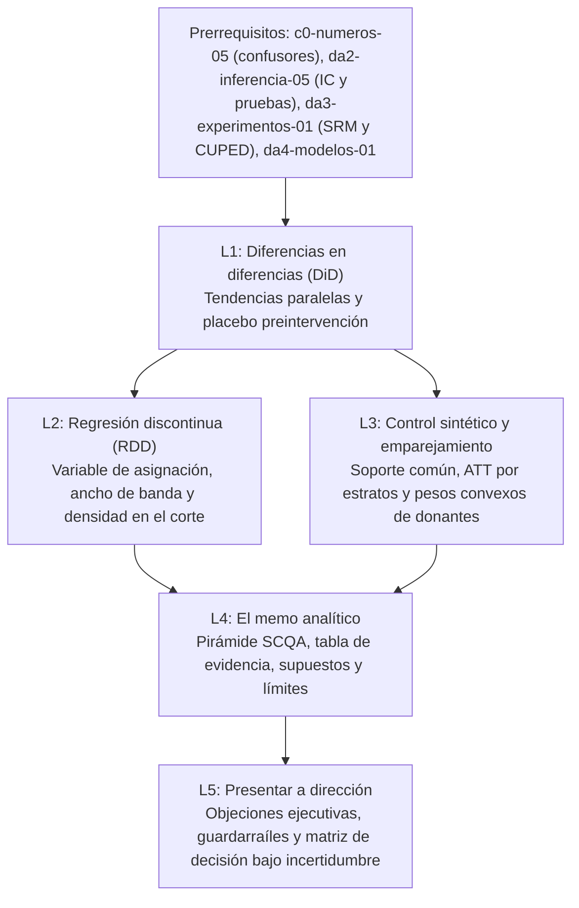

# Investigación Curricular — Módulo `da4-causalidad`: Inferencia causal y comunicación ejecutiva

- **Módulo:** `da4-causalidad`
- **Título:** Inferencia causal y comunicación ejecutiva
- **Ruta y nivel:** Analista de Datos (`da`), Nivel 4 (`Analista de datos senior`)
- **Duración total:** 115 minutos (5 lecciones: 25 + 25 + 25 + 20 + 20 min)
- **Prerrequisitos del módulo:** `da4-modelos`, `da3-experimentos`, `da2-inferencia`, `c0-numeros`
- **Datasets utilizados:** `orders`, `stores`, `calendar`, `marketing_spend`, `experiments`, `experiment_assignments`, `refunds`
- **Fecha de investigación y verificación:** `2026-10-29`

---

## Paso 1 — Investigación web de fuentes reales y verificadas (`HTTP 200`)

Todas las fuentes listadas a continuación fueron verificadas mediante petición HTTP real (`200 OK`) el `2026-10-29`. Cada lección cuenta con al menos 3 fuentes (mínimo 2 primarias de literatura econométrica/estadística y documentación oficial de DuckDB).

### Lección 1 (`da4-causalidad-01-diferencias-en-diferencias-did`)
1. **Scott Cunningham — *Causal Inference: The Mixtape*, Cap. 9: Difference-in-Differences** (Primaria)
   - URL: https://mixtape.scunning.com/09-Difference_in_Differences.html (`HTTP 200`, consultado `2026-10-29`)
   - Respalda: Formulación de resultados potenciales para el estimador DiD $2 \times 2$, descomposición del sesgo de selección e identificación bajo tendencias paralelas.
2. **Nick Huntington-Klein — *The Effect: An Introduction to Research Design and Causality*, Cap. 18: Difference-in-Differences** (Primaria)
   - URL: https://theeffectbook.net/ch-DifferenceinDifference.html (`HTTP 200`, consultado `2026-10-29`)
   - Respalda: Evaluación del supuesto de tendencias paralelas, pruebas de placebo en periodos previos (*pre-trend placebo tests*) y amenaza de choques concurrentes variantes en el tiempo.
3. **Matheus Facure — *Causal Inference for the Brave and True*, Cap. 13: Difference-in-Differences** (Secundaria)
   - URL: https://matheusfacure.github.io/python-causality-handbook/13-Difference-in-Differences.html (`HTTP 200`, consultado `2026-10-29`)
   - Respalda: Interpretación aplicada del contrafactual aditivo en intervenciones comerciales de tiendas y ciudades.
4. **DuckDB Documentation — *Aggregate Functions (`FILTER` clause and statistical aggregates)*** (Primaria técnica)
   - URL: https://duckdb.org/docs/stable/sql/functions/aggregates (`HTTP 200`, consultado `2026-10-29`)
   - Respalda: Cálculo declarativo de medias pre/post por cohorte mediante `AVG(col) FILTER (WHERE ...)` en SQL.

### Lección 2 (`da4-causalidad-02-regresion-discontinua-rdd`)
1. **Scott Cunningham — *Causal Inference: The Mixtape*, Cap. 6: Regression Discontinuity** (Primaria)
   - URL: https://mixtape.scunning.com/06-Regression_Discontinuity.html (`HTTP 200`, consultado `2026-10-29`)
   - Respalda: Definición de variable de asignación (*running variable*), diseño nítido (*Sharp RDD*) frente a difuso (*Fuzzy RDD*) y prueba de continuidad de densidad de McCrary contra manipulación en el umbral.
2. **Nick Huntington-Klein — *The Effect*, Cap. 20: Regression Discontinuity** (Primaria)
   - URL: https://theeffectbook.net/ch-RegressionDiscontinuity.html (`HTTP 200`, consultado `2026-10-29`)
   - Respalda: Centrado de la variable de asignación en el punto de corte ($X_c = X - c$), ajuste lineal local por lado y elección del ancho de banda (*bandwidth*).
3. **Matias D. Cattaneo, Nicolás Idrobo & Rocío Titiunik — *RD Packages: A Practical Introduction to Regression Discontinuity Designs*** (Primaria)
   - URL: https://rdpackages.github.io/ (`HTTP 200`, consultado `2026-10-29`)
   - Respalda: Compromiso sesgo-varianza al restringir la ventana alrededor del umbral y pruebas de falsación de densidad y covariables.
4. **DuckDB Documentation — *Aggregate Functions (`REGR_SLOPE`, `REGR_INTERCEPT`)*** (Primaria técnica)
   - URL: https://duckdb.org/docs/stable/sql/functions/aggregates (`HTTP 200`, consultado `2026-10-29`)
   - Respalda: Estimación de rectas lineales locales a izquierda y derecha del umbral directamente en SQL con `REGR_INTERCEPT(y, x - c)` y `REGR_SLOPE(y, x - c)`.

### Lección 3 (`da4-causalidad-03-control-sintetico-emparejamiento`)
1. **Scott Cunningham — *Causal Inference: The Mixtape*, Cap. 11: Synthetic Control** (Primaria)
   - URL: https://mixtape.scunning.com/11-Synthetic_Control.html (`HTTP 200`, consultado `2026-10-29`)
   - Respalda: Construcción del gemelo sintético de Abadie, Diamond y Hainmueller como combinación convexa del grupo donante ($\sum w_j = 1, w_j \ge 0$), ajuste preintervención (RMSPE) y placebos en el espacio.
2. **Nick Huntington-Klein — *The Effect*, Cap. 14: Matching** (Primaria)
   - URL: https://theeffectbook.net/ch-Matching.html (`HTTP 200`, consultado `2026-10-29`)
   - Respalda: Emparejamiento exacto y por celdas (*coarsened exact matching*), verificación del soporte común (*common support*) y ponderación por pesos del grupo tratado para estimar el ATT.
3. **Matheus Facure — *Causal Inference for the Brave and True*, Cap. 15: Synthetic Control** (Secundaria)
   - URL: https://matheusfacure.github.io/python-causality-handbook/15-Synthetic-Control.html (`HTTP 200`, consultado `2026-10-29`)
   - Respalda: Contraste entre regresión sin restricciones (extrapolación) y pesos convexos acotados en intervenciones de una sola unidad comercial.
4. **DuckDB Documentation — *Window Functions (`OVER`) and `WITH` CTEs*** (Primaria técnica)
   - URL: https://duckdb.org/docs/stable/sql/functions/window_functions (`HTTP 200`, consultado `2026-10-29`)
   - Respalda: Cálculo de pesos de estrato $N_{T,s} / \sum_s N_{T,s}$ mediante funciones de ventana `SUM(n_tratados) OVER ()`.

### Lección 4 (`da4-causalidad-04-memo-analitico-supuestos`)
1. **Miguel A. Hernán & James M. Robins — *Causal Inference: What If*** (Primaria)
   - URL: https://miguelhernan.org/whatifbook (`HTTP 200`, consultado `2026-10-29`)
   - Respalda: Emulación de ensayo diana (*target trial emulation*), declaración explícita de supuestos de intercambiabilidad, positividad y consistencia, y distinción entre validez interna y transporte externo.
2. **Nick Huntington-Klein — *The Effect*, Cap. 5: Identification** (Primaria)
   - URL: https://theeffectbook.net/ch-Identification.html (`HTTP 200`, consultado `2026-10-29`)
   - Respalda: Separación entre estimación estadística e identificación causal, y documentación transparente de amenazas al diseño.
3. **STROBE Initiative — *Strengthening the Reporting of Observational Studies in Epidemiology*** (Primaria)
   - URL: https://www.strobe-statement.org/ (`HTTP 200`, consultado `2026-10-29`)
   - Respalda: Estándares internacionales para reportar estudios observacionales: diseño, tamaño muestral, sesgos potenciales, análisis de sensibilidad y límites de generalización.
4. **DuckDB Documentation — *`WITH` Clause (Common Table Expressions)*** (Primaria técnica)
   - URL: https://duckdb.org/docs/stable/sql/query_syntax/with (`HTTP 200`, consultado `2026-10-29`)
   - Respalda: Estructuración modular de tablas de evidencia autosuficientes que consolidan balance basal, efecto ajustado, intervalo de confianza y diagnósticos de validez.

### Lección 5 (`da4-causalidad-05-presentacion-direccion-decisiones`)
1. **Ron Kohavi, Diane Tang & Ya Xu — *Trustworthy Online Controlled Experiments: A Practical Guide to A/B Testing*** (Primaria)
   - URL: https://experimentguide.com/ (`HTTP 200`, consultado `2026-10-29`)
   - Respalda: Reglas de lanzamiento basadas en métricas primarias y guardarraíles (*guardrail metrics*), memoria institucional y costos de subsidio.
2. **Nick Huntington-Klein — *The Effect*, Cap. 10: Treatment Effects & Cap. 21: Partial Identification** (Primaria)
   - URL: https://theeffectbook.net/ch-TreatmentEffects.html (`HTTP 200`, consultado `2026-10-29`)
   - Respalda: Diferencia operativa entre ATE, ATT y LATE al responder objeciones sobre por qué un efecto local en el umbral no se extrapola sin pérdida de margen a toda la cartera.
3. **Scott Cunningham — *Causal Inference: The Mixtape*, Cap. 4: Potential Outcomes** (Primaria)
   - URL: https://mixtape.scunning.com/04-Potential_Outcomes_and_Randomization.html (`HTTP 200`, consultado `2026-10-29`)
   - Respalda: Heterogeneidad de efectos de tratamiento, sesgo de selección y límites de extrapolación fuera de la subpoblación tratada.
4. **DuckDB Documentation — *`CASE` Statement and Conditional Expressions*** (Primaria técnica)
   - URL: https://duckdb.org/docs/stable/sql/expressions/case (`HTTP 200`, consultado `2026-10-29`)
   - Respalda: Codificación determinista de matrices de decisión bajo incertidumbre que cruzan escenarios del IC del 95 %, costos de equilibrio y alertas de guardarraíl.

---

## Paso 2 — Mapa de conceptos y tabla de progresión del módulo

### Mapa conceptual (Mermaid)

### Tabla de progresión de las 5 lecciones

| Orden | ID de lección | Título corto (`<= 60` car.) | Duración | Concepto nuevo central | Tablas de Mercado Brisa | Prerrequisitos directos |
| :--- | :--- | :--- | :--- | :--- | :--- | :--- |
| 1 | `da4-causalidad-01-diferencias-en-diferencias-did` | `Diferencias en diferencias (DiD) y tendencias paralelas` | 25 min | Estimador DiD $2 \times 2$, supuesto de tendencias paralelas y prueba de placebo preintervención ($t_{-2} \to t_{-1}$) | `orders`, `stores`, `calendar`, `marketing_spend` | `da4-modelos-01`, `da2-inferencia-05-pruebas-hipotesis-valor-p`, `c0-numeros-05-correlacion-causalidad` |
| 2 | `da4-causalidad-02-regresion-discontinua-rdd` | `Regresión discontinua (RDD) alrededor de un umbral` | 25 min | Diseño RDD nítido y difuso, centrado en el umbral ($X - c$), ancho de banda local y chequeo de manipulación de densidad | `orders`, `stores` | `da4-causalidad-01-diferencias-en-diferencias-did` |
| 3 | `da4-causalidad-03-control-sintetico-emparejamiento` | `Control sintético y emparejamiento (matching) en tiendas` | 25 min | Emparejamiento exacto por celdas (ATT y soporte común) y control sintético convexo de tiendas donantes | `orders`, `stores`, `calendar` | `da4-causalidad-01-diferencias-en-diferencias-did`, `da4-causalidad-02-regresion-discontinua-rdd` |
| 4 | `da4-causalidad-04-memo-analitico-supuestos` | `El memo analítico: estructura, supuestos y límites` | 20 min | Estructura piramidal SCQA, tabla de evidencia autosuficiente y separación entre validez interna y externa | `orders`, `stores`, `calendar`, `marketing_spend`, `experiments`, `experiment_assignments` | `da4-causalidad-02-regresion-discontinua-rdd`, `da4-causalidad-03-control-sintetico-emparejamiento` |
| 5 | `da4-causalidad-05-presentacion-direccion-decisiones` | `Presentar a dirección: objeciones y opciones de acción` | 20 min | Escenarios financieros del IC 95 % frente al umbral de rentabilidad, auditoría de guardarraíles y matriz de decisión | `orders`, `stores`, `refunds`, `experiments`, `experiment_assignments` | `da4-causalidad-04-memo-analitico-supuestos` |

---

## Paso 4 — Verificación de consultas SQL contra los `.parquet` reales en DuckDB

Todas las consultas de `workedExample` y `practice` fueron ejecutadas sobre `public/datasets/*.parquet` con `@duckdb/node-api`.

### Lección 1 (`da4-causalidad-01-diferencias-en-diferencias-did`)
- **Ejemplo trabajado (`orders`, `calendar`):** Piloto en Tienda Salamanca (`store_id = 10`) frente a tiendas comparadoras (`store_id IN (2, 7)`) en `FY24-Q1`, `FY24-Q2` y `FY24-Q3`.
  - `1_tratado_salamanca`: `n_pedidos = 256`, `media_q1 = 380.35`, `media_q2 = 390.00`, `media_q3 = 461.29`, `delta_pre_q2_q1 = 9.66`, `delta_post_q3_q2 = 71.28`.
  - `2_control_comparador`: `n_pedidos = 499`, `media_q1 = 489.22`, `media_q2 = 498.83`, `media_q3 = 499.53`, `delta_pre_q2_q1 = 9.61`, `delta_post_q3_q2 = 0.71`.
  - Placebo preintervención (`FY24-Q2 - FY24-Q1`): $9.66 - 9.61 = +0.05\text{ USD}$ (tendencias paralelas verificadas). Efecto DiD en `FY24-Q3`: $71.28 - 0.71 = +70.57\text{ USD}$.
- **Práctica (`orders`, `stores`, `calendar`):** Auditoría de la tienda minorista de Perú (`s.country_code = 'PE'`) frente al resto de tiendas `retail` en `Andina` y `Cono Sur`.
  - `control_sur_andina`: `media_q1 = 402.72`, `media_q2 = 413.41`, `media_q3 = 397.16`, `cambio_placebo_q2_q1 = 10.69`, `cambio_post_q3_q2 = -16.25`.
  - `tratado_pe`: `media_q1 = 387.12`, `media_q2 = 425.68`, `media_q3 = 436.54`, `cambio_placebo_q2_q1 = 38.57`, `cambio_post_q3_q2 = 10.86`.
  - Hallazgo clave: El placebo preintervención diverge en $38.57 - 10.69 = +27.88\text{ USD}$ antes de `FY24-Q3`, invalidando el supuesto de tendencias paralelas.

### Lección 2 (`da4-causalidad-02-regresion-discontinua-rdd`)
- **Ejemplo trabajado (`orders`, `store_id = 1`, ventana `[50, 110]`):** Diseño RDD nítido en Tienda Reforma Norte alrededor del corte $c = 80\text{ USD}$.
  - `1_control_bajo_80`: `n_pedidos = 49`, `prop_descuento = 0`, `media_subtotal_usd = 66.33`, `media_ingenua_total_usd = 76.94`, `pendiente_local = 1.16`, `intercepto_en_80_usd = 92.80`.
  - `2_tratado_sobre_80`: `n_pedidos = 28`, `prop_descuento = 1`, `media_subtotal_usd = 97.63`, `media_ingenua_total_usd = 107.59`, `pendiente_local = 1.102`, `intercepto_en_80_usd = 88.16`.
  - Salto causal en $x = 80$: $88.16 - 92.80 = -4.64\text{ USD}$ (frente a la diferencia ingenua de $+30.65\text{ USD}$).
- **Práctica (`orders`, todas las tiendas, ventana `[60, 100]`):** Diseño RDD difuso y conteo de densidad en ventana estrecha `[75, 85)`.
  - `1_control_bajo_80`: `n_pedidos = 661`, `n_ventana_5usd = 181`, `tasa_descuento = 0`, `media_ingenua_usd = 81.88`, `pendiente_local = 1.16`, `intercepto_en_80_usd = 92.80`.
  - `2_tratado_sobre_80`: `n_pedidos = 489`, `n_ventana_5usd = 122`, `tasa_descuento = 0.2843`, `media_ingenua_usd = 102.93`, `pendiente_local = 1.1176`, `intercepto_en_80_usd = 91.73`.

### Lección 3 (`da4-causalidad-03-control-sintetico-emparejamiento`)
- **Ejemplo trabajado (`orders`, `stores`):** Emparejamiento exacto por estrato (`store_type` $\times$ `device_type`) entre `Andina` y `Cono Sur` en `H2-2024`, diagnosticando falta de soporte común en `flagship × mobile` y `flagship × pos_tienda` (`n_tratados = 0`).
- **Práctica (`orders`, `calendar`):** Control sintético para `STR-ES-01` (`store_id = 10`) mediante combinación convexa $0.55 \times \text{AR-01} + 0.35 \times \text{CO-02} + 0.10 \times \text{CL-02}$ (`store_id IN (5, 7, 8)`).
  - `FY23-Q4`: `real_es01_usd = 393.72`, `media_donantes_simple = 435.75`, `control_sintetico_usd = 399.34`, `brecha_causal_usd = -5.62`.
  - `FY24-Q1`: `real_es01_usd = 380.35`, `media_donantes_simple = 399.55`, `control_sintetico_usd = 377.10`, `brecha_causal_usd = 3.25`.
  - `FY24-Q2`: `real_es01_usd = 390.00`, `media_donantes_simple = 420.49`, `control_sintetico_usd = 396.98`, `brecha_causal_usd = -6.97`.
  - `FY24-Q3`: `real_es01_usd = 461.29`, `media_donantes_simple = 408.67`, `control_sintetico_usd = 377.42`, `brecha_causal_usd = 83.87`.
  - `FY24-Q4`: `real_es01_usd = 392.26`, `media_donantes_simple = 428.89`, `control_sintetico_usd = 397.82`, `brecha_causal_usd = -5.55`.

### Lección 4 (`da4-causalidad-04-memo-analitico-supuestos`)
- **Ejemplo trabajado (`orders`, `stores`, `calendar`, `marketing_spend`):** Tabla de evidencia regional `FY24-Q2` a `FY24-Q3` que detecta el confusor variante en el tiempo en `Andina` (`delta_ticket_usd = +6.53` acompañado de `delta_mkt_usd = +7.48\text{ USD/día}`).
- **Práctica (`experiments`, `experiment_assignments`):** Tabla de evidencia ejecutiva para los 6 experimentos del catálogo con chequeo SRM (`validez_interna`), `brecha_pre_usd`, `efecto_bruto_usd`, `efecto_did_usd`, `ic95_inf_usd` e `ic95_sup_usd`.

### Lección 5 (`da4-causalidad-05-presentacion-direccion-decisiones`)
- **Ejemplo trabajado (`orders`, `stores`, `refunds`):** Auditoría de métrica primaria (`ticket_bruto_usd`) frente a guardarraíl de devoluciones (`tasa_reembolso_pct` e `ingreso_neto_usd`) por región en 2024.
- **Práctica (`experiments`, `experiment_assignments`):** Matriz de decisión ejecutiva cruzando `margen_neto_conservador`, `margen_neto_central` y `margen_neto_optimista` contra `costo_umbral_usd`, `srm_p_value` y `status` para clasificar cada iniciativa en `'1_desplegar_general'`, `'2_piloto_acotado'` o `'3_descartar_o_esperar'`.

---

## Paso 5 — Términos de glosario del módulo (`da4-causalidad-glossary.json`)

Se definieron y validaron 10 términos en `docs/curriculo/investigacion/da4-causalidad-glossary.json`:
1. `diferencias-en-diferencias` — *Diferencias en diferencias (DiD)* / *Difference-in-Differences (DiD)*
2. `tendencias-paralelas` — *Supuesto de tendencias paralelas* / *Parallel trends assumption*
3. `prueba-de-placebo` — *Prueba de placebo* / *Placebo test*
4. `regresion-discontinua` — *Regresión discontinua (RDD)* / *Regression Discontinuity Design (RDD)*
5. `variable-de-asignacion` — *Variable de asignación (running variable)* / *Running variable (forcing variable)*
6. `ancho-de-banda-rdd` — *Ancho de banda (bandwidth)* / *Bandwidth*
7. `emparejamiento-exacto` — *Emparejamiento (matching)* / *Matching*
8. `control-sintetico` — *Control sintético* / *Synthetic control*
9. `principio-de-la-piramide` — *Principio de la pirámide (SCQA)* / *Pyramid Principle (SCQA)*
10. `matriz-de-decision` — *Matriz de decisión bajo incertidumbre* / *Decision matrix under uncertainty*

---

## Paso 6 — Especificación del proyecto de módulo y rúbrica de 4 criterios (0–4)

### Enunciado del proyecto integrador
**Evaluación causal de la promoción de envío gratis y descuentos por umbral en tiendas de Mercado Brisa y memo ejecutivo de recomendación (`orders`, `stores`, `calendar`, `marketing_spend`)**

El comité de dirección de Mercado Brisa debe decidir si extiende a toda la red comercial dos intervenciones recientes: (a) el programa promocional de envío y exhibición probado en tiendas seleccionadas durante `FY24-Q3`, y (b) el umbral de beneficio en carrito (`subtotal_usd >= 80` USD y el experimento `EXP-FREE-SHIP-45`). Como analista de datos senior, debes entregar:
1. **Diagnóstico cuasiexperimental en SQL:** Una consulta reproducible en DuckDB que estime el efecto DiD y su prueba de placebo preintervención (`FY24-Q1` a `FY24-Q2`), verifique si hubo confusión por gasto publicitario regional en `marketing_spend`, y contraste el salto local RDD alrededor del umbral de elegibilidad frente a la diferencia ingenua de medias.
2. **Memo ejecutivo de 1 página bajo estructura SCQA:** Documento con tesis gobernante en el primer párrafo, tabla de evidencia autosuficiente (tamaño muestral, estimación puntual, IC del 95 % y diagnóstico de validez), supuestos de identificación explícitos, límites de validez interna/externa y recomendación operativa (`Desplegar`, `Piloto acotado` o `Descartar`) respaldada por escenarios de margen neto.

### Rúbrica de evaluación del proyecto (4 criterios, escala 0 a 4)

| Criterio | 0 — No entregado | 1 — Insuficiente | 2 — Básico | 3 — Competente | 4 — Sobresaliente |
| :--- | :--- | :--- | :--- | :--- | :--- |
| **1. Identificación causal y elección del diseño** | No distingue correlación de causalidad ni aplica diseño de comparación. | Calcula solo diferencias antes/después o tratado/control sin contrafactual válido. | Aplica DiD, RDD o control sintético en SQL, pero omite centrar el umbral o justificar el grupo de comparación. | Ejecuta correctamente DiD, RDD local o control sintético en SQL y explica por qué el diseño elimina el sesgo de selección o la tendencia temporal común. | Combina diseños complementarios (DiD + placebo temporal, RDD local centrado o control sintético convexo) y cuantifica exactamente cuánto sesgo introducía la comparación ingenua. |
| **2. Pruebas de falsación y auditoría de supuestos** | No menciona supuestos de identificación ni realiza chequeos de validez. | Menciona tendencias paralelas o continuidad de forma teórica sin verificarlas en los datos. | Calcula una prueba de placebo preintervención o conteo cerca del umbral, pero no interpreta su impacto en la credibilidad del estimador. | Verifica empíricamente tendencias previas (`FY24-Q1` a `FY24-Q2`), densidad alrededor del corte, soporte común y choques en `marketing_spend`, descartando estimaciones invalidadas. | Audita de forma integral placebos temporales, balance preintervención, soporte común, SRM y gasto publicitario concurrente, separando con precisión amenazas de validez interna y límites de validez externa. |
| **3. Estructura narrativa ejecutiva (SCQA y tabla de evidencia)** | Entrega código SQL suelto o un relato cronológico sin conclusión clara. | Incluye recomendación al final del texto sin intervalos de confianza ni tabla resumen. | Abre con una recomendación general e incluye métricas básicas, pero la tabla de evidencia carece de intervalos de confianza o diagnósticos de validez. | Redacta un memo de una página con apertura SCQA, tesis gobernante al inicio y una tabla de evidencia autosuficiente que integra muestra, efecto puntual, IC del 95 % y estado de validez. | Aplica el principio de la pirámide con argumentos MECE, tabla de evidencia reproducible en una sola consulta SQL y sección explícita de supuestos y alcance transportable sin jerga innecesaria. |
| **4. Traducción de incertidumbre en opciones de acción y guardarraíles** | Decide únicamente por el signo del estimador puntual o por `p < 0.05`. | Reporta el IC del 95 % pero no lo compara con el costo del programa ni revisa guardarraíles. | Compara la estimación central con el costo de equilibrio, pero ignora el límite inferior del IC o la tasa de reembolsos. | Traduce los límites inferior, central y superior del IC del 95 % en escenarios financieros netos de costo y verifica métricas guardarraíl antes de recomendar despliegue o piloto. | Construye una matriz de decisión determinista que vincula escenarios del IC del 95 %, umbral de rentabilidad y salud de guardarraíles, respondiendo de forma anticipada las objeciones financieras de dirección. |
