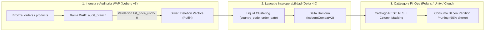

# Investigación Curricular y Especificación Pedagógica: `de3-lakehouse`

- **Módulo:** `de3-lakehouse`
- **Título:** Lakehouse abierto y almacenes en la nube
- **Área:** Ingeniería de Datos (`de`)
- **Nivel:** 3 (Especialización técnica)
- **Duración total:** 105 minutos (4 lecciones: 30 + 25 + 25 + 25 min)
- **Prerrequisitos:** `de2-pipelines` (*Pipelines batch, CDC e idempotencia*) y `de2-formatos` (*Formatos columnares, compresión y particionado físico*)
- **Proyecto del módulo:** Operar una tabla transaccional Apache Iceberg v3 con vectores de borrado, evolución de particiones y viaje en el tiempo sobre el dataset auditable de **Mercado Brisa**.
- **Fecha de verificación de fuentes:** `2026-10-29`

---

## 1. Investigación de fuentes primarias (Paso 1)

Todas las fuentes citadas en las cuatro lecciones y en el glosario del módulo provienen de especificaciones técnicas oficiales (Apache Software Foundation, Linux Foundation Delta Lake / Unity Catalog) y documentación oficial de proveedores cloud (Google Cloud, Snowflake, Databricks). Cada URL fue verificada mediante petición HTTP directa devolviendo estado `HTTP 200 OK` el `2026-10-29`.

### 1.1 Registro de fuentes verificadas por lección

| Lección | Fuente primaria | URL canónica | Estado HTTP | Fecha de acceso |
| :--- | :--- | :--- | :---: | :---: |
| `de3-lakehouse-01` | Apache Software Foundation — *Apache Iceberg Table Spec (Format Version 3)* | https://iceberg.apache.org/spec/ | `200 OK` | `2026-10-29` |
| `de3-lakehouse-01` | Apache Software Foundation — *Apache Iceberg Puffin File Specification* | https://iceberg.apache.org/puffin-spec/ | `200 OK` | `2026-10-29` |
| `de3-lakehouse-01` | Apache Software Foundation — *Apache Iceberg Partitioning and Hidden Partitioning* | https://iceberg.apache.org/docs/latest/partitioning/ | `200 OK` | `2026-10-29` |
| `de3-lakehouse-01` | Apache Software Foundation — *Apache Iceberg Branching and Tagging (WAP)* | https://iceberg.apache.org/docs/latest/branching/ | `200 OK` | `2026-10-29` |
| `de3-lakehouse-02` | Linux Foundation / Delta Lake — *Delta Universal Format (UniForm)* | https://docs.delta.io/delta-uniform/ | `200 OK` | `2026-10-29` |
| `de3-lakehouse-02` | Linux Foundation / Delta Lake — *Delta Lake Liquid Clustering* | https://docs.delta.io/delta-clustering/ | `200 OK` | `2026-10-29` |
| `de3-lakehouse-02` | Linux Foundation / Delta Lake — *Delta Transaction Log Protocol Specification* | https://raw.githubusercontent.com/delta-io/delta/master/PROTOCOL.md | `200 OK` | `2026-10-29` |
| `de3-lakehouse-02` | Databricks — *Read Delta tables with Iceberg clients (UniForm & IcebergCompatV2)* | https://docs.databricks.com/aws/en/delta/iceberg-reads | `200 OK` | `2026-10-29` |
| `de3-lakehouse-03` | Apache Software Foundation — *Apache Polaris: Open Source REST Catalog for Apache Iceberg* | https://polaris.apache.org/ | `200 OK` | `2026-10-29` |
| `de3-lakehouse-03` | Linux Foundation AI & Data — *Unity Catalog Open Source Documentation* | https://unitycatalog.io/ | `200 OK` | `2026-10-29` |
| `de3-lakehouse-03` | Databricks — *What is Unity Catalog? Data Governance and Access Control* | https://docs.databricks.com/aws/en/data-governance/unity-catalog/ | `200 OK` | `2026-10-29` |
| `de3-lakehouse-04` | Google Cloud — *BigQuery Pricing (On-Demand Analysis vs Capacity Editions)* | https://cloud.google.com/bigquery/pricing | `200 OK` | `2026-10-29` |
| `de3-lakehouse-04` | Snowflake Documentation — *Understanding Compute Cost (Virtual Warehouses & Credits)* | https://docs.snowflake.com/en/user-guide/cost-understanding-compute | `200 OK` | `2026-10-29` |
| `de3-lakehouse-04` | Databricks — *SQL Warehouses and Serverless Compute Architecture* | https://docs.databricks.com/aws/en/compute/sql-warehouse/ | `200 OK` | `2026-10-29` |

---

### 1.2 Síntesis técnica de las especificaciones primarias

#### Lección 1 (`de3-lakehouse-01-iceberg-v3-medallion`): Apache Iceberg v3 y Arquitectura Medallion
1. **Árbol de metadatos de Apache Iceberg:**
   - **Catálogo:** mantiene el puntero atómico hacia la ubicación del archivo `metadata.json` vigente mediante operaciones de intercambio atómico (*Compare-And-Swap*).
   - **Metadata file (`vN.metadata.json`):** define el esquema actual (`schema-id`), las especificaciones de partición históricas y vigentes (`partition-specs`), el orden de clasificación (`sort-orders`) y la lista de instantáneas (`snapshots`) con su `snapshot-id` y `sequence-number`.
   - **Manifest list (`snap-*.avro`):** índice de una instantánea que lista todos los archivos de manifiesto que la componen, almacenando rangos `lower_bound` y `upper_bound` de las columnas de partición para podar manifiestos completos sin abrirlos.
   - **Manifest file (`*.avro`):** registra los archivos de datos Parquet/ORC y archivos de borrado junto con estadísticas por columna (conteo de filas, nulos, mínimo y máximo por `field-id`).
2. **Novedades clave de la especificación Format Version 3 (v3):**
   - **Deletion Vectors (DVs):** sustituyen los archivos de borrado posicionales múltiples por bitmaps Roaring64 serializados en archivos **Puffin** (`deletion-vector-v1`). Garantizan a lo sumo un vector de borrado activo por archivo de datos; si llega un nuevo `DELETE` o `UPDATE` bajo estrategia *Merge-on-Read* (MoR), el escritor fusiona el bitmap previo con el nuevo en un único DV, eliminando la amplificación de lectura al reconciliar decenas de archivos delta.
   - **Row Lineage (`_row_id` y `_last_updated_sequence_number`):** seguimiento nativo de linaje por fila que asigna identificadores monotónicos estables a cada registro insertado y registra en qué número de secuencia sufrió su última modificación, permitiendo motores incrementales y vistas materializadas sin escaneos completos.
   - **Tipos y valores por defecto avanzados:** soporte nativo para el tipo semiestructurado `variant`, tipos geoespaciales (`geometry`, `geography`), timestamps con precisión de nanosegundos (`timestamp_ns`, `timestamptz_ns`) y evolución de esquema mediante `initial-default` y `write-default` sin reescribir Parquet histórico.
3. **Particionado oculto (*Hidden Partitioning*) y patrón WAP (*Write-Audit-Publish*):**
   - Iceberg almacena la transformación (`year(ts)`, `month(ts)`, `day(ts)`, `bucket(N, col)`, `truncate(L, col)`) en el `partition-spec`. El analista filtra directamente sobre la columna base (`WHERE order_ts >= ...`) y el motor deriva el predicado de partición sin depender de columnas derivadas adicionales. Cambiar el `partition-spec` es una operación de metadatos (*split planning*): los archivos antiguos conservan el `spec-id` anterior y los nuevos adoptan el nuevo sin reescribir la tabla.
   - Mediante ramas (*branches*) en el catálogo (`WAP`), el pipeline escribe en una rama aislada (`audit_branch`), ejecuta validaciones de calidad (por ejemplo, verificar precios negativos en `products`) y solo promueve la instantánea a `main` (*fast-forward*) si las reglas pasan.

#### Lección 2 (`de3-lakehouse-02-delta-lake-uniform`): Delta Lake 4.0, Liquid Clustering y Delta UniForm
1. **Registro transaccional `_delta_log`:**
   - Delta Lake descompone el estado de la tabla en entradas JSON secuenciales (`000000.json`, `000001.json`...) compuestas por acciones atómicas (`add`, `remove`, `metaData`, `protocol`, `commitInfo`, `cdc`). Cada cierto número de transacciones se materializa un archivo de *checkpoint* en Parquet para acelerar la reconstrucción del estado sin releer todo el historial JSON.
2. **Delta Universal Format (UniForm) e `IcebergCompatV2`:**
   - Como tanto Delta Lake como Apache Iceberg almacenan datos en archivos Parquet inmutables y difieren fundamentalmente en la capa de metadatos (`_delta_log` frente a `metadata.json` + manifiestos Avro), **Delta UniForm** traduce de forma asíncrona cada commit del `_delta_log` en metadatos compatibles con Iceberg y los registra en un catálogo Iceberg REST.
   - Requiere habilitar el mapeo de columnas por identificador inmutable (`delta.columnMapping.mode = 'name'` o `'id'`, equivalente al `field-id` de Iceberg) mediante el protocolo `IcebergCompatV2`. Así, un único conjunto físico de archivos Parquet es leído simultáneamente por lectores Delta y clientes Iceberg sin duplicar almacenamiento ni copiar datos.
3. **Liquid Clustering frente a particionado Hive y `Z-ORDER`:**
   - Reemplaza las particiones físicas rígidas (`PARTICION BY`) y el reordenamiento completo por lotes (`Z-ORDER`) mediante curvas de llenado espacial **Hilbert** que agrupan datos por hasta 4 claves de filtrado frecuente.
   - A diferencia de `Z-ORDER`, que reescribe todos los archivos dentro de una partición al ejecutarse, **Liquid Clustering** es incremental (`OPTIMIZE`): solo reagrupa los archivos nuevos o desbalanceados (*Z-cubes*) y permite modificar las claves de agrupación (`ALTER TABLE ... CLUSTER BY (...)`) sin reescribir los datos históricos.
4. **Change Data Feed (CDF):**
   - Con `delta.enableChangeDataFeed = true`, las operaciones `UPDATE`, `DELETE` y `MERGE` emiten lotes de cambios con las columnas de control `_change_type` (`insert`, `update_preimage`, `update_postimage`, `delete`), `_commit_version` y `_commit_timestamp`, alimentando la propagación incremental entre capas Silver y Gold.

#### Lección 3 (`de3-lakehouse-03-catalogos-polaris-unity`): Catálogos abiertos y gobierno (Apache Polaris y Unity Catalog)
1. **Estándar Iceberg REST Catalog y Apache Polaris:**
   - Sustituye el acoplamiento a Hive Metastore o conectores JDBC propietarios por una especificación OpenAPI estándar (`/v1/config`, `/v1/{prefix}/namespaces`, `/v1/{prefix}/namespaces/{ns}/tables/{table}`).
   - **Apache Polaris** implementa el estándar Iceberg REST Catalog con soporte nativo para coordinación de commits atómicos multi-motor, control de acceso basado en roles (RBAC) y **credenciales delegadas temporales (*vended credentials*)**: cuando un motor autenticado solicita leer o escribir una tabla, Polaris emite un token STS de corta duración restringido exclusivamente al prefijo S3/ADLS/GCS de esa tabla, eliminando llaves estáticas de larga duración en los nodos de cómputo.
2. **Espacio de nombres de tres niveles y gobierno en Unity Catalog:**
   - Estructura jerárquica `catalogo.esquema.tabla` (`brisa_prod.silver.customers`) que unifica el control de acceso (`GRANT SELECT ON TABLE ...`) sobre tablas gestionadas (*Managed Tables*), tablas externas (*External Tables*) y volúmenes de archivos no estructurados (*Volumes*).
   - Soporta interoperabilidad bidireccional: expone tablas gestionadas vía el endpoint **Iceberg REST Catalog** (con UniForm) y federa catálogos externos mediante *Lakehouse Federation*.
3. **Seguridad de grano fino (Row Filters, Column Masks) y Linaje de Columnas:**
   - En lugar de duplicar tablas físicas por país o departamento (`customers_es`, `customers_cl`, `customers_sin_pii`), el catálogo adjunta políticas dinámicas evaluadas en tiempo de consulta:
     - **Row-Level Security (RLS / Row Filters):** funciones SQL que filtran filas según la identidad o grupo del usuario (`IS_ACCOUNT_GROUP_MEMBER`).
     - **Column-Level Security (CLS / Column Masks):** funciones SQL que enmascaran columnas sensibles (`email`, `postal_code`) devolviendo valores redactados o resumidos para roles no autorizados sin alterar el archivo Parquet subyacente.
   - El **linaje automático a nivel de columna** parsea el árbol sintáctico (AST) de cada consulta ejecutada para trazar dependencias desde Bronze hasta dashboards BI, permitiendo análisis de impacto antes de alterar esquemas o políticas.

#### Lección 4 (`de3-lakehouse-04-costos-bigquery-snowflake-databricks`): Arquitectura y modelo de costos en BigQuery, Snowflake y Databricks
1. **Google BigQuery (Almacenamiento Capacitor en Colossus + Cómputo Dremel sobre Borg):**
   - Separa almacenamiento distribuido (**Colossus** en formato columnar **Capacitor**) del motor de ejecución distribuida (**Dremel**) mediante una red de alta velocidad (**Jupiter**) y memoria compartida para *shuffle*.
   - **Dos modelos de facturación de cómputo:**
     - **On-Demand (por TiB escaneado):** cobra según los bytes físicos o lógicos leídos por las columnas referenciadas en la consulta (con un mínimo de 10 MB por tabla referenciada). `SELECT *` o la ausencia de poda por partición (`PARTITION BY`) y agrupación (`CLUSTER BY`) dispara directamente la factura.
     - **Capacity / Editions (por Slots-hora):** asigna unidades virtuales de CPU/RAM (*slots*) con autoescalado entre una línea base (*baseline*) y un tope máximo (*max slots*). Ideal para cargas predecibles y continuas.
2. **Snowflake (Micro-particiones inmutables + Virtual Warehouses por segundo):**
   - Almacena tablas en **micro-particiones** columnares comprimidas e inmutables de 50 MB a 500 MB sin comprimir, manteniendo en la capa *Cloud Services* los metadatos de rango (`min`/`max`, nulos, valores distintos) de cada micro-partición.
   - **Facturación por créditos de cómputo:** los **Virtual Warehouses** (tallas X-Small a 6X-Large, donde cada salto duplica nodos y créditos/hora) facturan por segundo de actividad con un **mínimo de 60 segundos** cada vez que el clúster arranca o se reanuda. Un `AUTO_SUSPEND` demasiado corto (por ejemplo, 5 segundos) bajo consultas intermitentes provoca facturación repetida del mínimo de 60 segundos y pérdida de la caché SSD local de los nodos (*warehouse cache*).
3. **Databricks Lakehouse (Photon + Serverless SQL Warehouses en DBUs):**
   - Ejecuta consultas directamente sobre archivos Parquet abiertos gobernados por Delta Lake / Iceberg mediante el motor vectorizado **Photon** (escrito en C++ para aprovechar instrucciones SIMD de CPU).
   - **Facturación en DBUs (*Databricks Units*):** mide capacidad de procesamiento por segundo (con mínimo de 60 segundos en almacenes aprovisionados y arranque instantáneo en **Serverless SQL Warehouses**). El costo total combina las DBUs del plano de datos con la infraestructura subyacente (VM e I/O en modalidades Classic/Pro, o todo incluido en Serverless).
4. **Fórmula unificada de optimización FinOps en el Lakehouse:**
   - En los tres motores, el costo de consulta depende del volumen de bytes leídos tras aplicar **poda de particiones (*partition pruning*)**, **salto de bloques por estadísticas (*data skipping*)** y **proyección columnar** (seleccionar solo las columnas necesarias).

---

### 1.3 Anclaje cuantitativo sobre el dataset de Mercado Brisa

Para garantizar que todos los ejemplos, casos resueltos y prácticas SQL del módulo sean 100% reproducibles en DuckDB local y en el laboratorio DuckDB-Wasm del navegador, se auditaron las tablas reales de `public/datasets/`:

- `orders.parquet` (18.000 pedidos entre `2023-01-01` y `2025-12-31`):
  - `completed`: 14.760 pedidos (`6.269.462,42 USD`)
  - `refunded`: 1.440 pedidos (`605.025,58 USD`)
  - `cancelled`: 1.080 pedidos (`489.003,49 USD`)
  - `pending`: 720 pedidos (`306.326,28 USD`)
- `order_items.parquet` (42.000 líneas de detalle) y `products.parquet` (180 SKUs: 170 activos con precio válido, 9 inactivos con precio válido y 1 SKU inactivo con precio negativo `list_price_usd < 0` ideal para demostrar auditoría WAP en Iceberg).
- `customers.parquet` (2.400 clientes, 400 por cada uno de los 6 países: `AR`, `CL`, `CO`, `ES`, `MX`, `PE`; segmentos `retail` [967], `pro_barista` [966], `cafeteria_b2b` [467]; 347 clientes con `postal_code` nulo o incompleto).
- `customer_changes.parquet` (4.100 registros históricos SCD2 / CDF: 2.400 versiones vigentes `is_current = true` y 1.700 versiones históricas cerradas `is_current = false` distribuidas en niveles `bronce`, `plata`, `oro` y `platino`).
- `events.parquet` (65.000 eventos de telemetría web con `payload_json` que suma `2.977.400` caracteres totales, de los cuales `3.329` eventos y `161.696` caracteres pertenecen al cuarto trimestre de 2025).
- `marketing_spend.parquet` (730 registros diarios en 5 canales: `paid_social`, `display_video`, `organic_search`, `referral`, `email_campaign`).

---

## 2. Mapa de conceptos y progresión pedagógica (Paso 2)

El módulo `de3-lakehouse` construye una progresión deliberada desde la estructura física e interna de una tabla abierta (**Lección 1**), pasando por la interoperabilidad multi-formato y la optimización espacial del layout de archivos (**Lección 2**), hasta el plano de control de seguridad y metadatos (**Lección 3**) y finalmente la economía de ejecución en los tres grandes almacenes cloud (**Lección 4**).

| Lección | Conceptos nuevos introducidos | Conceptos que asume de lecciones previas | Errores típicos que aborda | Visualizador y componente práctico |
| :--- | :--- | :--- | :--- | :--- |
| **`de3-lakehouse-01`** *Apache Iceberg v3 y arquitectura Medallion* | Árbol de metadatos Iceberg (`metadata.json`, *manifest list*, *manifest file*), *Deletion Vectors* (Roaring bitmaps en archivos Puffin), *Row Lineage* (`_row_id`), *Hidden Partitioning*, ramas *Write-Audit-Publish* (WAP). | Formatos columnares Parquet, estadísticas de bloque `min`/`max` (`de2-formatos`), idempotencia batch y capas de transformación (`de2-pipelines`). | Creer que un `DELETE` reescribe inmediatamente el Parquet en MoR; añadir columnas auxiliares de fecha en `WHERE` rompiendo el particionado oculto; publicar directo a Gold sin rama WAP. | Visualizador `medallion-flow` + Práctica SQL de reconciliación Bronze → Silver → Gold por región en Mercado Brisa. |
| **`de3-lakehouse-02`** *Delta Lake 4.0 y Delta UniForm* | Registro transaccional `_delta_log` (JSON + checkpoints Parquet), *Delta UniForm* e `IcebergCompatV2`, *Liquid Clustering* (curvas Hilbert y *Z-cubes*), *Change Data Feed* (CDF). | Árbol de metadatos Iceberg, identificadores de columna inmutables (`field-id`) y estrategia *Merge-on-Read* de `de3-lakehouse-01`; SCD Tipo 2 de `de2-pipelines`. | Duplicar archivos Parquet para servir motores Delta e Iceberg; sobre-particionar al estilo Hive creando miles de archivos minúsculos (*small file problem*); confundir `Z-ORDER` total con *Liquid Clustering* incremental. | Visualizador `isolation-timeline` + Práctica SQL de diagnóstico de fragmentación por tienda y compactación lógica sobre `orders` y `stores`. |
| **`de3-lakehouse-03`** *Catálogos abiertos: Apache Polaris y Unity Catalog* | Estándar OpenAPI *Iceberg REST Catalog*, *Apache Polaris*, credenciales temporales delegadas (*vended credentials*), espacio de nombres de tres niveles (`catalogo.esquema.tabla`), *Row Filters* (RLS), *Column Masks* (CLS), linaje de columnas. | Metadatos unificados UniForm/Iceberg de `de3-lakehouse-01` y `02`; separación entre almacenamiento de objetos y metadatos. | Almacenar llaves S3/GCS estáticas en los clústeres de cómputo; clonar tablas físicas por país o rol (`customers_es`, `customers_sin_pii`) en lugar de aplicar políticas RLS/CLS en el catálogo. | Visualizador `medallion-flow` + Práctica SQL de vista gobernada con enmascaramiento de código postal y métricas comerciales por país. |
| **`de3-lakehouse-04`** *Costos y arquitectura en BigQuery, Snowflake y Databricks* | BigQuery (*Colossus*, *Capacitor*, *Dremel*, facturación *On-Demand* por TiB vs *Editions* por *slots*), Snowflake (micro-particiones, *Virtual Warehouses*, mínimo de 60s y caché local), Databricks (*Photon*, *Serverless SQL Warehouses*, DBUs). | Poda de particiones (*partition pruning*), estadísticas `min`/`max` (*data skipping*), proyección columnar y gobierno de tablas de `de3-lakehouse-01` a `03`. | Ejecutar `SELECT *` en BigQuery *On-Demand*; configurar `AUTO_SUSPEND = 5` segundos en Snowflake bajo tráfico frecuente (pagando el mínimo de 60s repetidamente y vaciando la caché SSD); cruzar tablas históricas sin predicado de poda. | Visualizador `partition-pruning` + Práctica SQL de estimación de ahorro de escaneo (*scan pruning*) por región en Mercado Brisa. |

---

## 3. Proyecto del módulo y rúbrica de evaluación (Paso 6)

### 3.1 Enunciado del proyecto: Operación integral de una tabla Apache Iceberg v3 y gobierno Lakehouse en Mercado Brisa

#### Contexto del caso
El equipo de plataforma de datos de **Mercado Brisa** administra el lago de datos transaccional que recibe pedidos de 14 tiendas físicas y canales digitales en 6 países (`AR`, `CL`, `CO`, `ES`, `MX`, `PE`). Actualmente enfrentan cuatro problemas operativos:
1. Los reembolsos (`status = 'refunded'`) y cancelaciones (`status = 'cancelled'`) obligaban a reescribir archivos Parquet enteros cada hora.
2. Un lote corrupto del catálogo de productos introdujo un SKU con precio negativo (`list_price_usd < 0`) que estuvo a punto de contaminar el reporte financiero de la capa Gold.
3. Los equipos regionales de ventas B2B (`segment = 'cafeteria_b2b'`) solicitan acceso a `customers` y `orders`, pero el área legal prohíbe exponer correos electrónicos y códigos postales incompletos, y el equipo de analítica usa clientes externos compatibles con Iceberg REST mientras ingeniería procesa con Delta Lake.
4. La factura mensual de cómputo en la nube creció un 180% porque los tableros ejecutivos escanean los 3 años históricos de `order_items` (`42.000` líneas) sin predicados de partición.

#### Entregables requeridos del estudiante
1. **Estrategia de tabla Iceberg v3 y auditoría WAP (SQL + diseño de metadatos):**
   - Escribir la consulta de reconciliación Bronze → Silver → Gold sobre `stores`, `orders` y `order_items` que aísle las órdenes vigentes (`status = 'completed'`) de los registros borrados lógicamente mediante vectores de borrado (`refunded`, `cancelled`), y la consulta de auditoría WAP que detecte el SKU inválido en `products` antes de hacer *fast-forward* a la rama `main`.
   - Justificar por qué un **Deletion Vector** en archivo Puffin evita la amplificación de lectura de múltiples *positional delete files* bajo estrategia *Merge-on-Read*.
2. **Diseño de layout con Liquid Clustering e interoperabilidad UniForm:**
   - Auditar con SQL la densidad de pedidos por país y tienda en `orders` y `stores`, demostrando por qué particionar físicamente por `(customer_id, order_date)` produce carpetas de ~1 fila (*small file problem*).
   - Especificar las propiedades de tabla necesarias para habilitar **Liquid Clustering** y **Delta UniForm** (`IcebergCompatV2`) sin duplicar archivos Parquet.
3. **Política de catálogo abierto (Polaris / Unity Catalog):**
   - Construir la consulta de vista gobernada sobre `customers` y `orders` bajo el espacio de nombres `brisa_prod.silver.customers` que audite clientes con código postal incompleto (`postal_code IS NULL OR LENGTH(postal_code) < 4`), contabilice clientes `cafeteria_b2b` y calcule los ingresos gobernados por país.
   - Explicar el flujo de **credenciales delegadas temporales (*vended credentials*)** en Apache Polaris y la diferencia entre *Row Filters* y *Column Masks*.
4. **Auditoría FinOps de poda de escaneo (*Scan Pruning*) y dimensionamiento cloud:**
   - Calcular por región el porcentaje de líneas ahorradas (`scan_saved_pct` ~65%) al podar `order_items` y `orders` al ejercicio `2025` con órdenes completadas frente a un escaneo completo de las 42.000 líneas.
   - Proponer la configuración óptima de cómputo comparando BigQuery (*On-Demand* vs *Editions*), Snowflake (*Virtual Warehouse* con `AUTO_SUSPEND` consciente de la caché y del mínimo de 60s) y Databricks (*Serverless SQL Warehouse* con Photon).

---

### 3.2 Rúbrica de evaluación del proyecto (4 criterios, escala 0 a 4)

| Criterio | 0 — Insuficiente | 1 — En desarrollo | 2 — Competente | 3 — Avanzado | 4 — Sobresaliente |
| :--- | :--- | :--- | :--- | :--- | :--- |
| **1. Comprensión conceptual** *(Metadatos transaccionales, UniForm, catálogos REST y arquitectura cloud)* | Confunde formatos de archivo (Parquet) con formatos de tabla (Iceberg/Delta) o con el catálogo de gobierno. | Identifica los componentes básicos de Iceberg y Delta Lake, pero confunde *Copy-on-Write* con *Merge-on-Read* o el rol del catálogo REST. | Explica correctamente el árbol de metadatos de Iceberg v3, el `_delta_log`, la traducción asíncrona de UniForm y el modelo de costos de los tres almacenes cloud. | Relaciona con precisión los *Deletion Vectors* (Puffin), las curvas Hilbert en *Liquid Clustering*, las credenciales delegadas en Polaris y el impacto del mínimo de 60s en Snowflake. | Articula las compensaciones arquitectónicas completas entre latencia de escritura, amplificación de lectura, gobierno multi-motor y costo unitario por consulta con rigor de especificación primaria. |
| **2. Corrección técnica** *(Consultas SQL sobre Mercado Brisa, métricas y propiedades de tabla)* | Las consultas SQL contienen errores de sintaxis, usan tablas inexistentes o devuelven resultados vacíos. | Las consultas ejecutan pero omiten filtros críticos (`status = 'completed'`) o producen conteos distorsionados por *fan-out* en los `JOIN`. | Todas las consultas SQL de reconciliación Medallion, diagnóstico de fragmentación, vista gobernada y ahorro de escaneo ejecutan sin errores y coinciden con las cifras de Mercado Brisa. | Emplea expresiones `FILTER (WHERE ...)`, CTEs limpias, redondeos precisos y documenta las propiedades reales de tabla (`IcebergCompatV2`, `partition-spec`, `CLUSTER BY`). | Combina consultas SQL idempotentes y libres de *fan-out* con especificaciones exactas de protocolo (v3 row lineage, OpenAPI REST endpoints y políticas dinámicas RLS/CLS). |
| **3. Aplicación al caso** *(Resolución de los 4 problemas operativos de Mercado Brisa)* | Propone soluciones genéricas desligadas de los datos reales de Mercado Brisa. | Aborda parcialmente el caso (por ejemplo, filtra reembolsos pero ignora el SKU con precio negativo o la política B2B). | Resuelve los 4 problemas sobre las tablas reales: aísla los `605.025,58 USD` en reembolsos, detecta el SKU negativo en WAP, gobierna los 467 clientes `cafeteria_b2b` y poda el ~65% del escaneo. | Conecta cada anomalía numérica del dataset (como los 347 códigos postales incompletos o la razón de 1,00 fila/carpeta en particionado Hive) con la decisión técnica que la corrige. | Diseña una arquitectura de extremo a extremo para Mercado Brisa donde la ingesta WAP, el layout Liquid Clustering, el gobierno en Unity/Polaris y el presupuesto FinOps operan como un sistema cohesivo. |
| **4. Comunicación de hallazgos** *(Claridad ejecutiva, justificación cuantitativa y trazabilidad)* | Presenta código SQL aislado sin explicar las implicaciones operativas ni de costos. | Incluye explicaciones descriptivas pero carece de métricas cuantitativas que respalden las decisiones de arquitectura. | Documenta cada decisión con tablas comparativas claras, métricas en dólares y porcentajes de reducción de lectura para los roles DE, DA y BI. | Estructura el informe separando causas raíz técnicas, evidencia cuantitativa medida en DuckDB y recomendaciones accionables de configuración en la nube. | Entrega un documento técnico de nivel de producción, conciso y verificable, que traduce métricas de almacenamiento y metadatos en impacto financiero directo y garantías de cumplimiento legal. |
