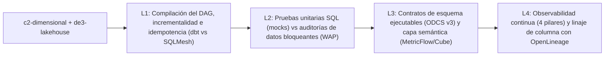

# Investigación curricular y diseño — `de3-transformacion`: Transformación declarativa, contratos y calidad

- **Módulo:** `de3-transformacion` — *Transformación declarativa, contratos y calidad*
- **Track:** Ingeniería de Datos (`de`, con cruce `bi` en la lección 3) · **Nivel:** 3 · **Duración total:** 110 min (4 lecciones: 30 + 25 + 30 + 25 min)
- **Prerrequisitos:** `de3-lakehouse` (*Formatos de tabla abiertos y arquitectura Lakehouse*) y `c2-dimensional` (*Modelado dimensional e invariantes de grano*)
- **Fecha de verificación de fuentes:** `2026-10-29`

---

## Paso 1 — Investigación de fuentes primarias verificadas

Todas las URLs listadas a continuación pertenecen a documentación técnica primaria, especificaciones abiertas o publicaciones de ingeniería reconocidas, y fueron verificadas con respuesta `HTTP 200` el `2026-10-29`.

### Lección 1: `de3-transformacion-01-dbt-sqlmesh-dag`
*Ingeniería de transformación declarativa: dbt, SQLMesh y el grafo DAG*

| # | Título | Publisher | URL | Fecha acceso | Estado HTTP | Concepto que respalda |
|---|---|---|---|---|---|---|
| 1 | About incremental models | dbt Labs | `https://docs.getdbt.com/docs/build/incremental-models` | 2026-10-29 | `200 OK` | Materialización incremental en dbt (`is_incremental()`), estrategias `merge`, `delete+insert` e `insert_overwrite`, `unique_key` y ventanas de retrospección (`lookback windows`) para absorber eventos tardíos. |
| 2 | About ref function | dbt Labs | `https://docs.getdbt.com/reference/dbt-jinja-functions/ref` | 2026-10-29 | `200 OK` | Construcción declarativa del grafo acíclico dirigido (DAG) mediante `ref()`, resolución de esquemas por entorno y serialización en `manifest.json`. |
| 3 | SQLMesh Model Kinds | Tobiko Data | `https://sqlmesh.readthedocs.io/en/stable/concepts/models/model_kinds/` | 2026-10-29 | `200 OK` | Semántica nativa de tipos de modelo en SQLMesh (`VIEW`, `FULL`, `INCREMENTAL_BY_TIME_RANGE`, `INCREMENTAL_BY_UNIQUE_KEY`, `EMBEDDED`) e intervalos de ejecución idempotentes (`@start_ds`, `@end_ds`). |
| 4 | SQLMesh Virtual Data Environments | Tobiko Data | `https://sqlmesh.readthedocs.io/en/stable/concepts/environments/` | 2026-10-29 | `200 OK` | Entornos virtuales de datos basados en huellas semánticas (AST SQL) y promoción instantánea mediante punteros de vistas (`CREATE OR REPLACE VIEW`) sin recalcular ni duplicar tablas físicas en almacén. |

### Lección 2: `de3-transformacion-02-tests-unitarios-auditorias-dag`
*Tests de esquema, pruebas unitarias y auditorías en el DAG*

| # | Título | Publisher | URL | Fecha acceso | Estado HTTP | Concepto que respalda |
|---|---|---|---|---|---|---|
| 1 | Add data tests to your DAG | dbt Labs | `https://docs.getdbt.com/docs/build/data-tests` | 2026-10-29 | `200 OK` | Pruebas genéricas de esquema (`not_null`, `unique`, `accepted_values`, `relationships`) y pruebas singulares SQL que fallan cuando la consulta devuelve una o más filas (`COUNT(*) > 0`). |
| 2 | Unit tests in dbt | dbt Labs | `https://docs.getdbt.com/docs/build/unit-tests` | 2026-10-29 | `200 OK` | Pruebas unitarias de lógica SQL (`unit_tests`) con entradas simuladas (`given`) y filas esperadas (`expect`) evaluadas en seco sin leer tablas de producción antes de materializar el modelo. |
| 3 | SQLMesh Audits | Tobiko Data | `https://sqlmesh.readthedocs.io/en/stable/concepts/audits/` | 2026-10-29 | `200 OK` | Auditorías integradas en el flujo Write-Audit-Publish (WAP): ejecución sobre tabla intermedia aislada, bloqueo automático (`blocking: true`) antes de intercambiar la vista productiva y modo de advertencia (`blocking: false`). |
| 4 | SQLMesh Testing (Unit Tests) | Tobiko Data | `https://sqlmesh.readthedocs.io/en/stable/concepts/tests/` | 2026-10-29 | `200 OK` | Especificación declarativa de pruebas unitarias SQL mediante CTEs sintéticas inyectadas por motor local (DuckDB) en integración continua antes de ejecutar planes en la nube. |

### Lección 3: `de3-transformacion-03-contracts-semantic-layer`
*Contratos de datos ejecutables (ODCS v3) y capa semántica*

| # | Título | Publisher | URL | Fecha acceso | Estado HTTP | Concepto que respalda |
|---|---|---|---|---|---|---|
| 1 | Model contracts | dbt Labs | `https://docs.getdbt.com/docs/collaborate/govern/model-contracts` | 2026-10-29 | `200 OK` | Contratos de modelo ejecutables (`contract: { enforced: true }`): verificación en tiempo de compilación y DDL de nombres de columna, tipos de datos físicos y restricciones `NOT NULL`. |
| 2 | Open Data Contract Standard (ODCS) | Bitol / Linux Foundation AI & Data | `https://bitol-io.github.io/open-data-contract-standard/latest/` | 2026-10-29 | `200 OK` | Estándar abierto ODCS v3.x (`apiVersion: v3.0.2`, `kind: DataContract`) para declarar esquema, reglas de calidad, niveles de servicio (SLA) y propietarios entre productores y consumidores. |
| 3 | Semantic models & MetricFlow | dbt Labs | `https://docs.getdbt.com/docs/build/semantic-models` | 2026-10-29 | `200 OK` | Separación de entidades, dimensiones, medidas atómicas y métricas derivadas o de razón en MetricFlow para garantizar consistencia semántica sin fan-out entre herramientas BI. |
| 4 | Cube Data Modeling Overview | Cube Dev | `https://cube.dev/docs/product/data-modeling/overview` | 2026-10-29 | `200 OK` | Modelado de cubos y vistas semánticas gobernadas, control de acceso y preagregaciones compartidas por tableros, hojas de cálculo y agentes analíticos. |

### Lección 4: `de3-transformacion-04-observabilidad-openlineage`
*Observabilidad de datos y linaje con OpenLineage*

| # | Título | Publisher | URL | Fecha acceso | Estado HTTP | Concepto que respalda |
|---|---|---|---|---|---|---|
| 1 | OpenLineage Object Model Specification | Linux Foundation AI & Data | `https://openlineage.io/docs/spec/object-model` | 2026-10-29 | `200 OK` | Modelo central de OpenLineage (`Run`, `Job`, `Dataset`, `RunEvent`), ciclo de vida de eventos (`START`, `RUNNING`, `COMPLETE`, `FAIL`, `ABORT`) e identificadores de espacio de nombres. |
| 2 | OpenLineage Column Lineage Dataset Facet | Linux Foundation AI & Data | `https://openlineage.io/docs/spec/facets/dataset-facets/column_lineage_facet` | 2026-10-29 | `200 OK` | Faceta `ColumnLineageDatasetFacet` para registrar qué campos de entrada (`inputFields`) alimentan cada columna de salida y con qué tipo de transformación (`DIRECT` vs `INDIRECT`). |
| 3 | OpenLineage Data Quality Metrics Facet | Linux Foundation AI & Data | `https://openlineage.io/docs/spec/facets/dataset-facets/data_quality_metrics` | 2026-10-29 | `200 OK` | Faceta `DataQualityMetricsInputDatasetFacet` para emitir telemetría de volumen (`rowCount`), conteo de nulos (`nullCount`), valores distintos y cuantiles por columna en cada ejecución. |
| 4 | Marquez Quickstart & Lineage Graph | LF AI & Data / Marquez Project | `https://marquezproject.ai/docs/quickstart` | 2026-10-29 | `200 OK` | Recolección y consulta del grafo de metadatos OpenLineage para análisis de causa raíz aguas arriba (*upstream*) y análisis de impacto aguas abajo (*downstream*). |

---

## Paso 2 — Mapa de conceptos y progresión del módulo

### Conexión con módulos prerrequisito y posteriores
- **Desde `c2-dimensional`:** El estudiante ya domina la declaración del grano atómico, las claves sustitutas, las dimensiones SCD Tipo 2 (`customer_changes`), el peligro de *fan-out* / *chasm trap* y el patrón *Drill-Across*. En `de3-transformacion` llevamos esos modelos dimensionales a producción mediante pipelines declarativos reproducibles (`dbt` / `SQLMesh`), contratos y pruebas automatizadas.
- **Desde `de3-lakehouse`:** El estudiante conoce el aislamiento de instantáneas (*Snapshots*) en Apache Iceberg y el patrón *Write-Audit-Publish (WAP)* a nivel de almacenamiento. Aquí conectamos WAP con el motor de transformación: cómo las auditorías bloqueantes de SQLMesh y `dbt build` gobiernan si el puntero de tabla o vista se publica.
- **Hacia `de4-operacion`:** Las facetas de telemetría y linaje (`OpenLineage`) producidas en la lección 4 alimentan la operación FinOps, los presupuestos de error (SLO) y los playbooks de respuesta a incidentes del nivel 4.

### Progresión interna entre las 4 lecciones (sin solapamientos)



| Lección | Conceptos nuevos introducidos | Conceptos reforzados (prerrequisitos) | Anomalía real de Mercado Brisa trabajada en DuckDB | Visualizador / Reto interactivo |
|---|---|---|---|---|
| **01 (`de3-transformacion-01-dbt-sqlmesh-dag`)** | Grafo declarativo (`ref()`, `source()`, `manifest.json`), materializaciones (`view`, `table`, `incremental`, `ephemeral`), ventana deslizante (*lookback window*), intervalos `@start_ds`/`@end_ds`, entornos virtuales de datos (SQLMesh AST fingerprint). | Idempotencia (`MERGE` / `QUALIFY ROW_NUMBER()`), grano de pagos frente a cabeceras de pedido (`c2-dimensional`). | `405` cobros duplicados con `status = 'captured'` en `payments` (`16,605` intentos sobre `16,200` órdenes únicas) que inflan los ingresos liquidados por región en `$168,674.63`. | `dbt-sqlmesh-dag-explorer` + `PipelineOrderChallenge` (ciclo incremental idempotente). |
| **02 (`de3-transformacion-02-tests-unitarios-auditorias-dag`)** | Diferencia entre *Unit Tests SQL* (mocks deterministas con `VALUES` antes de materializar) y *Data Tests / Audits* (evaluación sobre datos reales), auditorías bloqueantes (`blocking: true` en WAP) frente a alertas `warn`, pruebas de reconciliación cruzada. | Patrón *Write-Audit-Publish* (`de3-lakehouse`), integridad referencial e invariantes de dominio (`c1-sql`). | `1` SKU con `list_price_usd < 0` en `products`, `405` cobros `captured` duplicados en `payments`, `145` reembolsos sobre órdenes no elegibles (`cancelled`/`pending`) y `218` clientes con `postal_code IS NULL` (`WARN`). | `PipelineOrderChallenge` (secuencia de ejecución CI/CD: Unit Test -> Materialización staging -> Auditoría bloqueante WAP -> Publicación de vista). |
| **03 (`de3-transformacion-03-contracts-semantic-layer`)** | Contratos de datos ejecutables (`contract: { enforced: true }`, estándar Bitol ODCS v3), versionado de modelos (`v1`/`v2`) ante cambios destructivos, puente hacia la capa semántica (*MetricFlow* / *Cube*): entidades, dimensiones y métricas de razón sin fan-out. | Métricas aditivas vs no aditivas y patrón *Drill-Across* (`c2-dimensional-01` y `04`). | Conciliación semántica entre `orders` (`completed`/`refunded`), `refunds` y `customers`/`stores`, aislando los `218` nulos de código postal y el SKU negativo mediante contratos estrictos. | `semantic-contract-sim` (`SemanticContractSim`) + `PipelineOrderChallenge` (gobernanza de contrato y capa semántica). |
| **04 (`de3-transformacion-04-observabilidad-openlineage`)** | Los 4 pilares de la observabilidad (frescura, volumen, distribución, deriva de esquema), especificación OpenLineage (`Run`, `Job`, `Dataset`, `RunEvent`), facetas `ColumnLineageDatasetFacet` y `DataQualityMetricsInputDatasetFacet`, análisis de impacto y causa raíz. | Linaje en el DAG (`L1`), auditorías y contratos (`L2`, `L3`). | En `events` (`65,000` filas): `52,000` eventos (`80 %`) traen desfases horarios locales (`timezone_offset <> 'Z'`) concentrados en `add_to_cart`, `checkout_started`, `checkout_completed` y `product_view` (`0` en `page_view`), más `6,715` eventos con `customer_id IS NULL`. | `PipelineOrderChallenge` (trazabilidad de incidente desde alerta de observabilidad hasta causa raíz por linaje de columna). |

---

## Paso 6 — Especificación del proyecto de módulo y rúbrica de evaluación

### 1. Enunciado técnico del proyecto
- **Título:** Pipeline declarativo `staging -> intermediate -> marts` con suite de auditorías bloqueantes y contrato semántico para Mercado Brisa
- **Tablas de Mercado Brisa utilizadas:** `orders` (`18,000` filas), `order_items` (`42,000` filas), `payments` (`19,200` filas), `refunds` (`1,450` filas), `customers` (`2,400` filas), `products` (`180` filas) y `stores` (`14` filas).
- **Contexto:** El Comité de Finanzas y Operaciones de Mercado Brisa ha detectado discrepancias entre los tableros de ingresos liquidados y los cierres contables regionales. Tu objetivo es diseñar la cadena declarativa de transformación en tres capas (`stg_`, `int_`, `fct_`/`sem_`), blindarla con una suite de pruebas unitarias y auditorías bloqueantes (WAP) que detecten explícitamente las anomalías inyectadas en el dataset, y exponer un contrato de salida gobernado.

### 2. Requerimientos de entrega
1. **Capa Staging (`stg_payments_dedup`, `stg_products_clean`, `stg_valid_orders`):**
   - Filtrar `payments` a cobros capturados (`status = 'captured'`) y deduplicar reintentos múltiples por `order_id` conservando el último intento (`QUALIFY ROW_NUMBER() OVER (PARTITION BY order_id ORDER BY payment_ts DESC, payment_id DESC) = 1`), eliminando los `405` cobros duplicados.
   - Filtrar o poner en cuarentena los productos con `list_price_usd <= 0` (`1` SKU anómalo) y las órdenes fuera de los estados comerciales válidos (`status IN ('completed', 'refunded')`).
2. **Suite de Pruebas Unitarias y Auditorías Bloqueantes (`wap_audit_suite`):**
   - Escribir una consulta de auditoría que verifique las cuatro invariantes del pipeline sobre las tablas crudas frente a las tablas limpias:
     - `audit_negative_sku_price` (`BLOCKING`): `1` fila en crudo -> `0` filas en staging.
     - `audit_duplicate_captured_payments` (`BLOCKING`): `405` filas en crudo -> `0` filas en staging.
     - `audit_orphan_status_refunds` (`BLOCKING`): `145` reembolsos asociados a órdenes `cancelled` o `pending` -> `0` en la capa intermedia.
     - `audit_missing_customer_postal_code` (`WARN`): `218` clientes sin `postal_code` registrados en telemetría sin detener el cobro financiero.
3. **Capa Intermedia y Mart Semántico (`fct_regional_financial_reconciliation`):**
   - Aplicar el patrón *Drill-Across* preagregando pagos limpios y reembolsos elegibles por `order_id` antes de cruzar con `orders` y `stores`.
   - Exponer por cada `region` (`Cono Sur`, `Andina`, `Iberia`, `Norteamérica`): `valid_orders`, `gross_order_usd`, `settled_payment_usd`, `eligible_refunded_usd`, `net_retained_usd` y `net_retention_pct`.

### 3. Consulta SQL de referencia verificada en DuckDB

```sql
WITH stg_valid_orders AS (
  SELECT
    order_id,
    customer_id,
    store_id,
    total_usd
  FROM orders
  WHERE status IN ('completed', 'refunded')
),
stg_payments_dedup AS (
  SELECT
    order_id,
    payment_id,
    provider,
    amount_usd
  FROM payments
  WHERE status = 'captured'
  QUALIFY ROW_NUMBER() OVER (
    PARTITION BY order_id
    ORDER BY payment_ts DESC, payment_id DESC
  ) = 1
),
int_eligible_refunds AS (
  SELECT
    r.order_id,
    SUM(r.refund_amount_usd) AS refunded_usd
  FROM refunds r
  INNER JOIN stg_valid_orders vo ON r.order_id = vo.order_id
  WHERE r.status = 'processed'
  GROUP BY r.order_id
)
SELECT
  s.region,
  COUNT(vo.order_id) AS valid_orders,
  ROUND(SUM(vo.total_usd), 2) AS gross_order_usd,
  ROUND(SUM(p.amount_usd), 2) AS settled_payment_usd,
  ROUND(SUM(COALESCE(rf.refunded_usd, 0.0)), 2) AS eligible_refunded_usd,
  ROUND(SUM(p.amount_usd - COALESCE(rf.refunded_usd, 0.0)), 2) AS net_retained_usd,
  ROUND(
    100.0 * SUM(p.amount_usd - COALESCE(rf.refunded_usd, 0.0)) / NULLIF(SUM(p.amount_usd), 0),
    2
  ) AS net_retention_pct
FROM stg_valid_orders vo
INNER JOIN stores s ON vo.store_id = s.store_id
INNER JOIN stg_payments_dedup p ON vo.order_id = p.order_id
LEFT JOIN int_eligible_refunds rf ON vo.order_id = rf.order_id
GROUP BY s.region
ORDER BY net_retained_usd DESC;
```

**Resultado esperado exacto sobre Mercado Brisa:**

| `region` | `valid_orders` | `gross_order_usd` | `settled_payment_usd` | `eligible_refunded_usd` | `net_retained_usd` | `net_retention_pct` |
|---|---:|---:|---:|---:|---:|---:|
| `Cono Sur` | `5401` | `2256477.18` | `2256477.18` | `77991.82` | `2178485.36` | `96.54` |
| `Andina` | `5400` | `2180511.86` | `2180511.86` | `115379.23` | `2065132.63` | `94.71` |
| `Iberia` | `3085` | `1482611.35` | `1482611.35` | `43170.94` | `1439440.41` | `97.09` |
| `Norteamérica` | `2314` | `954887.61` | `954887.61` | `37992.53` | `916895.08` | `96.02` |

### 4. Rúbrica de evaluación (4 criterios, niveles 0–4)

| Criterio | 0 — No entregado | 1 — Insuficiente | 2 — Básico | 3 — Competente | 4 — Sobresaliente |
|---|---|---|---|---|---|
| **1. Corrección técnica e idempotencia del DAG** | No entrega código o la consulta no ejecuta en DuckDB. | Une `orders`, `payments` y `refunds` sin filtrar estados ni deduplicar, inflando el ingreso liquidado en `$168,674.63`. | Filtra `status = 'captured'` en `payments` pero no deduplica por `order_id` con ventana determinista o genera *fan-out* al cruzar reembolsos. | Deduplica `payments` con `QUALIFY ROW_NUMBER() OVER (PARTITION BY order_id ORDER BY payment_ts DESC, payment_id DESC) = 1` y preagrega `refunds` antes del `LEFT JOIN`. | Separa claramente las capas `stg_`, `int_` y `fct_`, garantiza grano `1:1` por `order_id` antes de agregar por `region` y concilia al centavo `gross_order_usd = settled_payment_usd`. |
| **2. Calidad de datos, pruebas unitarias y auditorías WAP** | No incluye ninguna prueba ni auditoría de calidad. | Solo incluye conteos descriptivos (`COUNT(*)`) sin condiciones de fallo (`COUNT(*) > 0`) ni distinción de severidad. | Define pruebas de nulidad o unicidad básicas, pero omite las anomalías de dominio (`list_price_usd <= 0` o reembolsos en órdenes canceladas). | Implementa tanto un test unitario con CTEs sintéticas (`VALUES`) como la suite de auditorías sobre Mercado Brisa que detecta las `405` filas duplicadas, el SKU negativo y los `145` reembolsos inválidos. | Clasifica explícitamente las auditorías en bloqueantes (`BLOCKING` para WAP) y no bloqueantes (`WARN` para los `218` códigos postales nulos), generando la decisión automática `HALT_DAG_ROLLBACK` vs `PUBLISH_WAP_SNAPSHOT`. |
| **3. Contratos de datos (ODCS v3) y capa semántica** | No declara contrato de salida ni métricas gobernadas. | Enumera columnas de salida sin tipos físicos, restricciones de nulidad ni fórmulas de negocio explícitas. | Declara tipos y `NOT NULL` básicos, pero calcula razones promediando porcentajes en lugar de dividir sumas agregadas (`SUM / NULLIF(SUM, 0)`). | Especifica el contrato ODCS v3 completo (esquema, SLA, severidad) y define las medidas aditivas y la métrica de razón `net_retention_pct` con protección `NULLIF`. | Vincula el contrato de esquema con la definición semántica y documenta el linaje a nivel de columna (`ColumnLineageDatasetFacet`) desde las fuentes hasta cada métrica ejecutiva. |
| **4. Comunicación ejecutiva y trazabilidad operativa** | Entrega únicamente bloques SQL sin interpretación ni contexto. | Describe los pasos técnicos del código sin cuantificar el impacto financiero de las anomalías detectadas. | Reporta los totales regionales pero no explica qué ocurriría aguas abajo si se publicaran datos sin bloqueo WAP. | Cuantifica con exactitud el sobrecobro evitado (`$168,674.63` por cobros duplicados y `$46,562.43` en reembolsos de órdenes no elegibles) y justifica la política de cada regla. | Presenta un informe ejecutivo accionable con diagnóstico de causa raíz, tabla de impacto por región y protocolo de respuesta operativa ante violaciones de contrato o alertas de observabilidad. |
