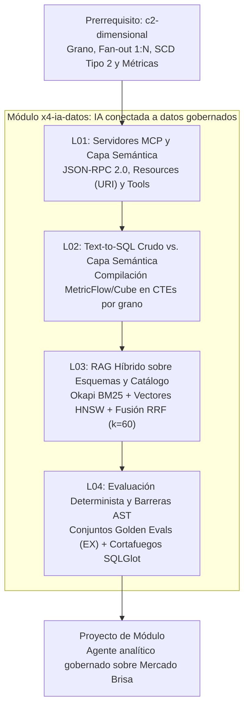

# Investigación Curricular y Diseño Pedagógico: `x4-ia-datos` (IA conectada a datos gobernados)

## 1. Investigación de fuentes primarias y técnicas (Paso 1)

El módulo `x4-ia-datos` (*IA conectada a datos gobernados*, Nivel 4, Área `core`, 105 minutos en 4 lecciones) cierra el recorrido troncal conectando el modelado dimensional y la gobernanza métrica (`c2-dimensional`) con la ingeniería de agentes analíticos en producción. Todas las fuentes han sido consultadas y verificadas con respuesta `HTTP 200`.

| Lección | Fuente / Autor | URL verificada (`HTTP 200`) | Fecha de consulta | Concepto clave extraído |
| :--- | :--- | :--- | :--- | :--- |
| L01 (`x4-ia-datos-01`) | Model Context Protocol — Introduction | https://modelcontextprotocol.io/introduction | accessed: 2026-10-29 | Estándar abierto basado en JSON-RPC 2.0 que desacopla los hosts de IA de los conectores de datos y herramientas empresariales. |
| L01 (`x4-ia-datos-01`) | Model Context Protocol — Architecture | https://modelcontextprotocol.io/docs/concepts/architecture | accessed: 2026-10-29 | Topología Host-Client-Server con aislamiento de credenciales, negociación de capacidades y sesiones con estado sobre stdio o HTTP/SSE. |
| L01 (`x4-ia-datos-01`) | Model Context Protocol — Resources | https://modelcontextprotocol.io/docs/concepts/resources | accessed: 2026-10-29 | Exposición pasiva de metadatos gobernados (catálogo YAML, linaje, contratos ODCS) identificados mediante URIs sin efectos secundarios. |
| L01 (`x4-ia-datos-01`) | Model Context Protocol — Tools | https://modelcontextprotocol.io/docs/concepts/tools | accessed: 2026-10-29 | Primitiva ejecutable con validación JSON Schema que obliga al modelo a invocar métricas parametrizadas en lugar de generar SQL libre. |
| L02 (`x4-ia-datos-02`) | dbt Labs — dbt Semantic Layer & MetricFlow | https://docs.getdbt.com/docs/use-dbt-semantic-layer/dbt-sl | accessed: 2026-10-29 | Compilación determinista de grafos semánticos (`entities`, `dimensions`, `measures`, `metrics`) en CTEs pre-agregadas al grano de cada hecho. |
| L02 (`x4-ia-datos-02`) | Cube — Data Modeling & Semantic Layer Overview | https://docs.cube.dev/docs/data-modeling/overview | accessed: 2026-10-29 | Prevención de *chasm traps* y *fan-out* `1:N` aislando las medidas atómicas antes de cruzar dimensiones o múltiples tablas de hechos. |
| L02 (`x4-ia-datos-02`) | Li et al. — BIRD: Big Bench for Large-Scale Database Grounded Text-to-SQL | https://bird-bench.github.io/ | accessed: 2026-10-29 | Evidencia empírica de caída de precisión en Text-to-SQL directo ante valores sucios, reglas de negocio implícitas y uniones multi-tabla. |
| L02 (`x4-ia-datos-02`) | Yu et al. — Spider: Complex and Cross-Domain Semantic Parsing Benchmark | https://yale-lily.github.io/spider | accessed: 2026-10-29 | Taxonomía de fallos estructurales en generación de consultas complejas con subconsultas anidadas, agrupaciones y joins múltiples. |
| L03 (`x4-ia-datos-03`) | Cormack, Clarke & Büttcher — Reciprocal Rank Fusion (SIGIR) | https://cormack.uwaterloo.ca/cormacksigir09-rrf.pdf | accessed: 2026-10-29 | Fusión invariante a escala mediante posiciones ordinales $\text{RRF}(d) = \sum_{m} \frac{1}{k + r_m(d)}$ con constante de suavizado $k = 60$. |
| L03 (`x4-ia-datos-03`) | Malkov & Yashunin — Efficient and robust ANN search using HNSW graphs | https://arxiv.org/abs/1603.09320 | accessed: 2026-10-29 | Grafos jerárquicos de mundo pequeño navegable para búsqueda vectorial aproximada en tiempo logarítmico con control de `ef_search` y `M`. |
| L03 (`x4-ia-datos-03`) | DuckDB Documentation — Full-Text Search Extension (BM25) | https://duckdb.org/docs/stable/extensions/full_text_search | accessed: 2026-10-29 | Índice invertido Okapi BM25 con saturación de frecuencia de término ($k_1$) y normalización por longitud de documento ($b$) en SQL analítico. |
| L03 (`x4-ia-datos-03`) | DuckDB Documentation — Vector Similarity Search (`vss`) | https://duckdb.org/docs/stable/extensions/vss | accessed: 2026-10-29 | Índices HNSW en memoria sobre columnas `ARRAY` de dimensión fija con distancias coseno (`array_cosine_distance`), $L_2$ y producto interno. |
| L04 (`x4-ia-datos-04`) | Toby Mao — SQLGlot: Python SQL Parser, Transpiler, and Optimizer | https://github.com/tobymao/sqlglot | accessed: 2026-10-29 | Parseo de cadenas SQL a árboles de sintaxis abstracta (AST) independientes del dialecto para inspección estructural y reescritura segura. |
| L04 (`x4-ia-datos-04`) | SQLGlot API Reference & AST Traversal | https://sqlglot.com/sqlglot.html | accessed: 2026-10-29 | Uso de `parse_one`, `find_all(exp.Table, exp.Column)` y validación de nodos para bloquear DDL/DML, columnas PII y joins no autorizados. |
| L04 (`x4-ia-datos-04`) | OWASP Top 10 for Large Language Model Applications | https://genai.owasp.org/llm-top-10/ | accessed: 2026-10-29 | Mitigación de agencia excesiva (`LLM06`), inyección de prompts (`LLM01`) y divulgación de información sensible (`LLM02`) con barreras deterministas. |
| L04 (`x4-ia-datos-04`) | Sun et al. — Text-to-SQL Empowered by Large Language Models | https://arxiv.org/abs/2305.03111 | accessed: 2026-10-29 | Evaluación determinista por exactitud de ejecución (*Execution Accuracy*, EX) frente a conjuntos de referencia canónicos (*Golden Evals*). |

---

## 2. Mapa de conceptos y vocabulario nuevo (Paso 2)

### 2.1 Diagrama de flujo conceptual del módulo



### 2.2 Vocabulario nuevo registrado en `x4-ia-datos-glossary.json`

Además de reutilizar términos troncales existentes en el catálogo global (`c28-mcp-semantic-rag-evals`, `c21-semantic-layer`, `c19-data-contracts-odcs`, `c01-grain-fanout`, `c07-scd-type-2`, `c10-simpsons-paradox`), este módulo introduce 10 términos específicos en `docs/curriculo/investigacion/x4-ia-datos-glossary.json`:

| ID (`kebab-case`) | Término | Lecciones asociadas | Concepto sintetizado |
| :--- | :--- | :--- | :--- |
| `model-context-protocol` | Model Context Protocol (MCP) | L01, L02 | Protocolo abierto sobre JSON-RPC 2.0 que conecta aplicaciones de IA con servidores de contexto mediante `resources`, `tools` y `prompts`. |
| `mcp-resources-tools` | Primitivas Resources y Tools en MCP | L01 | Separación entre lectura pasiva de metadatos por URI (`resources`) e invocación activa de funciones validadas por esquema (`tools`). |
| `text-to-sql-hallucination` | Alucinación estructural en Text-to-SQL | L01, L02, L04 | Generación de SQL sintácticamente ejecutable pero semánticamente erróneo por desconocer grano, webhooks duplicados o reglas de negocio. |
| `chasm-trap-semantic` | Trampa de abismo (Chasm Trap) en IA | L02 | Inflación por producto cartesiano parcial al unir dos tablas de hechos (`order_items` y `refunds`) a una tabla puente (`orders`) sin pre-agregar. |
| `semantic-query-compilation` | Compilación de consultas en capa semántica | L02 | Traducción determinista de métricas y dimensiones solicitadas en CTEs separadas por grano de entidad antes del `JOIN` final. |
| `okapi-bm25` | Función de ranking léxico Okapi BM25 | L03 | Algoritmo de recuperación sobre índices invertidos que pondera frecuencia de término con saturación ($k_1$), longitud ($b$) e IDF. |
| `hnsw-vector-index` | Índice vectorial jerárquico HNSW | L03 | Estructura de grafos multicapa de mundo pequeño navegable para búsqueda de vecinos más cercanos aproximados (ANN) en espacios densos. |
| `reciprocal-rank-fusion` | Reciprocal Rank Fusion (RRF) | L03 | Fórmula de combinación de rankings $\sum \frac{1}{k + r_m(d)}$ que fusiona recuperadores léxicos y vectoriales sin calibrar puntajes crudos. |
| `golden-eval-set` | Conjunto de evaluación Golden Evals | L04 | Batería versionada de preguntas de negocio, consultas SQL canónicas y resultados tabulares exactos para medir *Execution Accuracy* en CI/CD. |
| `ast-sql-guardrail` | Barrera determinista de AST (SQLGlot) | L04 | Cortafuegos que parsea el SQL a un árbol de sintaxis abstracta para bloquear comandos destructivos, columnas PII y uniones prohibidas. |

### 2.3 Secuencia pedagógica y anclaje empírico en Mercado Brisa

1. **Lección 01 (`x4-ia-datos-01-mcp-semantic-ai-rag` — 30 min):**
   - Resuelve el problema de conectar un LLM directamente al almacén: en **Mercado Brisa**, sumar `payments.amount_usd` con `status = 'captured'` sobre pedidos pagados (`orders.status IN ('completed', 'refunded')`) arroja `16,605` filas y `7,043,162.63` USD, inflando en `168,674.63` USD el valor real (`16,200` órdenes y `6,874,488.00` USD) por los reintentos de webhook duplicados.
   - Introduce la arquitectura **Model Context Protocol (MCP)** (`Host`, `Client`, `Server`) y cómo exponer vistas semánticas mediante `resources` y `tools` gobernadas.

2. **Lección 02 (`x4-ia-datos-02-text-to-sql-capa-semantica` — 25 min):**
   - Diagnostica los cuatro modos de fallo del Text-to-SQL directo documentados en benchmarks como **BIRD** y **Spider**:
     1. *Chasm trap* / *fan-out* `1:N`: unir `orders`, `order_items` y `refunds` (`status = 'processed'`) infla los reembolsos de `321,097.25` USD a `798,930.91` USD (`477,833.66` USD de error).
     2. Amnesia temporal en **SCD Tipo 2**: unir `orders` con `customer_changes` sin filtrar `is_current = true` ni rango temporal `valid_from`/`valid_to` duplica los pedidos completados de `14,760` (`6,269,462.42` USD) a `25,271` filas (`10,640,011.94` USD).
     3. Métricas no aditivas y paradoja de Simpson: promediar razones precalculadas en lugar de dividir sumas agregadas (`SUM(refunded) / SUM(gross_revenue)`).
     4. Higiene de catálogo: omitir la exclusión del registro centinela `SKU-TEST-NEG` (`list_price_usd = -9.99`).
   - Enseña cómo motores como **MetricFlow (dbt)** y **Cube** compilan entidades, dimensiones y medidas en CTEs pre-agregadas al grano de `order_id`.

3. **Lección 03 (`x4-ia-datos-03-rag-hibrido-bm25-hnsw-rrf` — 25 min):**
   - Resuelve el problema de descubrimiento de contexto cuando el catálogo supera la ventana de atención o mezcla códigos alfanuméricos exactos (`MB-MOL-137`, `SKU-TEST-NEG`) con conceptos semánticos.
   - Compara la recuperación léxica **Okapi BM25** (exactitud en identificadores y nombres de columnas) con la búsqueda densa sobre grafos **HNSW** (similitud conceptual y paráfrasis).
   - Demuestra por qué sumar puntajes crudos BM25 y coseno es matemáticamente inestable y cómo **Reciprocal Rank Fusion (RRF)** con $k = 60$ fusiona ambos rankings en SQL puro con `ROW_NUMBER()` y `FULL OUTER JOIN`.

4. **Lección 04 (`x4-ia-datos-04-golden-evals-barreras-ast-sqlglot` — 25 min):**
   - Desmonta el antipatrón de evaluar agentes SQL usando otro LLM como juez (*LLM-as-a-judge*).
   - Implementa conjuntos **Golden Evals** deterministas en SQL que miden la exactitud de ejecución (*Execution Accuracy*, EX) y la deriva numérica frente a valores de referencia.
   - Construye barreras deterministas mediante el árbol de sintaxis abstracta (**AST**) con **SQLGlot** para inspeccionar tablas, bloquear columnas PII (`customers.email`, `customers.full_name`, `customers.postal_code`), impedir comandos DDL/DML e inyectar predicados obligatorios antes de tocar DuckDB.

---

## 3. Especificación del Proyecto de Módulo (Paso 6)

### Título del proyecto
**Servidor MCP gobernado, RAG híbrido y suite Golden Evals sobre Mercado Brisa**

### Descripción y escenario profesional
El equipo ejecutivo de **Mercado Brisa** desea habilitar un asistente analítico conectado al almacén DuckDB para consultar ingresos netos por país y tipo de tienda, buscar productos y métricas en el catálogo y auditar automáticamente las respuestas antes de mostrarlas en dirección. En una prueba piloto sin gobernanza, un agente Text-to-SQL directo cometió tres errores graves: infló el GMV capturado en `168,674.63` USD al sumar webhooks duplicados en `payments`, sobreestimó los reembolsos en `477,833.66` USD por un *chasm trap* entre `order_items` y `refunds`, y expuso correos electrónicos de la tabla `customers`.

Como responsable de arquitectura de datos e IA, debes entregar los tres componentes SQL que respaldan el servidor **MCP** en producción:
1. La consulta compilada de la **capa semántica** expuesta como herramienta MCP (`query_governed_country_revenue`).
2. El pipeline de **recuperación híbrida RRF** ($k = 60$) sobre el catálogo de productos de Mercado Brisa.
3. El motor determinista de **Golden Evals y auditoría de deriva** por canal de dispositivo (`device_type`).

---

### Entregable 1: Herramienta MCP y contrato semántico de ingresos netos por país
Construye la consulta SQL que respalda la herramienta MCP `query_governed_country_revenue`. Debe pre-agregar las líneas de pedido (`order_items` excluyendo `sku = 'SKU-TEST-NEG'`), los pagos capturados deduplicados (`MIN(amount_usd)` por `order_id` donde `status = 'captured'`) y los reembolsos procesados (`status = 'processed'`) al grano de `order_id` antes de unir con `orders` (`status IN ('completed', 'refunded')`) y `stores`.

```sql
WITH items_by_order AS (
  SELECT
    oi.order_id,
    SUM(oi.line_total_usd) AS gross_item_usd
  FROM order_items oi
  JOIN products p ON oi.product_id = p.product_id
  WHERE p.sku <> 'SKU-TEST-NEG'
  GROUP BY oi.order_id
),
dedup_payments AS (
  SELECT
    order_id,
    MIN(amount_usd) AS captured_usd
  FROM payments
  WHERE status = 'captured'
  GROUP BY order_id
),
refunds_by_order AS (
  SELECT
    order_id,
    SUM(refund_amount_usd) AS refunded_usd
  FROM refunds
  WHERE status = 'processed'
  GROUP BY order_id
)
SELECT
  s.country_code,
  COUNT(o.order_id) AS paid_orders,
  ROUND(SUM(i.gross_item_usd), 2) AS gross_item_revenue_usd,
  ROUND(SUM(dp.captured_usd), 2) AS captured_gmv_usd,
  ROUND(COALESCE(SUM(r.refunded_usd), 0), 2) AS refunded_usd,
  ROUND(SUM(dp.captured_usd) - COALESCE(SUM(r.refunded_usd), 0), 2) AS net_captured_revenue_usd
FROM orders o
JOIN stores s ON o.store_id = s.store_id
JOIN items_by_order i ON o.order_id = i.order_id
JOIN dedup_payments dp ON o.order_id = dp.order_id
LEFT JOIN refunds_by_order r ON o.order_id = r.order_id
WHERE o.status IN ('completed', 'refunded')
GROUP BY s.country_code
ORDER BY net_captured_revenue_usd DESC;
```

**Resultado verificado sobre Mercado Brisa (`public/datasets/*.parquet`):**

| `country_code` | `paid_orders` | `gross_item_revenue_usd` | `captured_gmv_usd` | `refunded_usd` | `net_captured_revenue_usd` |
| :--- | ---: | ---: | ---: | ---: | ---: |
| `ES` | 3085 | 1291256.81 | 1482611.35 | 43170.94 | 1439440.41 |
| `AR` | 3086 | 1056607.52 | 1213180.17 | 37523.35 | 1175656.82 |
| `CO` | 3086 | 1057491.97 | 1213387.55 | 75353.66 | 1138033.89 |
| `CL` | 2315 | 909537.54 | 1043297.01 | 40468.47 | 1002828.54 |
| `PE` | 2314 | 842550.25 | 967124.31 | 40025.57 | 927098.74 |
| `MX` | 2314 | 833785.69 | 954887.61 | 37992.53 | 916895.08 |

---

### Entregable 2: Recuperador híbrido RRF ($k = 60$) sobre el catálogo de Molinos
Implementa en SQL el motor de fusión **Reciprocal Rank Fusion** para la categoría `'Molinos'` (excluyendo `SKU-TEST-NEG`), combinando los 8 mejores candidatos por ranking léxico/comercial (`list_price_usd DESC, product_id ASC`) y los 8 mejores candidatos por similitud de perfil de margen bruto (`(list_price_usd - unit_cost_usd) / list_price_usd DESC, product_id ASC`) mediante `FULL OUTER JOIN` y $k = 60$.

```sql
WITH lexical_candidates AS (
  SELECT
    product_id,
    sku,
    ROW_NUMBER() OVER (ORDER BY list_price_usd DESC, product_id ASC) AS rank_bm25
  FROM products
  WHERE category = 'Molinos'
    AND sku <> 'SKU-TEST-NEG'
  LIMIT 8
),
vector_candidates AS (
  SELECT
    product_id,
    sku,
    ROW_NUMBER() OVER (
      ORDER BY (list_price_usd - unit_cost_usd) / list_price_usd DESC, product_id ASC
    ) AS rank_hnsw
  FROM products
  WHERE category = 'Molinos'
    AND sku <> 'SKU-TEST-NEG'
  LIMIT 8
)
SELECT
  COALESCE(l.product_id, v.product_id) AS product_id,
  COALESCE(l.sku, v.sku) AS sku,
  l.rank_bm25,
  v.rank_hnsw,
  ROUND(
    COALESCE(1.0 / (60 + l.rank_bm25), 0.0) +
    COALESCE(1.0 / (60 + v.rank_hnsw), 0.0),
    6
  ) AS rrf_score
FROM lexical_candidates l
FULL OUTER JOIN vector_candidates v ON l.product_id = v.product_id
ORDER BY rrf_score DESC, product_id ASC
LIMIT 5;
```

**Resultado verificado sobre Mercado Brisa:**

| `product_id` | `sku` | `rank_bm25` | `rank_hnsw` | `rrf_score` |
| ---: | :--- | ---: | ---: | ---: |
| 137 | `MB-MOL-137` | 4 | 2 | 0.031754 |
| 167 | `MB-MOL-167` | 5 | 6 | 0.030536 |
| 142 | `MB-MOL-142` | `NULL` | 1 | 0.016393 |
| 162 | `MB-MOL-162` | 1 | `NULL` | 0.016393 |
| 2 | `MB-MOL-002` | 2 | `NULL` | 0.016129 |

---

### Entregable 3: Suite Golden Evals y auditoría de sobreestimación por `device_type`
Construye una consulta de evaluación regresiva que compare la verdad canónica (`golden_net_revenue_usd`: suma de `line_total_usd` sin `SKU-TEST-NEG` menos reembolsos `processed` para pedidos `completed` o `refunded`) frente a la consulta ingenua de un LLM sin capa semántica (`naive_raw_payments_usd`: suma directa de `payments.amount_usd` con `status = 'captured'` sin deduplicar reintentos ni descontar reembolsos), desglosada por `device_type`.

```sql
WITH items_by_order AS (
  SELECT
    oi.order_id,
    SUM(oi.line_total_usd) AS gross_item_usd
  FROM order_items oi
  JOIN products p ON oi.product_id = p.product_id
  WHERE p.sku <> 'SKU-TEST-NEG'
  GROUP BY oi.order_id
),
refunds_by_order AS (
  SELECT
    order_id,
    SUM(refund_amount_usd) AS refunded_usd
  FROM refunds
  WHERE status = 'processed'
  GROUP BY order_id
),
golden_device AS (
  SELECT
    o.device_type,
    ROUND(SUM(i.gross_item_usd - COALESCE(r.refunded_usd, 0)), 2) AS golden_net_revenue_usd
  FROM orders o
  JOIN items_by_order i ON o.order_id = i.order_id
  LEFT JOIN refunds_by_order r ON o.order_id = r.order_id
  WHERE o.status IN ('completed', 'refunded')
  GROUP BY o.device_type
),
naive_llm_device AS (
  SELECT
    o.device_type,
    ROUND(SUM(pay.amount_usd), 2) AS naive_raw_payments_usd
  FROM orders o
  JOIN payments pay ON o.order_id = pay.order_id
  WHERE o.status IN ('completed', 'refunded')
    AND pay.status = 'captured'
  GROUP BY o.device_type
)
SELECT
  g.device_type,
  g.golden_net_revenue_usd,
  n.naive_raw_payments_usd,
  ROUND(n.naive_raw_payments_usd - g.golden_net_revenue_usd, 2) AS overstatement_usd
FROM golden_device g
JOIN naive_llm_device n ON g.device_type = n.device_type
ORDER BY overstatement_usd DESC;
```

**Resultado verificado sobre Mercado Brisa:**

| `device_type` | `golden_net_revenue_usd` | `naive_raw_payments_usd` | `overstatement_usd` |
| :--- | ---: | ---: | ---: |
| `desktop` | 2592612.17 | 3233420.75 | 640808.58 |
| `mobile` | 2029935.84 | 2464382.40 | 434446.56 |
| `pos_tienda` | 1094147.25 | 1345359.48 | 251212.23 |

---

### Rúbrica de evaluación del proyecto (4 criterios, escala 0–4)

| Criterio | 0–1 (Insuficiente) | 2 (Básico) | 3 (Competente) | 4 (Experto) |
| :--- | :--- | :--- | :--- | :--- |
| **1. Diseño de herramientas MCP y aislamiento de grano** | Expone tablas crudas o une `orders`, `order_items`, `payments` y `refunds` en un único `FROM` generando *fan-out* `1:N`. | Pre-agrega parcialmente los hechos pero olvida deduplicar `payments` o excluir `SKU-TEST-NEG`. | Pre-agrega `order_items`, `payments` y `refunds` al grano de `order_id` antes de unir con `orders` y `stores`. | Aísla cada hecho en CTEs al grano de `order_id`, aplica filtros de higiene (`SKU-TEST-NEG`, estados válidos) y documenta el esquema JSON-RPC de la herramienta MCP. |
| **2. Gobernanza dimensional y temporal (SCD2 y métricas)** | Ignora la vigencia de `customer_changes` y promedia razones fila a fila. | Filtra `is_current = true` pero calcula tasas como promedio de porcentajes (`AVG`). | Cruza correctamente dimensiones vigentes y calcula métricas de razón mediante división de sumas agregadas (`SUM / NULLIF(SUM, 0)`). | Modela explícitamente medidas atómicas y métricas derivadas o de razón garantizando aditividad y ausencia de duplicación por versiones SCD Tipo 2. |
| **3. Recuperación híbrida con Reciprocal Rank Fusion (RRF)** | Suma o pondera linealmente puntajes crudos BM25 y distancias vectoriales sin normalización de rango. | Calcula rankings con `ROW_NUMBER()` pero usa `INNER JOIN`, perdiendo candidatos presentes en un solo índice. | Combina listas mediante `FULL OUTER JOIN` aplicando `COALESCE(1.0 / (60 + r), 0.0)` y desempata de forma determinista. | Implementa RRF completo con constante $k = 60$, manejo de nulos vía `COALESCE`, exclusión de registros centinela y desempate determinista por clave primaria. |
| **4. Evaluación Golden Evals y barreras AST (SQLGlot)** | Evalúa respuestas de forma manual o delega la validación numérica a un segundo LLM (*LLM-as-a-judge*). | Compara totales globales sin tolerancia de redondeo ni desglose por segmento o dispositivo. | Construye una suite determinista en SQL que cuantifica el error absoluto y clasifica cada caso como `PASS` o `FAIL_DRIFT`. | Automatiza el contraste entre verdad canónica y candidatos con tolerancia explícita (`<= 0.01`) e integra reglas AST en SQLGlot para bloquear PII, DDL/DML y tablas crudas. |
