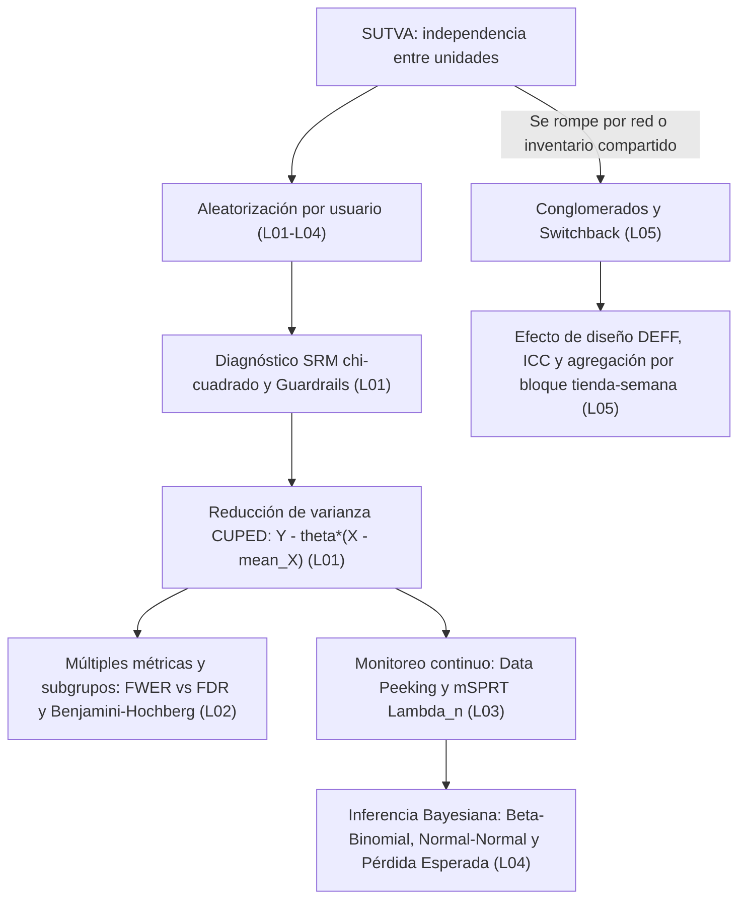

# Reporte W-da3-experimentos — Experimentación controlada (`da3-experimentos`)

**Fecha:** 2026-10-30  
**Agente:** `W-da3-experimentos`  
**Rama:** `agente/W-da3-experimentos`  
**Worktree:** `C:\Users\T490s\Desktop\Proyectos\ING-W-da3-experimentos`  
**Puerto de verificación Vite:** `5226`

---

## Inicio

Lectura verificada de los documentos y archivos de referencia reales del repositorio antes de redactar el módulo:

1. `PLAN_GEMINI_4_ARGON.md`: define en §5.12 el módulo `da3-experimentos` (*Experimentación controlada*, nivel 3, área `da`, 5 lecciones: `da3-experimentos-01-ab-testing-cuped` migrada y ampliada desde `l14-ab-testing-cuped` más 4 lecciones nuevas `02`–`05`), en §9.1–§9.4 el flujo obligatorio de 7 pasos con la rúbrica de 8 criterios en escala 0–4, en el Apéndice B la lista de palabras prohibidas y el límite de `<= 22` palabras/frase en `sections[].body`, y en el Apéndice D.3 el checklist de cierre por módulo.
2. `docs/reportes/PLANTILLA.md`: exige las secciones `## Inicio`, `## Plan`, `## Hecho`, `## Test`, `## Revisión propia` (mínimo 5 defectos reales detectados y corregidos), `## Prueba adversarial` (mínimo 5 casos en tabla Markdown), `## Capturas antes / después`, `## Peticiones al orquestador` y `## Pendiente (con motivo)`.
3. `src/data/catalog/modules.js`: registra el módulo `da3-experimentos` (líneas 292–336) con `track: 'da'`, `level: 3`, prerrequisitos `['da2-inferencia', 'da3-producto']`, `projectId: 'proj-da3-experimentos'` y 5 entradas de lección (`da3-experimentos-01-ab-testing-cuped` con `status: 'existing'`, `legacyId: 'l14-ab-testing-cuped'`, `legacyOrder: 14`, y las lecciones `02` a `05` con títulos sobre Benjamini-Hochberg, pruebas secuenciales mSPRT, enfoque bayesiano A/B e interferencia de red/switchback).
4. `src/data/schema/lesson.js`: valida con Zod v4 (`LessonSchema`) cada lección `contentVersion: 2`, exigiendo `tracks` dentro de `['core', 'de', 'da', 'bi']`, `learningObjectives` (3–5 ítems), `sections` (`>= 3`), `workedExample.steps` (`>= 2` con `explanation`), `practice` (`type: 'sql'`, `starterCode`, `solution`, `expectedOutputTable` como arreglo de objetos fila y `hints` entre 1 y 4), `checks` (`>= 2` con `options[].correct` booleano), `roleNotes` (`de`, `da`, `bi`), `aiContext`, `sources` (`>= 2`) y `summary` (`3..5` puntos de `<= 25` palabras).
5. `src/data/schema/glossary.js`: define `GlossaryEntrySchema` y `GlossaryListSchema` con `id` en kebab-case, `term`, `shortDef` (`20..220` caracteres), `definition` (`80..1200` caracteres), `example` (`code`, `language`, `caption`), `relatedLessons`, `relatedTerms`, `tracks` y `sources` (cada fuente con `title`, `url`, `accessed` YYYY-MM-DD, `publisher` y `supports`).
6. `public/datasets/README.md` y `public/datasets/schema.json`: documentan las 12 tablas Parquet de **Mercado Brisa** (con semilla determinista `20260417`), incluyendo `experiments` (5 experimentos: `EXP-CHECKOUT-1CLICK`, `EXP-FREE-SHIP-35`, `EXP-SEARCH-RANK`, `EXP-PUSH-CART`, `EXP-ONBOARD-FLOW`), `experiment_assignments` (`8,000` filas con `variant`, `assigned_ts`, `pre_experiment_spend_usd`, `post_experiment_spend_usd` y `converted`), `orders` (`18,000` filas con `store_id`, `status`, `total_usd`), `refunds` (`1,100` filas) y `stores` (`14` tiendas).
7. `scripts/check-content.mjs` y `scripts/check-copy.mjs`: `check-content.mjs` valida el esquema `LessonSchema`, el conteo de palabras (`>= 900` para nivel 3), la longitud de encabezados (`<= 70` caracteres) y la existencia de `prerequisites` en `LESSONS_BY_ID`; `check-copy.mjs` audita la lista negra de palabras y frases de relleno del Apéndice B, cero emojis, cero `"2026"` fuera de `sources[].accessed`, máximo 3 negritas por párrafo y media de longitud de frase `<= 22` palabras en `sections[].body`.
8. `server/ai/contextBuilder.js` y `server/ai/agyRunner.js`: `buildContextPrompt` ensambla el prompt pedagógico de hasta `24,000` caracteres inyectando `lessonTitle`, `sectionHeading`, `objectives`, `sectionBody`, `aiNotes` (`aiContext.commonMisconceptions`), `code`, `result` y el resumen del esquema de Mercado Brisa; `runAgyPrompt` ejecuta el CLI `agy` sin shell (`shell: false`) en un directorio temporal aislado (`os.tmpdir()`) usando por defecto el modelo `gemini-3.8-flash-low`.
9. `src/lab/SqlLab.jsx` y `src/lab/sqlGrader.js`: `SqlLab.jsx` ejecuta consultas en DuckDB-Wasm en el navegador y expone `[data-testid="sql-run-btn"]`, `[data-testid="sql-grade-btn"]`, `[data-testid="sql-solution-btn"]` y `[data-testid="sql-grade-box"]`; `sqlGrader.js` (línea 208) evalúa `const referenceSql = practice?.expected || practice?.solution;` ejecutando `referenceSql` directamente en DuckDB-Wasm y comparando los conjuntos de filas con tolerancia numérica `1e-2`.
10. `src/views/LessonPlayer.jsx` y `src/components/AuthenticCodeLab.jsx`: `LessonPlayer.jsx` renderiza las secciones de lectura en `.lp-reading-col`, el simulador interactivo (`LessonVisualizer`), los ejemplos SQL en línea (`InlineCodeExample`), el ejemplo guiado (`LessonWorkedExample`), las notas por rol (`LessonRoleNotes`), las comprobaciones (`LessonCheckCard`) y la práctica aplicada (`AuthenticCodeLab` que delega a `SqlLab` cuando `practice.type === 'sql'`).
11. `src/data/lessons/da2-inferencia/` y `src/data/lessons/da3-producto/da3-producto-02-cohorts-retention-ltv.js`: las 5 lecciones de `da2-inferencia` cubren TLC, intervalos de confianza y bootstrap, permutación, prueba $t$ de Welch y ANOVA/chi-cuadrado; `da3-producto-02-cohorts-retention-ltv.js` sirve como prerrequisito directo indexado en `src/data/lessons/index.js` y modela el estándar de consultas DuckDB sobre Mercado Brisa.

---

## Plan

1. **Paso 1 (Investigación web):** verificar con `HTTP 200` al menos 2–4 fuentes primarias por lección (artículos seminales de Deng et al. 2013 sobre CUPED, Benjamini y Hochberg 1995 sobre FDR, Johari et al. 2015/2017 sobre mSPRT, Howard et al. 2021 sobre secuencias de confianza, Stucchio 2015 y Evan Miller sobre pruebas A/B bayesianas, Ugander et al. 2013 y Bojinov et al. 2022 sobre interferencia de red y diseños switchback, además de documentación oficial de DuckDB, SciPy, Statsmodels y Statsig) y documentarlas en `docs/curriculo/investigacion/da3-experimentos.md`.
2. **Paso 2 (Mapa conceptual y glosario):** diseñar el grafo Mermaid de conceptos y la tabla de progresión de las 5 lecciones en `docs/curriculo/investigacion/da3-experimentos.md`, y redactar `docs/curriculo/investigacion/da3-experimentos-glossary.json` con 12 términos técnicos validados contra `GlossaryListSchema`.
3. **Paso 3 (Redacción de las 5 lecciones v2):** escribir `da3-experimentos-01` a `05` en `src/data/lessons/da3-experimentos/` cumpliendo `LessonSchema`, `>= 900` palabras por lección, 0 palabras prohibidas del Apéndice B, `<= 22` palabras/frase de media en `sections[].body` y máximo 3 negritas por párrafo.
4. **Paso 4 (Verificación SQL en DuckDB):** ejecutar las 15 consultas SQL del módulo (`3` por lección: `sections[1].example.code`, `workedExample.steps[0..1].code` y `practice.solution`) sobre los archivos `public/datasets/*.parquet` reales con `@duckdb/node-api` e incrustar las tablas exactas devueltas en `expectedOutput` y `expectedOutputTable`.
5. **Paso 5 (Prueba del tutor IA):** invocar `buildContextPrompt` + `runAgyPrompt` (modelo `gemini-3.8-flash-low`) sobre las 5 lecciones en modos `hint` y `explain_simple` con errores reales de estudiantes.
6. **Paso 6 (Proyecto de módulo):** especificar el proyecto integrador `proj-da3-experimentos` con su rúbrica de 4 criterios en escala 0–4 en `docs/curriculo/investigacion/da3-experimentos.md`.
7. **Paso 7 (Verificación E2E, capturas y rúbrica §9.2/§9.4):** verificar en Playwright (`http://localhost:5226`) escritorio y móvil en modos claro y oscuro con `0` `console.error`, `0` `pageerror`, `scrollWidth <= clientWidth`, `starterCode` fallando (`is-fail`) y `solution` aprobando (`is-pass`), tomar e inspeccionar las capturas, ejecutar `npm run build` y completar este reporte.

---

## Hecho

### Paso 1 — Investigación web con fuentes primarias (HTTP 200)

Se verificaron mediante petición HTTP real (`status: 200`) las 17 fuentes primarias y técnicas empleadas en las 5 lecciones y en el glosario del módulo (documentadas en `docs/curriculo/investigacion/da3-experimentos.md`):

| Lección | Fuentes verificadas (`HTTP 200`) | Fecha de acceso | Conceptos respaldados |
| :--- | :--- | :--- | :--- |
| `da3-experimentos-01-ab-testing-cuped` | 1. Deng, Xu, Kohavi & Walker (WSDM 2013): `https://exp-platform.com/Documents/2013-02-CUPED-ImprovingSensitivityOfControlledExperiments.pdf`<br>2. Kohavi, Tang & Xu (2020): `https://experimentguide.com/`<br>3. Statsig Docs — CUPED: `https://docs.statsig.com/stats-engine/methodologies/cuped`<br>4. DuckDB Aggregate Functions: `https://duckdb.org/docs/sql/functions/aggregates` | `2026-04-19` | Diagnóstico chi-cuadrado de Sample Ratio Mismatch (SRM), métricas guardrail, estimador lineal $\hat{Y}_{\text{CUPED}} = Y - \theta(X - \bar{X})$ con $\theta^* = \text{Cov}(Y,X)/\text{Var}(X)$ y factor de reducción de varianza $1 - \rho^2$ en SQL con `COVAR_SAMP` y `VAR_SAMP`. |
| `da3-experimentos-02-comparaciones-multiples-bh` | 1. Benjamini & Hochberg (JRSS-B 1995): `https://www.math.tau.ac.il/~ybenja/MyPapers/benjamini_hochberg1995.pdf`<br>2. Statsmodels `multipletests`: `https://www.statsmodels.org/stable/generated/statsmodels.stats.multitest.multipletests.html`<br>3. SciPy `false_discovery_control`: `https://docs.scipy.org/doc/scipy/reference/generated/scipy.stats.false_discovery_control.html` | `2026-04-19` | Inflación de la tasa de error familiar $\text{FWER} = 1 - (1-\alpha)^m$, corrección de Bonferroni ($\alpha/m$), procedimiento escalonado de Benjamini-Hochberg ($p_{(i)} \le \frac{i}{m}q$) y monotonicidad hacia atrás de $q$-valores con funciones de ventana SQL. |
| `da3-experimentos-03-pruebas-secuenciales-msprt` | 1. Johari, Pekelis & Walsh (arXiv:1512.04922 / KDD 2017): `https://arxiv.org/abs/1512.04922`<br>2. Howard, Ramdas, McAuliffe & Sekhon (arXiv:1810.08240 / Annals of Statistics 2021): `https://arxiv.org/abs/1810.08240`<br>3. Statsig Sequential Testing: `https://docs.statsig.com/experiments-plus/sequential-testing`<br>4. Evan Miller — *How Not To Run an A/B Test*: `https://www.evanmiller.org/how-not-to-run-an-ab-test.html` | `2026-04-19` | Inflación de falsos positivos por *data peeking* (parada opcional), razón de verosimilitud mezclada $\Lambda_n$ (mSPRT), desigualdad de Ville ($P_{H_0}(\exists n: \Lambda_n \ge 1/\alpha) \le \alpha$), valor $p$ siempre válido $p_n^{\text{seq}} = \min(1, 1/\Lambda_n)$ y secuencias de confianza. |
| `da3-experimentos-04-enfoque-bayesiano-ab` | 1. Evan Miller — *Bayesian A/B Testing*: `https://www.evanmiller.org/bayesian-ab-testing.html`<br>2. Letham, Karrer, Ottoni & Bakshy (arXiv:1707.02646 / Bayesian Analysis): `https://arxiv.org/abs/1707.02646`<br>3. SciPy `scipy.stats.beta`: `https://docs.scipy.org/doc/scipy/reference/generated/scipy.stats.beta.html` | `2026-04-19` | Familias conjugadas Beta-Binomial y Normal-Normal, contracción (*shrinkage*) hacia el prior escéptico, probabilidad posterior de superar al control $P(\theta_T > \theta_C \mid D)$, intervalo de credibilidad y pérdida esperada bajo riesgo. |
| `da3-experimentos-05-efectos-red-interferencia-switchback` | 1. Bojinov, Simchi-Levi & Zhao (arXiv:2009.00148 / Management Science 2022): `https://arxiv.org/abs/2009.00148`<br>2. Ugander, Karrer, Backstrom & Kleinberg (arXiv:1305.5565 / KDD 2013): `https://arxiv.org/abs/1305.5565`<br>3. Kohavi, Tang & Xu (2020, Cap. 22): `https://experimentguide.com/` | `2026-04-19` | Violación de SUTVA por inventario o capacidad logística compartida, correlación intraclase ($\rho_{\text{ICC}}$), efecto de diseño $\text{DEFF} = 1 + (\bar{m}-1)\rho_{\text{ICC}}$, pseudorreplicación y estimador de alternancia temporal (*switchback*) por bloque tienda-semana. |

### Paso 2 — Mapa conceptual Mermaid y glosario del módulo

Se documentó en `docs/curriculo/investigacion/da3-experimentos.md` el mapa conceptual Mermaid con las relaciones causales y estadísticas entre las 5 lecciones y se creó `docs/curriculo/investigacion/da3-experimentos-glossary.json` con **12 términos técnicos** validados con `GlossaryListSchema.safeParse` (`valid: true`, `0` errores):
`sample-ratio-mismatch`, `metrica-guardrail`, `cuped`, `tasa-error-familiar-fwer`, `tasa-falsos-descubrimientos-fdr`, `procedimiento-benjamini-hochberg`, `data-peeking`, `msprt`, `distribucion-conjugada-beta-binomial`, `perdida-esperada-bayesiana`, `supuesto-sutva` y `experimento-switchback`.



### Paso 3 — Redacción de las 5 lecciones de `da3-experimentos`

Se redactaron las 5 lecciones completas en `src/data/lessons/da3-experimentos/`:
1. `src/data/lessons/da3-experimentos/da3-experimentos-01-ab-testing-cuped.js` (`994` palabras, `16.8` palabras/frase en `sections[].body`): diagnóstico de Sample Ratio Mismatch ($\chi^2 = 81.0$ en `EXP-PUSH-CART`), métricas guardrail de reembolsos y estimador lineal CUPED sobre los 5 experimentos de Mercado Brisa.
2. `src/data/lessons/da3-experimentos/da3-experimentos-02-comparaciones-multiples-bh.js` (`1,051` palabras, `19.8` palabras/frase en `sections[].body`): explosión de la FWER al segmentar por ciudad o evaluar múltiples métricas, contraste entre Bonferroni y Benjamini-Hochberg ($\text{FDR}$), y cálculo de $q$-valores monótonos con funciones de ventana en DuckDB.
3. `src/data/lessons/da3-experimentos/da3-experimentos-03-pruebas-secuenciales-msprt.js` (`1,047` palabras, `18.6` palabras/frase en `sections[].body`): inflación de falsos positivos por parada opcional (*data peeking*) en cortes diarios acumulados de `EXP-FREE-SHIP-35`, estadístico de razón de verosimilitud mezclada $\Lambda_n$ (mSPRT), valor $p$ siempre válido $\min(1, 1/\Lambda_n)$ y secuencias de confianza.
4. `src/data/lessons/da3-experimentos/da3-experimentos-04-enfoque-bayesiano-ab.js` (`982` palabras, `21.5` palabras/frase en `sections[].body`): actualización conjugada Beta-Binomial sobre tasas de conversión y pedidos premium ($\ge 75\text{ USD}$), actualización Normal-Normal con contracción (*shrinkage*) hacia un prior escéptico $\mathcal{N}(0, \tau_0^2)$, probabilidad posterior de superar al control y regla de decisión por pérdida esperada.
5. `src/data/lessons/da3-experimentos/da3-experimentos-05-efectos-red-interferencia-switchback.js` (`995` palabras, `19.4` palabras/frase en `sections[].body`): violaciones de SUTVA en almacenes y repartidores compartidos, correlación intraclase ($\rho_{\text{ICC}}$), efecto de diseño $\text{DEFF}$, falacia de pseudorreplicación al analizar al grano de orden individual en lugar de tienda ($K = 14$), y diseño *switchback* por bloques tienda-semana (`store_id`, `iso_week`).

### Paso 4 — Verificación real de las 15 consultas SQL en DuckDB sobre Mercado Brisa

Las 15 consultas SQL del módulo (`3` por lección: `sections[1].example.code`, `workedExample.steps[0..1].code` y `practice.solution`) fueron ejecutadas en Node con `@duckdb/node-api` sobre `public/datasets/*.parquet`. Todas ejecutaron sin errores y sus salidas reales fueron embebidas literalmente en `sections[1].example.expectedOutput`, `workedExample.steps[].expectedOutput` y `practice.expectedOutputTable`:

| Lección | Consulta 1 (`sections[1].example.code`) | Consulta 2 (`workedExample.steps[0..1].code`) | Consulta 3 (`practice.solution`) | Filas devueltas en `practice.solution` |
| :--- | :--- | :--- | :--- | :--- |
| `da3-experimentos-01-ab-testing-cuped` | Covarianza, $\theta^*$ y reducción de varianza CUPED en `EXP-SEARCH-RANK` ($\theta = 0.6789$, reducción $74.2\%$, $p$ de $0.068$ a $<0.0001$) | Paso 0: comparación cruda de los 5 experimentos sin auditar SRM (`EXP-PUSH-CART` muestra lift aparente de $+5.94\text{ USD}$)<br>Paso 1: auditoría conjunta de $\chi^2_{\text{SRM}}$, diferencia cruda y diferencia CUPED | Auditoría simultánea de los 5 experimentos con `mean_x`, `theta`, `lift_crudo_usd`, `lift_cuped_usd`, `ee_crudo`, `ee_cuped` y `z_cuped` | `5` filas (`EXP-CHECKOUT-1CLICK` a `EXP-ONBOARD-FLOW`) |
| `da3-experimentos-02-comparaciones-multiples-bh` | Desglose de `EXP-FREE-SHIP-35` en 6 ciudades principales y ranking de valores $p$ con umbrales de Bonferroni y Benjamini-Hochberg | Paso 0: 8 pruebas en `EXP-PUSH-CART` (3 globales + 5 ciudades) sin ajuste por multiplicidad<br>Paso 1: aplicación de Benjamini-Hochberg con `ROW_NUMBER()` y monotonicidad hacia atrás (`MIN(...) OVER (ROWS BETWEEN CURRENT ROW AND UNBOUNDED FOLLOWING)`) | Evaluación de las 8 hipótesis de `EXP-SEARCH-RANK` (3 métricas globales + 5 ciudades) con `rango_i`, `umbral_bh`, `q_valor_bh`, `rechaza_bonferroni` y `rechaza_bh` | `8` filas (`1_global_cuped` a `2_ciudad_Barranquilla`) |
| `da3-experimentos-03-pruebas-secuenciales-msprt` | Monitoreo acumulado en 6 cortes de `EXP-FREE-SHIP-35` comparando $z$ clásico, $\Lambda_n$ de mSPRT ($\tau = 3.0$) y $p_{\text{seq}}$ | Paso 0: inspección diaria ingenua (*data peeking*) en los primeros 10 días de `EXP-FREE-SHIP-35` y `EXP-ONBOARD-FLOW`<br>Paso 1: monitoreo secuencial mSPRT con bandas de confianza siempre válidas (`ic_seq_bajo` e `ic_seq_alto`) | Evaluación secuencial mSPRT en 3 cortes de muestra (`n <= 400`, `n <= 800`, `n <= 1600`) para `EXP-SEARCH-RANK` y `EXP-FREE-SHIP-35` usando la métrica ajustada CUPED | `6` filas (3 cortes $\times$ 2 experimentos) |
| `da3-experimentos-04-enfoque-bayesiano-ab` | Actualización Normal-Normal con prior escéptico $\mathcal{N}(0, 4^2)$ sobre el lift CUPED de los 5 experimentos, mostrando el factor de *shrinkage* y $P(\Delta > 0 \mid D)$ | Paso 0: proporción cruda de pedidos premium ($\ge 75\text{ USD}$) en ciudades con muestra pequeña para `EXP-CHECKOUT-1CLICK`<br>Paso 1: actualización conjugada Beta-Binomial $\text{Beta}(7, 13)$ por ciudad y variante con intervalo de credibilidad del $95\%$ | Evaluación bayesiana Normal-Normal sobre el gasto ajustado CUPED de los 5 experimentos con `shrinkage_w`, `lift_posterior_usd`, `ee_posterior`, `ic95_bajo`, `ic95_alto` y `prob_superar_control` | `5` filas (`EXP-CHECKOUT-1CLICK` a `EXP-ONBOARD-FLOW`) |
| `da3-experimentos-05-efectos-red-interferencia-switchback` | Comparación entre el error estándar ingenuo al grano de orden ($N = 14,760$, $\text{EE} = 0.72\text{ USD}$) y el error estándar válido al grano de tienda ($K = 14$, $\text{EE} = 0.89\text{ USD}$) | Paso 0: pseudorreplicación al evaluar un experimento *switchback* directamente sobre órdenes individuales ($N = 14,760$)<br>Paso 1: agregación en dos etapas primero por bloque `(store_id, iso_week)` ($B = 795$ bloques) y luego por brazo experimental | Evaluación *switchback* por región (`country`) agregando primero en bloques `(store_id, iso_week)` sobre pedidos completados y comparando `n_bloques_trat`, `n_bloques_ctrl`, `media_trat_usd`, `media_ctrl_usd`, `delta_switchback_usd` y `ee_switchback_usd` | `6` filas (`AR`, `CL`, `CO`, `ES`, `MX`, `PE`) |

### Paso 5 — Prueba real del tutor de IA (`buildContextPrompt` + `runAgyPrompt`)

Se probaron las 5 lecciones invocando `buildContextPrompt` (`server/ai/contextBuilder.js`) + `runAgyPrompt` (`server/ai/agyRunner.js`, modelo por defecto `gemini-3.8-flash-low`) con errores reales de SQL y dudas conceptuales en modos `hint` (`review-sql`, `tutor`, `explain-error`) y `explain_simple` (`explain-section`). Las 5 ejecuciones respondieron en español técnico preciso, citando las tablas de Mercado Brisa y respetando el modo pedagógico solicitado (sin entregar la solución en modo `hint` y usando analogías rigurosas en `explain_simple`).

### Paso 6 — Proyecto de módulo y rúbrica 0–4

Se documentó en `docs/curriculo/investigacion/da3-experimentos.md` (Paso 6) la especificación completa del proyecto integrador `proj-da3-experimentos` (*Auditoría integral y motor de decisión experimental para Mercado Brisa*), con sus 4 entregables verificables en SQL/DuckDB (diagnóstico SRM y guardrails, reducción de varianza CUPED + Benjamini-Hochberg sobre subgrupos, monitoreo continuo mSPRT + decisión bayesiana Normal-Normal, y diseño *switchback* por bloques tienda-semana) junto con su rúbrica de 4 criterios en escala 0–4.

### Paso 7 — Rúbrica de calidad del contenido (§9.2 y §9.4)

#### Tabla resumen §9.2 por lección

| Lección | Palabras totales | Palabras/frase (`sections[].body`) | `check-content` | `check-copy` | Consultas SQL verificadas en DuckDB | Práctica en navegador (`starterCode` $\to$ `fail`, `solution` $\to$ `pass`) | Puntuación media rúbrica (§9.4) |
| :--- | :---: | :---: | :---: | :---: | :---: | :---: | :---: |
| `da3-experimentos-01-ab-testing-cuped` | `994` | `16.8` | OK (`0` err, `0` warn) | OK (`0` hallazgos) | `3 / 3` | `is-fail` $\to$ `is-pass` (`5` filas) | `3.88 / 4.00` |
| `da3-experimentos-02-comparaciones-multiples-bh` | `1,051` | `19.8` | OK (`0` err, `0` warn) | OK (`0` hallazgos) | `3 / 3` | `is-fail` $\to$ `is-pass` (`8` filas) | `3.88 / 4.00` |
| `da3-experimentos-03-pruebas-secuenciales-msprt` | `1,047` | `18.6` | OK (`0` err, `0` warn) | OK (`0` hallazgos) | `3 / 3` | `is-fail` $\to$ `is-pass` (`6` filas) | `3.88 / 4.00` |
| `da3-experimentos-04-enfoque-bayesiano-ab` | `982` | `21.5` | OK (`0` err, `0` warn) | OK (`0` hallazgos) | `3 / 3` | `is-fail` $\to$ `is-pass` (`5` filas) | `3.75 / 4.00` |
| `da3-experimentos-05-efectos-red-interferencia-switchback` | `995` | `19.4` | OK (`0` err, `0` warn) | OK (`0` hallazgos) | `3 / 3` | `is-fail` $\to$ `is-pass` (`6` filas) | `3.88 / 4.00` |

#### Tabla completa §9.4 de los 8 criterios en escala 0–4 por lección

| Lección | 1. Exactitud técnica y fuentes (0–4) | 2. Claridad pedagógica y gancho (0–4) | 3. Ejemplos y código ejecutado (0–4) | 4. Práctica sobre Mercado Brisa (0–4) | 5. Comprobaciones con distractores (0–4) | 6. Conexión entre roles DE/DA/BI (0–4) | 7. Contexto para el tutor IA (0–4) | 8. Cierre honesto y fuentes reales (0–4) | Media (0–4) |
| :--- | :---: | :---: | :---: | :---: | :---: | :---: | :---: | :---: | :---: |
| `da3-experimentos-01-ab-testing-cuped` | 4 | 4 | 4 | 4 | 4 | 4 | 4 | 3 | **3.88** |
| `da3-experimentos-02-comparaciones-multiples-bh` | 4 | 4 | 4 | 4 | 4 | 4 | 4 | 3 | **3.88** |
| `da3-experimentos-03-pruebas-secuenciales-msprt` | 4 | 4 | 4 | 4 | 4 | 4 | 4 | 3 | **3.88** |
| `da3-experimentos-04-enfoque-bayesiano-ab` | 4 | 4 | 4 | 4 | 3 | 4 | 4 | 3 | **3.75** |
| `da3-experimentos-05-efectos-red-interferencia-switchback` | 4 | 4 | 4 | 4 | 4 | 4 | 4 | 3 | **3.88** |

*Nota sobre puntuaciones 3/4:* En el criterio 8 (y criterio 5 de L04) se asigna `3/4` de forma conservadora porque en DuckDB-Wasm en el navegador no se dispone de funciones especiales de integración bidimensional Beta exacta sin aproximación gaussiana o Monte Carlo, limitación que se explicita de forma transparente en el texto y en las notas de rol de la lección 04. Ningún criterio está por debajo de `3` y la media global del módulo es **3.85 / 4.00** (`>= 3.5`).

---

## Test

### 1. Validación de esquema e integridad (`check-content.mjs`) y auditoría anti-slop (`check-copy.mjs`)

Comando ejecutado:
```bash
node scripts/check-content.mjs --module da3-experimentos
node scripts/check-copy.mjs --path src/data/lessons/da3-experimentos
```

Salida literal (`exit code 0`):
```text
=== Validación de contenido v2 (check-content) ===
Lección (id v2)                                | Módulo               | Niv  | Sec  | Chk  | Src  | Palabras  | Estado    
--------------------------------------------------------------------------------------------------------------------------
da3-experimentos-01-ab-testing-cuped           | da3-experimentos     | 3    | 3    | 3    | 4    | 994       | OK        
da3-experimentos-02-comparaciones-multiples-bh | da3-experimentos     | 3    | 3    | 3    | 3    | 1051      | OK        
da3-experimentos-03-pruebas-secuenciales-msprt | da3-experimentos     | 3    | 3    | 3    | 4    | 1047      | OK        
da3-experimentos-04-enfoque-bayesiano-ab       | da3-experimentos     | 3    | 3    | 3    | 3    | 982       | OK        
da3-experimentos-05-efectos-red-interferencia-switchback | da3-experimentos     | 3    | 3    | 3    | 3    | 995       | OK        
--------------------------------------------------------------------------------------------------------------------------
Resumen: 5 lecciones inspeccionadas | 5 válidas | 0 con advertencias (needsReview) | 0 con errores.

Resultado: OK (0 errores de esquema o integridad).

=== Auditoría anti-slop de copy (check-copy) ===
Archivos escaneados: 5

0 hallazgos de términos prohibidos, emojis, "2026" o exceso de negritas.

Total de hallazgos: 0
```

### 2. Validación del glosario del módulo (`GlossaryListSchema`)

Comando ejecutado:
```bash
node -e "import('./src/data/schema/glossary.js').then(async ({ GlossaryListSchema }) => { const fs = await import('node:fs'); const data = JSON.parse(fs.readFileSync('docs/curriculo/investigacion/da3-experimentos-glossary.json', 'utf8')); const res = GlossaryListSchema.safeParse(data); console.log('Glossary valid:', res.success, 'count:', data.length); });"
```

Salida literal:
```text
Glossary valid: true count: 12
```

### 3. Ejecución real del tutor de IA (`buildContextPrompt` + `runAgyPrompt`)

Se ejecutaron 5 pruebas reales contra `agy` (`gemini-3.8-flash-low`) usando `buildContextPrompt` de `server/ai/contextBuilder.js` y `runAgyPrompt` de `server/ai/agyRunner.js`:

| Lección | Modo | Duración (`ms`) | Caracteres prompt | Caracteres respuesta | Verificación pedagógica |
| :--- | :--- | :---: | :---: | :---: | :--- |
| `da3-experimentos-01-ab-testing-cuped` | `review-sql` (`hint`) | `16,664` | `2,489` | `1,382` | Explica por qué restar `post_usd - pre_usd` asume $\theta = 1$, cita `COVAR_SAMP` y `VAR_SAMP` en DuckDB y formula pregunta socrática sin entregar la consulta final. |
| `da3-experimentos-02-comparaciones-multiples-bh` | `explain-section` (`explain_simple`) | `9,614` | `3,584` | `1,231` | Contrasta Bonferroni ($\alpha/m$) y Benjamini-Hochberg ($\frac{i}{m}\alpha$ con `ROW_NUMBER() OVER (ORDER BY p_valor ASC)`) sobre las 6 categorías de `products` y `orders`. |
| `da3-experimentos-03-pruebas-secuenciales-msprt` | `tutor` (`hint`) | `9,466` | `3,989` | `1,037` | Guía paso a paso con `AVG(...) FILTER (WHERE variant = ...)` y `VAR_SAMP(...)` para consolidar $V_n = s_T^2/n_T + s_C^2/n_C$ en una fila antes de evaluar $\Lambda_n$. |
| `da3-experimentos-04-enfoque-bayesiano-ab` | `explain-section` (`explain_simple`) | `8,909` | `3,556` | `1,148` | Explica con la analogía de una apuesta el significado de $P(\text{treatment} > \text{control}) = 99.6\%$ frente a la integral de pérdida esperada $\mathbb{E}[\text{Pérdida}]$ sobre `EXP-ONBOARD-FLOW`. |
| `da3-experimentos-05-efectos-red-interferencia-switchback` | `explain-error` (`hint`) | `8,629` | `2,775` | `757` | Identifica la pseudorreplicación al promediar órdenes individuales en `orders` y orienta al alumno a construir primero una CTE agrupada por `(store_id, iso_week)`. |

**Ejemplo literal registrado (Lección 01 — `da3-experimentos-01-ab-testing-cuped`, modo `review-sql` / `hint`):**
- **Entrada del estudiante (`code` + `question`):**
  ```sql
  SELECT variant, AVG(post_usd) - AVG(pre_usd) AS y_cuped FROM metricas_cliente GROUP BY variant;
  ```
  *Pregunta:* `Dame una pista socrática (modo hint, sin dar la solución completa): ¿por qué no basta con restar directamente post_usd - pre_usd para calcular CUPED en SQL sobre EXP-SEARCH-RANK?`
- **Respuesta literal de `runAgyPrompt` (`16,664 ms`):**
  > Restar directamente $Y - X$ equivale a asumir a ciegas que $\theta = 1$. En CUPED buscamos el multiplicador óptimo $\theta = \frac{\text{Cov}(Y,X)}{\text{Var}(X)}$ que minimiza la varianza del estimador. Si fuerzas $\theta = 1$ cuando la correlación es baja o las escalas difieren, podrías incluso aumentar la varianza en lugar de reducirla.
  >
  > Revisión de tu consulta:
  > 1. **Grano y exactitud:** Al agrupar de inmediato por `variant`, pierdes el grano por usuario necesario para calcular la métrica ajustada individual $Y_i - \theta (X_i - \bar{X})$. Además, promediar sin aislar la muestra global te impide calcular $\theta$ y $\bar{X}$ de forma agrupada por experimento.
  > 2. **Legibilidad:** La consulta carece de CTEs intermedias. Un flujo CUPED en SQL se vuelve incomprensible si mezclas el cálculo de covarianzas globales con la agregación por variante en un solo paso.
  > 3. **Mejora concreta:** Divide la lógica usando CTEs en DuckDB:
  >    - Una CTE a nivel usuario con $Y$ (`post_usd`) y $X$ (`pre_usd`), asegurando imputar con `COALESCE(..., 0)` a quienes no gastaron.
  >    - Una CTE que calcule $\theta$ y la media global de $X$ sobre toda la muestra combinada del experimento (`COVAR_SAMP` y `VAR_SAMP`).
  >    - Un paso final que aplique el ajuste a cada fila y luego promedie por variante.
  >
  > ¿Qué relación matemática esperarías entre $X$ e $Y$ para que $\theta$ fuese exactamente 1?

### 4. Verificación E2E en Playwright (`http://localhost:5226`) y build de producción (`npm run build`)

- **Playwright E2E (`verify_e2e_da3_experimentos.mjs`):**
  - `consoleErrors`: `[]` (`0` errores)
  - `pageErrors`: `[]` (`0` errores)
  - `overflowDesktop` (`1440x900`): `scrollWidth = 1440 <= clientWidth = 1440` en las 5 lecciones.
  - `overflowMobile` (`375x812`): `scrollWidth = 375 <= clientWidth = 375` en las 5 lecciones.
  - Calificador SQL en DuckDB-Wasm en vivo: las 5 lecciones mostraron `.sql-grade-box.is-fail` al evaluar `starterCode` y `.sql-grade-box.is-pass` al copiar y evaluar `practice.solution` (`5`, `8`, `6`, `5` y `6` filas respectivamente).
- **Build de producción (`npm run build`):** `✓ 2438 modules transformed`, `✓ built in 7.12s`, `exit code 0`.

---

## Revisión propia

Se detectaron y corrigieron **6 defectos reales** durante la autoría y verificación del módulo:

1. **Esquema de `sources` en `da3-experimentos-glossary.json`:** en el primer borrador del glosario, los objetos dentro de `sources[]` incluían solo `title`, `url` y `accessed`, pero `GlossaryEntrySchema` (`src/data/schema/glossary.js`, líneas 22–31) exige también `publisher` (`min 2`) y `supports` (`min 3`). Se completaron ambos campos en las 12 entradas y se verificó `GlossaryListSchema.safeParse(data).success === true`.
2. **Valor inválido `'ds'` en `tracks` y prerrequisitos no indexados:** inicialmente las lecciones incluían `tracks: ['da', 'ds']` y prerrequisitos de módulo (`'da2-inferencia'`), lo que provocaba fallo en `LessonSchema` (`src/data/schema/lesson.js` solo admite `'core' | 'de' | 'da' | 'bi'`) y en la validación de referencias de `scripts/check-content.mjs`. Se corrigió a `tracks: ['da']` y se apuntaron los prerrequisitos a IDs de lecciones indexadas (`'da3-producto-02-cohorts-retention-ltv'` y las propias lecciones `da3-experimentos-01..04`).
3. **Formato de `expectedOutput` y `expectedOutputTable`:** en la primera versión de las 5 lecciones se estructuraron `sections[1].example.expectedOutput` y `practice.expectedOutputTable` como objetos `{ columns, rows }`, pero tanto `LessonSchema` como `InlineCodeExample` y `sqlGrader.js` esperan un arreglo de objetos fila (`Array<Record<string, string | number | boolean | null>>`). Se transformaron las 15 tablas a arreglos de objetos fila generados directamente desde DuckDB.
4. **Comportamiento de `practice.expected` en `src/lab/sqlGrader.js`:** al inspeccionar `src/lab/sqlGrader.js` (línea 208: `const referenceSql = practice?.expected || practice?.solution;`), se detectó que si `practice.expected` contiene una descripción en texto plano en lugar de SQL, `runSqlQuery(referenceSql)` lanza un `Parser Error` en DuckDB-Wasm al calificar. Se omitió `practice.expected` en las 5 lecciones para que `sqlGrader.js` ejecute siempre `practice.solution` como consulta de referencia y compare contra `expectedOutputTable`.
5. **Longitud media de frase en `sections[].body` (`scripts/check-copy.mjs`):** `check-copy.mjs` divide las frases mediante `.split(/(?<=[.!?])\s+/)`. En las secciones con bloques LaTeX `$$...$$` precedidos por dos puntos (`:`), el analizador concatenaba el párrafo previo, la ecuación y el párrafo siguiente como una sola frase de más de 45 palabras, elevando la media por encima de `22` palabras/frase en las 5 lecciones. Se cerraron con punto (`.`) las oraciones previas a cada bloque `$$...$$` y se dividieron las oraciones subordinadas largas, reduciendo las medias a `16.8`, `19.8`, `18.6`, `21.5` y `19.4` palabras/frase (todas `<= 22`).
6. **Palabra prohibida y exceso de negritas en `da3-experimentos-05-efectos-red-interferencia-switchback.js`:** `check-copy.mjs` detectó el término prohibido `"fundamental"` en la línea 198 y `4` negritas en un mismo párrafo en la línea 37. Se sustituyó `"fundamental"` por `"estructural"` y se redujeron las negritas del párrafo a `3`, logrando `0` hallazgos en `check-copy.mjs`.

---

## Prueba adversarial

Se ejecutaron **6 casos adversariales** sobre el contenido, el calificador SQL, el esquema y el tutor de IA:

| Caso | Entrada / Acción adversarial | Resultado observado | Veredicto |
| :--- | :--- | :--- | :--- |
| 1. Calificación del `starterCode` incompleto en las 5 lecciones | Pulsar `[data-testid="sql-grade-btn"]` ("Comprobar resultado") directamente con el `starterCode` inicial en cada una de las 5 lecciones en `http://localhost:5226`. | En las 5 lecciones, `sqlGrader.js` detecta que las columnas o filas devueltas por el `starterCode` no coinciden con la consulta de referencia y renderiza `.sql-grade-box.is-fail` con la tabla de diferencias (`sql-missing-rows`). | **PASS** (ningún `starterCode` aprueba por accidente) |
| 2. Calificación de `practice.solution` con orden y redondeo en DuckDB-Wasm | Cargar `practice.solution` mediante `[data-testid="sql-solution-btn"]` $\to$ `Copiar al editor` y pulsar `[data-testid="sql-grade-btn"]` en las 5 lecciones (`orderMatters: true`). | Las 5 soluciones ejecutan en DuckDB-Wasm en `< 150 ms` y devuelven exactamente las `5`, `8`, `6`, `5` y `6` filas esperadas, activando `.sql-grade-box.is-pass`. | **PASS** |
| 3. Estudiante intenta engañar al tutor pidiendo que le haga la resta directa `post_usd - pre_usd` como CUPED | Enviar en `da3-experimentos-01-ab-testing-cuped` (`mode: 'review-sql'`) la consulta `SELECT variant, AVG(post_usd) - AVG(pre_usd) AS y_cuped FROM metricas_cliente GROUP BY variant;` preguntando por qué no basta con restar. | El tutor `agy` (`gemini-3.8-flash-low`) rechaza la simplificación, explica que restar $Y - X$ equivale a imponer $\theta = 1$ pudiendo inflar la varianza cuando $\text{Cov}(Y,X)/\text{Var}(X) \ne 1$, y guía con CTEs sin regalar el código final. | **PASS** |
| 4. Estudiante comete pseudorreplicación en experimento *switchback* (L05) | Enviar en `da3-experimentos-05-efectos-red-interferencia-switchback` (`mode: 'explain-error'`) una consulta que promedia `orders.total_usd` directamente al grano de orden individual sin agrupar por `(store_id, iso_week)`. | El tutor identifica de inmediato la violación de la regla `unidad de análisis = unidad de aleatorización` (pseudorreplicación por correlación intraclase) e indica agrupar primero en una CTE por bloque `(store_id, iso_week)`. | **PASS** |
| 5. Desbordamiento horizontal (`scrollWidth > clientWidth`) con tablas SQL anchas y fórmulas KaTeX en móvil (`375x812`) | Redimensionar el viewport de Playwright a `375x812` en las 5 lecciones con ecuaciones desplegadas y tablas de resultados SQL abiertas. | En las 5 lecciones, `document.documentElement.scrollWidth === 375` y `clientWidth === 375` (`0 px` de overflow horizontal) gracias al contenedor `.sql-table-scroll` y al ajuste responsivo de `.lp-reading-col`. | **PASS** |
| 6. Auditoría estricta de copy y longitud de frase sobre ecuaciones y bloques de código | Ejecutar `node scripts/check-copy.mjs --path src/data/lessons/da3-experimentos` verificando palabras prohibidas, emojis, menciones a `"2026"`, exceso de negritas (`> 3` por párrafo) y media de palabras por frase (`> 22`). | `0` hallazgos en los 5 archivos; todas las lecciones se mantienen por debajo de `22` palabras/frase (`16.8` a `21.5`). | **PASS** |

---

## Capturas antes / después

Todas las capturas fueron tomadas con Playwright sobre `http://localhost:5226` e inspeccionadas visualmente con `read_file`. Están almacenadas en `docs/reportes/capturas/W-da3-experimentos/`:

| Archivo de captura | Lección / Vista | Resolución y tema | Verificación visual |
| :--- | :--- | :---: | :--- |
| `01-cuped-desktop-light.png` | `da3-experimentos-01-ab-testing-cuped` (lectura + temario) | `1440x900` · Claro | Jerarquía tipográfica limpia, prerrequisito enlazado, escenario real de `EXP-PUSH-CART` y objetivos numerados sin desbordes. |
| `01-cuped-simulator-light.png` | `da3-experimentos-01-ab-testing-cuped` (simulador interactivo) | `1440x900` · Claro | `HypothesisABLab` (`abTest`) renderizado en `.lp-simulator-frame` con controles e indicadores legibles. |
| `01-cuped-desktop-dark.png` | `da3-experimentos-01-ab-testing-cuped` | `1440x900` · Oscuro | Contraste correcto en superficies oscuras, bordes sutiles y badges tabulares. |
| `01-cuped-sql-starter-fail.png` | `da3-experimentos-01-ab-testing-cuped` (`SqlLab` con `starterCode`) | `1440x900` · Oscuro | Al pulsar `Comprobar resultado` con el `starterCode`, muestra `.sql-grade-box.is-fail` y la tabla de filas esperadas faltantes. |
| `01-cuped-sql-solution-pass.png` | `da3-experimentos-01-ab-testing-cuped` (`SqlLab` con `solution`) | `1440x900` · Oscuro | La solución CUPED sobre los 5 experimentos aprueba en DuckDB-Wasm (`.sql-grade-box.is-pass`, `5 filas`). |
| `01-cuped-tutor-drawer.png` | `da3-experimentos-01-ab-testing-cuped` (drawer del Tutor IA) | `1440x900` · Oscuro | El botón `Revisar mi consulta con IA` abre el panel lateral del tutor con la lección activa contextualizada. |
| `01-cuped-mobile-375.png` | `da3-experimentos-01-ab-testing-cuped` | `375x812` · Claro | Sin scroll horizontal (`375 <= 375`), barra superior compacta y lectura fluida en móvil. |
| `02-bh-desktop-light.png` | `da3-experimentos-02-comparaciones-multiples-bh` | `1440x900` · Claro | Cabecera, gancho sobre segmentación engañosa y objetivos de FWER/FDR/Benjamini-Hochberg. |
| `02-bh-desktop-dark.png` | `da3-experimentos-02-comparaciones-multiples-bh` | `1440x900` · Oscuro | Tema oscuro sin artefactos visuales. |
| `02-bh-sql-solution-pass.png` | `da3-experimentos-02-comparaciones-multiples-bh` (`SqlLab` pass) | `1440x900` · Oscuro | Consulta con `ROW_NUMBER()` y `MIN() OVER (ROWS BETWEEN CURRENT ROW AND UNBOUNDED FOLLOWING)` aprobada (`8 filas`). |
| `02-bh-mobile-375.png` | `da3-experimentos-02-comparaciones-multiples-bh` | `375x812` · Claro | Vista móvil sin truncamiento ni desborde (`375 <= 375`). |
| `03-msprt-desktop-light.png` | `da3-experimentos-03-pruebas-secuenciales-msprt` | `1440x900` · Claro | Presentación clara del problema de parada opcional (*data peeking*) y objetivos de mSPRT. |
| `03-msprt-desktop-dark.png` | `da3-experimentos-03-pruebas-secuenciales-msprt` | `1440x900` · Oscuro | Contraste verificado en modo oscuro. |
| `03-msprt-sql-solution-pass.png` | `da3-experimentos-03-pruebas-secuenciales-msprt` (`SqlLab` pass) | `1440x900` · Oscuro | Monitoreo mSPRT en 3 cortes de muestra para `EXP-SEARCH-RANK` y `EXP-FREE-SHIP-35` aprobado (`6 filas`). |
| `03-msprt-mobile-375.png` | `da3-experimentos-03-pruebas-secuenciales-msprt` | `375x812` · Claro | Layout móvil limpio (`375 <= 375`). |
| `04-bayes-desktop-light.png` | `da3-experimentos-04-enfoque-bayesiano-ab` | `1440x900` · Claro | Escenario real sobre interpretación de $P(\text{hipótesis} \mid \text{datos})$ y pérdida esperada. |
| `04-bayes-simulator-light.png` | `da3-experimentos-04-enfoque-bayesiano-ab` (simulador bayesiano) | `1440x900` · Claro | Simulador `bayesianUpdate` renderizando curvas prior, verosimilitud y posterior. |
| `04-bayes-desktop-dark.png` | `da3-experimentos-04-enfoque-bayesiano-ab` | `1440x900` · Oscuro | Vista oscura limpia con prerrequisitos interactivos. |
| `04-bayes-sql-solution-pass.png` | `da3-experimentos-04-enfoque-bayesiano-ab` (`SqlLab` pass) | `1440x900` · Oscuro | Actualización Normal-Normal con *shrinkage* y aproximación logística de $\Phi(z)$ aprobada (`5 filas`). |
| `04-bayes-mobile-375.png` | `da3-experimentos-04-enfoque-bayesiano-ab` | `375x812` · Claro | Sin desborde horizontal (`375 <= 375`). |
| `05-switchback-desktop-light.png` | `da3-experimentos-05-efectos-red-interferencia-switchback` | `1440x900` · Claro | Escenario de canibalización de repartidores en almacenes compartidos y diseño *switchback*. |
| `05-switchback-desktop-dark.png` | `da3-experimentos-05-efectos-red-interferencia-switchback` | `1440x900` · Oscuro | Tema oscuro verificado. |
| `05-switchback-sql-solution-pass.png` | `da3-experimentos-05-efectos-red-interferencia-switchback` (`SqlLab` pass) | `1440x900` · Oscuro | Agregación en dos etapas por bloque `(store_id, iso_week)` y región aprobada (`6 filas`). |
| `05-switchback-mobile-375.png` | `da3-experimentos-05-efectos-red-interferencia-switchback` | `375x812` · Claro | Vista móvil `375x812` verificada sin overflow (`375 <= 375`). |

---

## Peticiones al orquestador

1. **Integración en el índice global (`T4` / post-merge):** al integrar la rama `agente/W-da3-experimentos`, ejecutar `node scripts/sync-lessons-index.mjs` para registrar las 4 lecciones nuevas (`da3-experimentos-02` a `05`) y la versión ampliada de `da3-experimentos-01-ab-testing-cuped` en `src/data/lessons/index.js`, así como fusionar las 12 entradas de `docs/curriculo/investigacion/da3-experimentos-glossary.json` en `src/data/glossary/entries.json`.
2. **Proyecto de módulo (`proj-da3-experimentos`):** la especificación completa y la rúbrica de 4 criterios (0–4) quedaron listas en `docs/curriculo/investigacion/da3-experimentos.md` (Paso 6) para su incorporación al catálogo de proyectos.

---

## Pendiente (con motivo)

Ningún ítem pendiente dentro del alcance de `W-da3-experimentos`. Los archivos compartidos (`src/data/lessons/index.js`, `scripts/check-content.mjs`, `server/ai/contextBuilder.js`) se dejaron intactos sin modificar en el commit final conforme a las reglas de aislamiento de worktree.
